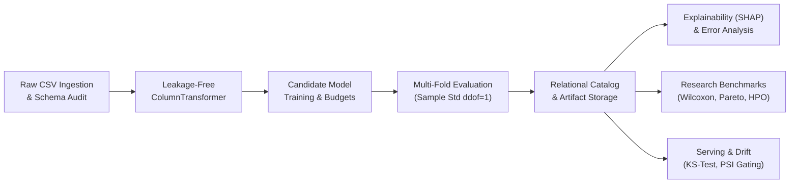

# AutoNexa

<div align="center">

### From Raw Data to Reliable Models

*A visual, research-grade Automated Machine Learning (AutoML) platform engineered for tabular datasets.*

[-0969da?style=flat-square&logo=githubactions&logoColor=white)](https://github.com/Ishitadas03/AutoNexa/actions)
[](https://www.python.org/)
[](https://fastapi.tiangolo.com/)
[](https://nextjs.org/)
[](https://scikit-learn.org/)
[](https://www.sqlite.org/)
[](https://www.docker.com/)

[**Live Web Application**](https://autonexa-orpin.vercel.app) • [**GitHub Repository**](https://github.com/Ishitadas03/AutoNexa) • [**System Architecture**](docs/architecture.md) • [**API Reference**](docs/api_reference.md) • [**Operations Runbook**](docs/operations/autonexa_runbook.md)

</div>

---

## Overview

**AutoNexa** is an automated machine learning and research platform that transforms raw tabular datasets into mathematically sound, explainable, and production-ready predictive models. While manual machine learning workflows frequently suffer from silent data leakage, lucky single-split bias, opaque decisions, and unmonitored production drift, AutoNexa provides an integrated, reproducible pipeline from CSV ingestion to continuous model monitoring.



---

## Why AutoNexa?

| Challenge in Tabular ML | AutoNexa Solution | Verified Engineering Approach |
| :--- | :--- | :--- |
| **Silent Data Leakage** | Preprocessing fitted across entire datasets inflates scores. | Transformers (imputers, encoders, scalers) are fitted strictly on training partitions via isolated `ColumnTransformer` pipelines. |
| **Unreliable Evaluation** | Single-seed lucky runs produce non-reproducible models. | Stratified K-Fold with rare-class fallbacks, Bessel-corrected sample standard deviation (`ddof=1`), and untouched final test partitions. |
| **Black-Box Opacity** | Inability to audit individual predictions or feature drivers. | Native tree feature importance, model-agnostic permutation tests, and local instance SHAP explanations (`TreeExplainer` / `LinearExplainer`). |
| **Model Degradation** | Covariate shifts in production traffic go undetected. | Real-time inference telemetry windows evaluated against baseline reference profiles via Kolmogorov-Smirnov (KS) and PSI tests. |

---

## Key Capabilities

- **Secure Ingestion & Tabular Intelligence**: Multipart CSV streaming in 64 KB chunks with strict size limits (10 MB default), RFC 4180 validation, SHA-256 fingerprinting, missingness audits, and automatic ML task detection (`binary_classification`, `multiclass_classification`, `regression`).
- **Leakage-Safe Preprocessing**: Isolated pipelines combining `SimpleImputer` (median for numeric, mode for categorical), `StandardScaler`, and `OneHotEncoder(handle_unknown="ignore", max_categories=25)` with `remainder="drop"`.
- **Resource-Aware AutoML Engine**: Trains canonical baselines, regularized linear models (`LogisticRegression`, `Ridge`), decision trees, random forests, and gradient boosted ensembles (`HistGradientBoosting`) under strict wall-clock time and memory limits.
- **Explainable AI (XAI) & Diagnostics**: Global feature importance and instance-level SHAP attributions paired with comprehensive error analysis (confusion matrices, probability calibration, and residual distributions).
- **Reproducible Research Benchmarking**: Matched multi-seed runs (2–10 seeds) with Student-t and bootstrap confidence intervals, paired Wilcoxon signed-rank tests, Optuna Bayesian HPO, and Pareto multi-objective optimization (accuracy vs. latency vs. model size).
- **Model Registry & Low-Latency Serving**: Monotonic versioning (`v1`, `v2`, ...), single-production stage exclusivity, low-latency prediction serving with strict feature schema validation, and probability outputs.
- **Continuous Monitoring & Retraining Gating**: Automated inference telemetry tracking, statistical drift detection (KS-test, PSI), and retraining candidate validation against incumbent production models.
- **Resilient Operational Architecture**: SQLite metadata storage in Write-Ahead Logging (WAL) mode, automatic startup reconciliation of legacy disk runs, and online backup tooling with archive path-traversal defenses.

---

## Technology Stack

| Domain | Technologies |
| :--- | :--- |
| **Frontend** | [Next.js 16](https://nextjs.org/) (App Router), [React 19](https://react.dev/), [Tailwind CSS v4](https://tailwindcss.com/), [Three.js](https://threejs.org/) / [React Three Fiber](https://r3f.docs.pmnd.rs/), [Recharts](https://recharts.org/), [Lucide React](https://lucide.dev/) |
| **Backend & API** | [FastAPI](https://fastapi.tiangolo.com/), [Uvicorn](https://www.uvicorn.org/) (single-worker), [Pydantic Settings](https://docs.pydantic.dev/latest/concepts/pydantic_settings/) |
| **Machine Learning** | [scikit-learn](https://scikit-learn.org/), [SHAP](https://shap.readthedocs.io/), [Optuna](https://optuna.org/), [SciPy](https://scipy.org/), [NumPy](https://numpy.org/), [Pandas](https://pandas.pydata.org/) |
| **Persistence & Ops** | [SQLite](https://www.sqlite.org/) (WAL Mode), [SQLAlchemy](https://www.sqlalchemy.org/), [Docker](https://www.docker.com/) & Docker Compose, [GitHub Actions CI](https://github.com/features/actions) |

---

## Repository Structure

```text
AutoNexa/
├── backend/
│   ├── app/
│   │   ├── api/routes/        # REST endpoints (health, datasets, experiments, models, serving, etc.)
│   │   ├── core/              # Config, constant-time RBAC security, correlation ID, structured logging
│   │   ├── db/                # SQLAlchemy models, SQLite WAL engine, idempotent reconciliation
│   │   ├── schemas/           # Type-safe Pydantic request and response models
│   │   ├── services/automl/   # Core training engine, preprocessor, registry, XAI, HPO, monitoring
│   │   └── main.py            # FastAPI application factory and lifespan manager
│   ├── scripts/               # Online SQLite backup, verification, and restore tooling
│   ├── Dockerfile             # Production Python 3.11 slim container
│   ├── requirements.txt       # Minimal production runtime dependencies
│   ├── requirements-dev.txt   # Development, testing, MLflow, and SHAP dependencies
│   └── tests/                 # 279 automated unit, integration, and security tests
├── frontend/
│   ├── src/
│   │   ├── app/               # Next.js 16 App Router pages and layouts
│   │   ├── components/        # Interactive 3D scene, landing flows, and 16 workspace tabs
│   │   └── lib/api.ts         # Strongly typed backend API client
│   └── package.json           # Frontend dependencies and build scripts
├── docs/                      # Architectural specs, API reference, runbooks, and research plots
├── data/research_benchmarks/  # Curated benchmark datasets (wine, cancer, diabetes, churn)
└── docker-compose.yml         # Containerized production orchestration
```

---

## Getting Started

### Prerequisites
- **Python**: `3.11.x`
- **Node.js**: `20.x` or `22.x` (with npm `10.x+`)
- **Git**: `2.x+`

### 1. Backend Setup

```bash
# Clone repository
git clone https://github.com/Ishitadas03/AutoNexa.git
cd AutoNexa

# Create and activate Python virtual environment
python -m venv backend/.venv
source backend/.venv/bin/activate       # On Windows: .\backend\.venv\Scripts\Activate.ps1

# Install development & test dependencies
pip install --upgrade pip
pip install -r backend/requirements-dev.txt

# Configure environment template
cp backend/.env.example backend/.env

# Launch FastAPI development server (single-worker)
cd backend
python -m uvicorn app.main:app --host 127.0.0.1 --port 8000 --workers 1
```

- **Interactive Swagger UI**: [http://127.0.0.1:8000/docs](http://127.0.0.1:8000/docs)
- **Liveness Health Check**: [http://127.0.0.1:8000/api/v1/health](http://127.0.0.1:8000/api/v1/health)

### 2. Frontend Setup

In a separate terminal:

```bash
cd AutoNexa/frontend

# Install dependencies reproducibly
npm ci

# Configure local backend URL
echo "NEXT_PUBLIC_API_BASE_URL=http://localhost:8000" > .env.local

# Launch Next.js development server
npm run dev
```

Open [http://localhost:3000](http://localhost:3000) to access the interactive workspace.

---

## Configuration & Security

The platform is configured via `backend/.env` with strict type validation.

| Variable | Default Value | Purpose |
| :--- | :--- | :--- |
| `ENVIRONMENT` | `development` | `development`, `staging`, or `production`. *(Enforces fail-closed auth in production)* |
| `API_AUTH_ENABLED` | `true` | Toggles API key enforcement via `X-API-Key` or `Authorization: Bearer` |
| `API_KEY_READ` | `autonexa-read-key-secret` | Read-only / Inference key for querying, inspection, and prediction |
| `API_KEY_ADMIN` | `autonexa-admin-key-secret` | Administrative key for uploads, training, promotion, and deletion |
| `UPLOAD_DIR` | `uploads` | Directory for ingested CSV files *(must be mapped to persistent volume)* |
| `EXPERIMENTS_DIR` | `experiments` | Storage for model binaries, manifests, and event streams |
| `METADATA_DB_PATH`| `data/metadata.db` | SQLite database file for indexed catalog metadata |

> For the exhaustive configuration reference and production fail-closed security rules, see [docs/configuration.md](docs/configuration.md).

---

## API Summary

The backend exposes RESTful endpoints secured via constant-time RBAC (`AppRole.INFERENCE` vs. `AppRole.ADMIN`):

- **Health & Ops** (`/api/v1/health`): Public liveness probe, authenticated readiness probe, administrative diagnostics, and in-memory metrics.
- **Datasets** (`/api/v1/datasets`): Chunked CSV upload, automated profiling, data quality auditing, and training dispatch.
- **Experiments** (`/api/v1/experiments`): Leaderboard inspection, reproducibility manifests, `.joblib` artifact downloads, tabular inference, SHAP feature importance, and error diagnostics.
- **Model Registry & Serving** (`/api/v1/models`, `/api/v1/serving`): Monotonic model versioning, lifecycle stage transitions, and low-latency inference.
- **Benchmarking & Pipelines** (`/api/v1/benchmarks`, `/api/v1/pipelines`): Repeated-seed comparisons, Optuna HPO, Pareto frontier optimization, and asynchronous pipeline coordination.

> For the full endpoint table with request/response schemas and authorization requirements, see [docs/api_reference.md](docs/api_reference.md).

---

## Verified Testing

AutoNexa enforces comprehensive testing across route contracts, statistical correctness, concurrency, and security boundaries:

```text
======================= 279 passed, 12 warnings in 84.16s =======================
```

**Run Tests Locally:**
```bash
# Run complete test suite
pytest backend/tests -v

# Run frontend lint and production build check
cd frontend && npm run lint && npm run build
```

---

## Operational Tooling: Backup & Recovery

AutoNexa includes a crash-safe operational backup utility in [`backend/scripts/backup_restore.py`](backend/scripts/backup_restore.py) using the SQLite Online Backup API:

```bash
# Create a verified, timestamped backup archive
python backend/scripts/backup_restore.py backup --base-dir backend --output-dir backups

# Verify archive integrity and cryptographic manifest
python backend/scripts/backup_restore.py verify --archive backups/autonexa_backup_*.tar.gz

# Restore state with strict path-traversal validation
python backend/scripts/backup_restore.py restore --archive backups/autonexa_backup_*.tar.gz --target-base-dir backend
```

> For operational recovery scenarios and Kubernetes probe configurations, see [docs/operations/autonexa_runbook.md](docs/operations/autonexa_runbook.md).

---

## Architectural Constraints & Roadmap

### Current Constraints
- **Single-Worker Execution (`--workers 1`)**: In-process mutexes, background worker queues, and SQLite write concurrency require running a single Uvicorn worker process.
- **In-Memory Telemetry**: Operational request counters and latency histograms reside in-memory and reset on server restarts.
- **Default Scale Limits**: Standard defaults target datasets up to 100,000 rows and 500 columns.

### Future Roadmap
- [ ] **Distributed Task Queue**: Integration with Celery/Redis for multi-worker distributed training.
- [ ] **PostgreSQL Storage Dialect**: Native PostgreSQL support for multi-instance horizontal scaling.
- [ ] **Cloud Blob Storage**: S3 and Google Cloud Storage adapters for model artifacts and datasets.
- [ ] **Quantum ML (QML) Benchmarking**: Variational quantum circuit benchmarks via PennyLane (in research design).

---

## Contributing & License

### Contributing
Contributions are welcome. Please ensure that all pull requests include appropriate tests, pass existing quality checks (`pytest backend/tests`), and adhere to existing code style.

### License
The AutoNexa repository does not currently specify an open-source license. All rights are reserved by the repository owner ([Ishitadas03](https://github.com/Ishitadas03)). An open-source license will be added in a future release.

---

## Contact

- **Author & Maintainer**: Ishita Das ([@Ishitadas03](https://github.com/Ishitadas03))
- **Repository**: [https://github.com/Ishitadas03/AutoNexa](https://github.com/Ishitadas03/AutoNexa)
- **Live Deployment**: [https://autonexa-orpin.vercel.app](https://autonexa-orpin.vercel.app)
