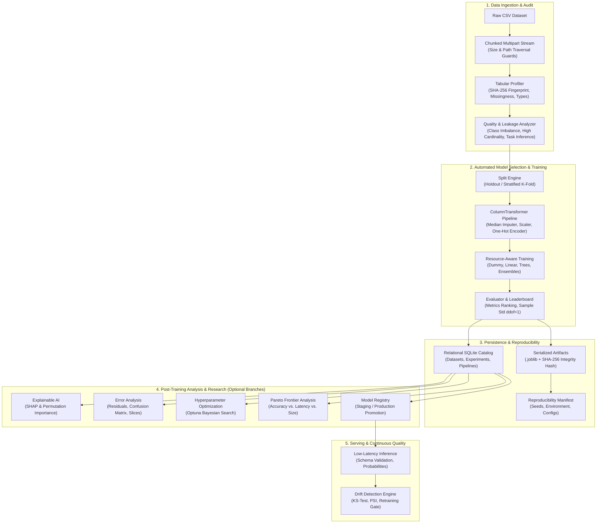
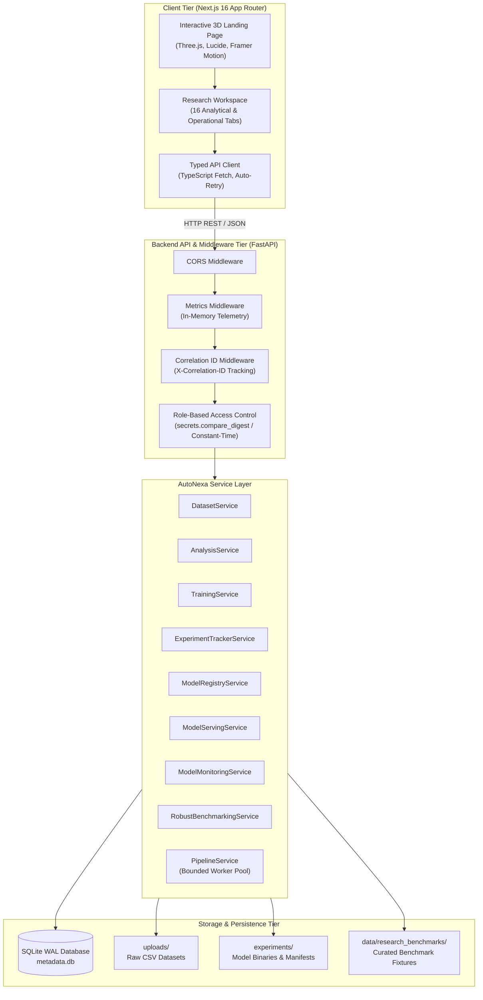

# AutoNexa

<div align="center">

**From Raw Data to Reliable Models**

*A visual, research-grade Automated Machine Learning (AutoML) platform engineered for tabular datasets.*

[-0969da?style=flat-square&logo=githubactions&logoColor=white)](https://github.com/Ishitadas03/AutoNexa/actions)
[](https://www.python.org/)
[](https://fastapi.tiangolo.com/)
[](https://nextjs.org/)
[](https://scikit-learn.org/)
[](https://www.sqlite.org/)
[](https://www.docker.com/)

[**Explore Live Web Application**](https://autonexa-orpin.vercel.app) • [**GitHub Repository**](https://github.com/Ishitadas03/AutoNexa) • [**System Architecture**](docs/architecture.md) • [**Operational Runbook**](docs/operations/autonexa_runbook.md)

</div>

---

## Table of Contents

- [Project Overview](#project-overview)
- [Problem Statement & Motivation](#problem-statement--motivation)
- [Key Features](#key-features)
- [Visual Workflow](#visual-workflow)
- [System Architecture](#system-architecture)
- [Technology Stack](#technology-stack)
- [Repository Structure](#repository-structure)
- [Getting Started](#getting-started)
  - [Prerequisites](#prerequisites)
  - [Local Backend Setup](#local-backend-setup)
  - [Local Frontend Setup](#local-frontend-setup)
  - [Containerized Setup (Docker Compose)](#containerized-setup-docker-compose)
- [Configuration Reference](#configuration-reference)
- [API Overview](#api-overview)
- [ML Methodology & Scientific Reliability](#ml-methodology--scientific-reliability)
- [Testing & Quality Assurance](#testing--quality-assurance)
- [Operational Tooling: Backup, Restore & Verification](#operational-tooling-backup-restore--verification)
- [Research Visualizations & Benchmarks](#research-visualizations--benchmarks)
- [Current Constraints & Future Roadmap](#current-constraints--future-roadmap)
- [Security & Responsible Machine Learning](#security--responsible-machine-learning)
- [Contributing & License](#contributing--license)
- [Acknowledgments & Contact](#acknowledgments--contact)

---

## Project Overview

**AutoNexa** is an open-source, visual, research-oriented Automated Machine Learning (AutoML) platform built to transform raw tabular data into robust, explainable, and production-ready predictive models. While conventional machine learning often relies on ad-hoc scripts with hidden data leakage, unvalidated metrics, and scattered artifacts, AutoNexa establishes an integrated, mathematically sound pipeline from ingestion to serving.

### What AutoNexa Solves

Building production machine learning pipelines for tabular data is fraught with systematic pitfalls:
- **Silent Data Leakage**: Global preprocessing, unconstrained imputation, or test-split contamination inflate validation scores while models fail in real-world environments.
- **Unsound Evaluation**: Selecting models based on single-split lucky runs or inconsistent random seeds produces non-reproducible research conclusions.
- **Opacity & Black-Box Predictions**: Complex estimators without model-specific and model-agnostic feature attributions leave domain experts unable to audit automated decisions.
- **Operational Drift & Stale Models**: Deployed estimators deteriorate when underlying feature distributions shift without detection mechanisms.

### Target Audience

- **AI/ML Engineers & Researchers**: Requiring reproducible repeated-seed benchmarking, Optuna hyperparameter optimization, and Pareto frontier trade-off analysis.
- **Software Engineering Recruiters & Evaluators**: Reviewing clean architectural boundaries, strict Role-Based Access Control (RBAC), type-safe schema contracts, and deterministic test suites.
- **Data Scientists & Practitioners**: Streamlining dataset profiling, candidate model generation, explainability (SHAP), and error slicing through an interactive web workspace.

---

## Problem Statement & Motivation

| Manual Pipeline Challenges | How AutoNexa Solves It | Verified Implementation |
| :--- | :--- | :--- |
| **Data Ingestion Risks** | Path traversal attacks, uncontrolled file sizes, unverified delimiters, and raw row leaks. | Chunked multipart streaming with configurable size limits (10 MB default), strict RFC 4180 parsing, and metadata-only responses. |
| **Target & Feature Leakage** | Preprocessing (scaling/imputation) fitted across the entire dataset prior to evaluation splits. | Isolated `ColumnTransformer` pipelines strictly fitted on training splits, with median/mode imputation and categorical frequency encoding. |
| **Statistical Non-Reproducibility** | Evaluating models on single random seeds without confidence intervals or baseline checks. | Multi-seed matched benchmarking (2–10 seeds), sample standard deviations (`ddof=1`), and Student-t / Wilcoxon hypothesis tests. |
| **Model Opacity** | Inability to audit individual predictions or understand primary feature drivers. | Native tree feature importance, model-agnostic permutation testing, and local SHAP attributions (`TreeExplainer` / `LinearExplainer`). |
| **Silent Distribution Drift** | Deployed models degrading as population covariates shift in production. | In-memory inference telemetry, Kolmogorov-Smirnov (KS-test) drift tests, and Population Stability Index (PSI) monitoring. |
| **Audit & Governance Deficits** | Lost experiment metadata, untracked library versions, and tampered serialized weights. | Relational SQLite metadata store, SHA-256 cryptographic dataset and artifact fingerprinting, and exportable JSON reproducibility manifests. |

---

## Key Features

### 1. Dataset Ingestion, Validation & Schema Intelligence
- **Secure File Streaming**: Streams multipart `.csv` uploads in 64 KB chunks, validating byte signatures, enforcing configurable size ceilings (`MAX_UPLOAD_SIZE_BYTES`), and mitigating path-traversal attacks.
- **Automated Profiling**: Computes deterministic row/column counts, missingness ratios, duplicate counts, column data types, and cryptographic SHA-256 dataset fingerprints.
- **Diagnostic Heuristics**: Detects constant/near-constant columns, high-cardinality ID features, target class imbalances, and recommends ML tasks (`binary_classification`, `multiclass_classification`, `regression`).

### 2. Preprocessing & Leakage-Aware Training
- **Leakage-Safe Preprocessing**: Builds dynamic `ColumnTransformer` pipelines combining `SimpleImputer` (median for numeric, mode for categorical), `StandardScaler`, and `OneHotEncoder(handle_unknown="ignore", max_categories=25)`.
- **Candidate Model Portfolio**: Trains linear baselines (`LogisticRegression`, `Ridge`), decision trees, random forests, and gradient boosted ensembles (`HistGradientBoostingClassifier`, `HistGradientBoostingRegressor`).
- **Resource Budgeting**: Enforces strict execution time budgets (`MAX_TRAINING_BUDGET_SECONDS`) and bounded sample sizes (`MAX_DATASET_ROWS`, `MAX_DATASET_COLUMNS`).
- **Cross-Validation Reliability**: Supports holdout validation and Stratified K-Fold / K-Fold splits with rare-class fallbacks, untouched final test sets, and sample standard deviation calculations (`ddof=1`).

### 3. Explainable AI (XAI) & Prediction Diagnostics
- **Global Feature Importance**: Computes native tree feature importances for ensemble models and model-agnostic permutation importance on untouched holdout partitions.
- **Instance-Level Attributions**: Generates local feature contributions using SHAP (`TreeExplainer` for trees, `LinearExplainer` for linear models) alongside a deterministic leave-one-covariate-out perturbation fallback.
- **Prediction Error Analysis**:
  - *Classification*: Full confusion matrices, per-class Precision/Recall/F1, probability calibration buckets, and prioritized misclassified instances.
  - *Regression*: Signed residual skewness, MAE, MSE, RMSE, Median Absolute Error, feature-error Spearman correlations, and categorical slice breakdowns.

### 4. Research Benchmarking & Multi-Objective Optimization
- **Scientific Comparability Audit**: Validates that compared models share identical dataset fingerprints, target columns, train/test split proportions, and evaluation metrics before computing relative deltas.
- **Repeated-Seed Experiments**: Executes matched experimental runs across 2 to 10 random seeds, calculating Student-t and non-parametric bootstrap confidence intervals.
- **Hyperparameter Optimization (HPO)**: Powered by Optuna (Bayesian TPE search) and randomized search with parameter spaces tailored for classifiers and regressors.
- **Pareto Frontier Optimization**: Analyzes multi-objective trade-offs (e.g., accuracy vs. inference latency vs. model disk size) and selects candidates using Utopia distance or balanced compromise weighting.

### 5. Model Registry, Serving & Real-Time Monitoring
- **Model Registry Lifecycle**: Monotonic versioning (`v1`, `v2`, ...), auditable stage transitions (`Development`, `Staging`, `Production`, `Archived`), and single-production version exclusivity per model family.
- **Low-Latency Inference**: Serves single-record and batch predictions with strict input feature schema validation and probability outputs.
- **Drift & Degradation Monitoring**: Continuously evaluates inference telemetry windows against baseline reference profiles using Kolmogorov-Smirnov tests and Population Stability Index (PSI).
- **Candidate Retraining Gate**: Evaluates newly trained models against active production incumbents before authorizing stage promotion.

### 6. Relational Catalog & Resilient Operations
- **Relational Metadata Store**: Persists indexed metadata for datasets, experiments, and pipelines in SQLite with WAL (Write-Ahead Logging) mode, foreign key enforcement, and busy timeouts.
- **Metadata Reconciliation**: Idempotently scans server disk storage on startup, reconciling untracked legacy experiments and datasets into the relational catalog.
- **Online Backup & Recovery**: Utilizes the SQLite Online Backup API to generate crash-safe, verified `.tar.gz` archives with strict archive traversal protections.

---

## Visual Workflow

The following flowchart illustrates the verified, end-to-end execution path through the AutoNexa platform:



---

## System Architecture

AutoNexa is structured as a decoupled two-tier application: a Next.js 16 frontend and a high-performance FastAPI backend.



### Architectural & Concurrency Constraints

> [!IMPORTANT]
> **Single-Worker Backend Constraint (`--workers 1`)**:
> The AutoNexa backend utilizes in-process thread locking (`threading.RLock`, `threading.Lock`), in-memory metrics collectors, and SQLite write concurrency bounded by busy timeouts. **Do NOT increase the Uvicorn worker count beyond 1** in production without implementing external distributed locks (e.g., Redis) and migrating to a multi-writer database (e.g., PostgreSQL).

---

## Technology Stack

The AutoNexa platform relies strictly on production-verified dependencies:

| Category | Technology | Pinned Version | Purpose in AutoNexa |
| :--- | :--- | :--- | :--- |
| **Frontend Framework** | **Next.js** | `16.4.2` | App router, server-side rendering, and production web client |
| **UI & Styling** | **Tailwind CSS** | `^4.0.0` | Modern responsive styling, glassmorphism design tokens |
| **3D & Canvas** | **Three.js** / **React Three Fiber** | `^0.186.1` / `^9.8.2` | Interactive 3D geometric particle canvas and hero visualizations |
| **Visualizations** | **Recharts** | `^3.10.1` | Leaderboards, ROC curves, residual distributions, and metric comparisons |
| **Icons & Motion** | **Lucide React** / **Motion** | `^1.58.0` / `^14.3.0` | Accessible vector icons and smooth micro-animations |
| **Backend Framework**| **FastAPI** | `0.143.3` | Asynchronous REST API routing, OpenAPI generation, and dependency injection |
| **ASGI Server** | **Uvicorn** | `0.34.0` | High-performance ASGI runtime bound to a single worker |
| **Configuration** | **Pydantic Settings** | `2.16.0` | Type-safe environment validation and fail-closed security enforcement |
| **Relational Store** | **SQLAlchemy** / **SQLite** | `2.1.4` / Built-in | Relational metadata catalog operating in Write-Ahead Logging (WAL) mode |
| **Machine Learning** | **scikit-learn** | `1.9.1` | Model candidate generation, pipelines, metrics, and permutation importance |
| **Data Processing** | **Pandas** / **NumPy** | `3.0.6` / `2.4.6` | Data profiling, tabular manipulations, and numeric calculations |
| **Explainable AI** | **SHAP** | `0.51.0` | Tree and linear Shapley additive explanations (`TreeExplainer`, `LinearExplainer`) |
| **Optimization** | **Optuna** / **SciPy** | `5.0.0` / `1.17.1` | Bayesian hyperparameter optimization and hypothesis testing (t-test, Wilcoxon) |
| **System Diagnostics**| **psutil** | `7.2.2` | Memory RSS profiling, process uptime, and storage space monitoring |
| **Testing** | **pytest** / **HTTPX** | `9.1.1` / `0.28.1` | Automated test runner and asynchronous TestClient HTTP harnesses |
| **Containerization** | **Docker** / **Docker Compose** | Pinned Base Images | Multi-stage production container builds and isolated local orchestration |

---

## Repository Structure

```text
AutoNexa/
├── .github/
│   └── workflows/
│       └── ci.yml                 # GitHub Actions quality gates (test, build, container smoke)
├── backend/
│   ├── app/
│   │   ├── api/
│   │   │   ├── routes/
│   │   │   │   ├── benchmarks.py      # Repeated runs, robust benchmarking, HPO, Pareto routes
│   │   │   │   ├── datasets.py        # CSV upload, profiling, analysis & training routes
│   │   │   │   ├── experiments.py     # Tracking, inspection, XAI, error analysis, inference
│   │   │   │   ├── health.py          # Liveness, readiness probe, diagnostics & metrics
│   │   │   │   ├── model_registry.py  # Model versioning, stage transition, artifact download
│   │   │   │   ├── monitoring.py      # Telemetry, reference profiles, drift detection & retraining
│   │   │   │   ├── pipelines.py       # End-to-end AutoML pipeline orchestration
│   │   │   │   └── serving.py         # Production inference serving and latency tracking
│   │   ├── core/
│   │   │   ├── config.py              # Centralized Pydantic settings & validation rules
│   │   │   ├── correlation.py         # Request correlation ID middleware (X-Correlation-ID)
│   │   │   ├── logging.py             # Structured log formatter and sensitive secret redaction
│   │   │   ├── metrics.py             # In-memory operational metrics collector
│   │   │   └── security.py            # RBAC enforcement, constant-time API key verification
│   │   ├── db/
│   │   │   ├── models.py              # SQLAlchemy ORM models (Datasets, Experiments, Pipelines)
│   │   │   ├── reconciliation.py      # Idempotent filesystem-to-database migration engine
│   │   │   ├── session.py             # SQLite WAL engine configuration and session factories
│   │   │   └── repositories/          # Type-safe relational database repositories
│   │   ├── schemas/                   # Strongly typed Pydantic request/response contracts
│   │   ├── services/
│   │   │   ├── analysis_service.py    # Schema intelligence, heuristics & task detection
│   │   │   ├── dataset_service.py     # Multipart CSV streaming, validation & profiling
│   │   │   └── automl/                # Core machine learning & benchmarking engine
│   │   │       ├── evaluator.py       # Metrics aggregation and ranking engine
│   │   │       ├── explainability_service.py # SHAP and permutation importance engine
│   │   │       ├── error_analysis_service.py # Residuals, confusion matrix, slice diagnostics
│   │   │       ├── hpo_service.py     # Optuna Bayesian & Random search optimizer
│   │   │       ├── model_monitoring_service.py # KS-test & PSI distribution drift analyzer
│   │   │       ├── pareto.py          # Non-dominated sorting & Utopia distance selection
│   │   │       ├── pipeline_service.py# Asynchronous pipeline coordinator & worker pool
│   │   │       ├── preprocessor.py    # Leakage-free ColumnTransformer pipeline builder
│   │   │       ├── registry.py        # Model candidate registry (linear, trees, ensembles)
│   │   │       └── statistical_engine.py # Hypothesis testing, bootstrap CIs & IQR metrics
│   │   └── main.py                    # FastAPI application initialization & lifespan manager
│   ├── Dockerfile                     # Pinned Python 3.11-slim non-root production container
│   ├── requirements.txt               # Pinned minimal production runtime dependencies
│   ├── requirements-dev.txt           # Full development, MLflow, SHAP, and pytest dependencies
│   ├── scripts/
│   │   └── backup_restore.py          # SQLite Online Backup, verification, and restore utility
│   └── tests/                         # 279 automated unit, integration, and security tests
├── data/
│   └── research_benchmarks/           # Curated benchmark datasets (wine, cancer, diabetes, etc.)
├── docs/
│   ├── architecture.md                # In-depth architectural specifications
│   ├── operations/                    # Deployment guides and operational runbooks
│   ├── quality/                       # Comprehensive phase audit and validation reports
│   └── research/plots/                # Verified empirical research charts and visualizations
├── frontend/
│   ├── src/
│   │   ├── app/                       # Next.js 16 App Router pages and global layouts
│   │   ├── components/
│   │   │   ├── 3d/                    # Interactive Three.js particle canvas
│   │   │   ├── landing/               # Hero, visual pipeline flows, and documentation modal
│   │   │   └── workspace/             # 16 analytical tabs (Datasets, AutoML, XAI, Monitoring, etc.)
│   │   ├── lib/api.ts                 # Strongly typed backend API client
│   │   └── types/                     # Shared TypeScript data contracts
│   ├── package.json                   # Next.js, React 19, and Tailwind CSS dependencies
│   └── Dockerfile                     # Multi-stage production container build for frontend
├── docker-compose.yml                 # Multi-container production deployment orchestration
├── .env.example                       # Root Docker Compose environment variable template
├── vercel.json                        # Vercel deployment caching and routing configuration
└── README.md                          # Platform documentation
```

---

## Getting Started

### Prerequisites

| Tool | Minimum Version | Required Purpose |
| :--- | :--- | :--- |
| **Python** | `3.11.x` | Backend runtime, scikit-learn, and test runner |
| **Node.js** | `20.x` or `22.x` | Next.js 16 frontend build and development |
| **npm** | `10.x+` | Frontend package management |
| **Git** | `2.x+` | Source control |
| **Docker** (Optional) | `24.x+` with Compose | Multi-container isolated deployment |

---

### Local Backend Setup

#### 1. Clone the Repository
```bash
git clone https://github.com/Ishitadas03/AutoNexa.git
cd AutoNexa
```

#### 2. Configure Python Virtual Environment

**On Windows (PowerShell):**
```powershell
python -m venv backend\.venv
.\backend\.venv\Scripts\Activate.ps1
```

**On Linux / macOS (bash):**
```bash
python3 -m venv backend/.venv
source backend/.venv/bin/activate
```

#### 3. Install Backend Dependencies
For local development, testing, SHAP explainability, and full benchmarking:
```bash
pip install --upgrade pip
pip install -r backend/requirements-dev.txt
```

#### 4. Configure Backend Environment
Copy the example environment template into the `backend/` directory:
```bash
cp backend/.env.example backend/.env
```
*(On Windows PowerShell, use `Copy-Item backend\.env.example backend\.env`)*

Review `backend/.env`. For local development, default values work out of the box.

#### 5. Launch Backend Server
```bash
cd backend
python -m uvicorn app.main:app --host 127.0.0.1 --port 8000 --workers 1
```
The backend initializes the SQLite database at `backend/data/metadata.db`, reconciles any legacy disk artifacts, and listens on `http://127.0.0.1:8000`.

- **Interactive Swagger UI**: [http://127.0.0.1:8000/docs](http://127.0.0.1:8000/docs)
- **ReDoc Documentation**: [http://127.0.0.1:8000/redoc](http://127.0.0.1:8000/redoc)
- **Liveness Health Check**: [http://127.0.0.1:8000/api/v1/health](http://127.0.0.1:8000/api/v1/health)

---

### Local Frontend Setup

In a new terminal window:

#### 1. Navigate to Frontend Directory
```bash
cd AutoNexa/frontend
```

#### 2. Install Node Dependencies
```bash
npm ci
```

#### 3. Configure Frontend Environment
Ensure `frontend/.env.local` points to your active local backend:
```bash
echo "NEXT_PUBLIC_API_BASE_URL=http://localhost:8000" > .env.local
```

#### 4. Launch Frontend Development Server
```bash
npm run dev
```
Open [http://localhost:3000](http://localhost:3000) in your web browser. The application will connect directly to the local backend.

---

### Containerized Setup (Docker Compose)

To run the complete production stack (isolated backend, frontend, and persistent volumes) via Docker:

#### 1. Configure Secrets
Copy the top-level environment template:
```bash
cp .env.example .env
```
Edit `.env` and assign secure, distinct 16+ character secrets for `AUTONEXA_API_KEY_READ` and `AUTONEXA_API_KEY_ADMIN`.

#### 2. Build & Launch Containers
```bash
docker compose up --build -d
```

#### 3. Verify Container Health
```bash
docker compose ps
curl -f http://127.0.0.1:8000/api/v1/health
```

#### 4. Tear Down
```bash
docker compose down
```
*(Persistent data is safely retained in Docker volumes `autonexa-data`, `autonexa-uploads`, and `autonexa-experiments`)*.

---

## Configuration Reference

The backend configuration is managed by `pydantic-settings` via `backend/.env`.

| Variable | Type | Default Value | Required | Purpose & Constraints |
| :--- | :--- | :--- | :---: | :--- |
| `APP_NAME` | string | `AutoNexa` | No | Application branding identifier |
| `APP_VERSION` | string | `0.1.0` | No | Semantic application release version |
| `ENVIRONMENT` | string | `development` | No | `development`, `staging`, or `production`. *(In production, enforces fail-closed auth)* |
| `DEBUG` | boolean | `false` | No | Enable verbose debug logging output |
| `LOG_LEVEL` | string | `INFO` | No | Logging threshold (`DEBUG`, `INFO`, `WARNING`, `ERROR`) |
| `API_V1_PREFIX` | string | `/api/v1` | No | URL routing prefix for all v1 API endpoints |
| `SERVER_HOST` | string | `127.0.0.1` | No | Network interface binding (`0.0.0.0` for Docker) |
| `SERVER_PORT` | integer | `8000` | No | HTTP port for incoming connections |
| `BACKEND_CORS_ORIGINS` | JSON list | `["http://localhost:3000"]` | No | Permitted CORS origins for client browser traffic |
| `UPLOAD_DIR` | path | `uploads` | No | Directory for storing raw ingested CSV files |
| `EXPERIMENTS_DIR` | path | `experiments` | No | Root directory for model artifacts, manifests, and pipelines |
| `METADATA_DB_PATH` | path | `data/metadata.db` | No | SQLite database file location for indexed metadata |
| `MAX_UPLOAD_SIZE_BYTES`| integer | `10485760` (10 MB) | No | Strict maximum streaming file size ceiling |
| `API_AUTH_ENABLED` | boolean | `true` | No | Global toggle for API key verification |
| `API_KEY_READ` | string | `autonexa-read-key-secret` | Yes (in prod) | Key for read-only querying, inspection, and inference |
| `API_KEY_ADMIN` | string | `autonexa-admin-key-secret`| Yes (in prod) | Key for uploads, training, pipeline runs, and promotion |
| `MAX_DATASET_ROWS` | integer | `100000` | No | Resource limit: Maximum allowed tabular rows |
| `MAX_DATASET_COLUMNS` | integer | `500` | No | Resource limit: Maximum allowed tabular columns |
| `MAX_TRAINING_BUDGET_SECONDS` | integer | `300` | No | Maximum execution wall-clock time per AutoML run |
| `PIPELINE_MAX_CONCURRENCY` | integer | `2` | No | Maximum concurrent end-to-end pipeline worker jobs |
| `MONITORING_PSI_WARNING_THRESHOLD` | float | `0.1` | No | Population Stability Index warning trigger |
| `MONITORING_PSI_CRITICAL_THRESHOLD` | float | `0.2` | No | Population Stability Index critical alert trigger |

---

## API Overview

The AutoNexa backend exposes RESTful endpoints grouped into functional domains. All endpoints (except public liveness health) enforce Role-Based Access Control via the `X-API-Key` or `Authorization: Bearer <key>` header.

### 1. System Health, Readiness & Diagnostics
| Method | Endpoint | Access Role | Description |
| :--- | :--- | :--- | :--- |
| `GET` | `/api/v1/health` | **Public** | Basic process liveness probe. Returns operational status without paths. |
| `GET` | `/api/v1/health/readiness` | `inference` (Read) | Non-blocking probe checking DB ping, storage writeability, and worker state. |
| `GET` | `/api/v1/health/diagnostics` | `admin` (Admin) | Detailed administrative report: table counts, Python version, PID, uptime. |
| `GET` | `/api/v1/metrics` | `inference` (Read) | In-memory operational metrics snapshot (request counts, latencies, DB stats). |

### 2. Dataset Management & Schema Intelligence
| Method | Endpoint | Access Role | Description |
| :--- | :--- | :--- | :--- |
| `GET` | `/api/v1/datasets` | `inference` (Read) | List cataloged datasets with pagination, search, and sorting. |
| `GET` | `/api/v1/datasets/{dataset_id}` | `inference` (Read) | Retrieve dataset metadata, column types, and fingerprint by ID. |
| `POST` | `/api/v1/datasets/upload` | `admin` (Admin) | Ingest multipart CSV, validate schema, enforce 10 MB limit, and profile. |
| `POST` | `/api/v1/datasets/{dataset_id}/analyze` | `inference` (Read) | Audit data quality, class imbalance, missingness, and recommend ML tasks. |
| `POST` | `/api/v1/datasets/{dataset_id}/train` | `admin` (Admin) | Launch resource-aware AutoML training across candidate models. |

### 3. Experiments, Explainability & Predictions
| Method | Endpoint | Access Role | Description |
| :--- | :--- | :--- | :--- |
| `GET` | `/api/v1/experiments` | `inference` (Read) | Paginated list of completed experiments with status and task filters. |
| `GET` | `/api/v1/experiments/{id}` | `inference` (Read) | Inspect experiment leaderboard, winning estimator, and SHA-256 hash. |
| `GET` | `/api/v1/experiments/{id}/details` | `inference` (Read) | Retrieve candidate fold metrics, system specs, and error diagnostics. |
| `GET` | `/api/v1/experiments/{id}/reproducibility-manifest` | `inference` (Read) | Export cryptographic JSON manifest with dependencies and seeds. |
| `GET` | `/api/v1/experiments/{id}/artifact` | `admin` (Admin) | Download verified `.joblib` model binary with integrity headers. |
| `DELETE` | `/api/v1/experiments/{id}` | `admin` (Admin) | Safely delete experiment directory and persisted artifacts. |
| `POST` | `/api/v1/experiments/{id}/predict` | `inference` (Read) | Run inference on JSON records using winning pipeline with probabilities. |
| `POST` | `/api/v1/experiments/{id}/predict-csv` | `inference` (Read) | Stream batch CSV inference and download enriched CSV with predictions. |
| `GET` | `/api/v1/experiments/{id}/explainability/importance` | `inference` (Read) | Calculate global feature importance (native tree or permutation). |
| `POST` | `/api/v1/experiments/{id}/explainability/prediction` | `inference` (Read) | Generate local instance SHAP explanations (`TreeExplainer` / `LinearExplainer`). |
| `POST` | `/api/v1/experiments/{id}/error-analysis` | `inference` (Read) | Compute confusion matrices, calibration buckets, or residual distributions. |

### 4. Model Registry & Serving
| Method | Endpoint | Access Role | Description |
| :--- | :--- | :--- | :--- |
| `POST` | `/api/v1/models/register` | `admin` (Admin) | Register winning model from experiment into registry with SHA-256 check. |
| `GET` | `/api/v1/models` | `inference` (Read) | List registered model families, active stages, and versions. |
| `POST` | `/api/v1/models/{name}/versions/{v}/stage` | `admin` (Admin) | Promote stage (`Development`, `Staging`, `Production`, `Archived`). |
| `POST` | `/api/v1/serving/models/{name}/predict` | `inference` (Read) | High-speed inference using active Production model version. |

### 5. Research Benchmarking & Optimization
| Method | Endpoint | Access Role | Description |
| :--- | :--- | :--- | :--- |
| `POST` | `/api/v1/benchmarks/compare` | `inference` (Read) | Compare experiments with strict comparability audit and baseline deltas. |
| `POST` | `/api/v1/benchmarks/repeated-runs` | `inference` (Read) | Execute repeated-seed series (2–10 seeds) with bootstrap confidence intervals. |
| `GET` | `/api/v1/benchmarks/dataset-catalog` | `inference` (Read) | List curated research benchmark fixtures (`wine`, `diabetes`, etc.). |
| `POST` | `/api/v1/benchmarks/robust` | `inference` (Read) | Multi-seed matched benchmarking with Wilcoxon and paired t-tests. |
| `POST` | `/api/v1/benchmarks/hpo` | `admin` (Admin) | Run Optuna Bayesian hyperparameter search over custom search spaces. |
| `POST` | `/api/v1/benchmarks/multi-objective` | `inference` (Read) | Compute Pareto frontier (accuracy vs. latency vs. size) & Utopia distance. |

### 6. Pipeline Orchestration & Monitoring
| Method | Endpoint | Access Role | Description |
| :--- | :--- | :--- | :--- |
| `POST` | `/api/v1/pipelines` | `admin` (Admin) | Launch asynchronous end-to-end pipeline (validate -> train -> gate). |
| `GET` | `/api/v1/pipelines` | `inference` (Read) | Query recorded pipeline execution runs and current status. |
| `POST` | `/api/v1/pipelines/{id}/cancel` | `admin` (Admin) | Cooperatively cancel an in-flight pipeline execution. |
| `GET` | `/api/v1/monitoring/overview` | `inference` (Read) | Operational overview of active drift alerts, telemetry, and profiles. |
| `POST` | `/api/v1/monitoring/drift/analyze` | `inference` (Read) | Evaluate production telemetry against baseline via KS-test and PSI. |

---

## ML Methodology & Scientific Reliability

### 1. Estimator Portfolio
AutoNexa provides an extensible catalog of verified scikit-learn estimators:

- **Classification Estimators**:
  - `dummy`: Dummy Baseline Classifier (`strategy="prior"`)
  - `logistic_regression`: L2-Regularized Logistic Regression (`max_iter=1000`)
  - `decision_tree`: Decision Tree Classifier (`max_depth=10`)
  - `random_forest`: Random Forest Ensemble (`n_estimators=50, max_depth=10, n_jobs=1`)
  - `hist_gradient_boosting`: Histogram-Based Gradient Boosting (`max_iter=50`)
- **Regression Estimators**:
  - `dummy_regressor`: Dummy Baseline Regressor (`strategy="mean"`)
  - `linear_regression`: L2 Ridge Linear Regression (`alpha=1.0`)
  - `decision_tree_regressor`: Decision Tree Regressor (`max_depth=10`)
  - `random_forest_regressor`: Random Forest Regressor (`n_estimators=50, max_depth=10, n_jobs=1`)
  - `hist_gradient_boosting_regressor`: Histogram-Based Gradient Boosting Regressor (`max_iter=50`)

### 2. Preprocessing & Leakage Safeguards
Data leakage is prevented structurally:
- Preprocessing transformations are encapsulated entirely within a scikit-learn `Pipeline` and `ColumnTransformer`.
- Numeric features: Imputed using **median** statistics and standardized via `StandardScaler`.
- Categorical features: Imputed using **most-frequent** category and encoded using `OneHotEncoder(handle_unknown="ignore", max_categories=25)`.
- All imputers, encoders, and scalers are fitted **strictly on the training partition**; they never observe the validation or holdout test partitions prior to transformation.

### 3. Evaluation Protocols
- **Holdout Validation**: Deterministic train/test split with stratification for classification tasks.
- **Cross-Validation**: Configurable K-Fold / Stratified K-Fold splits.
- **Rare-Class Handling**: Automatically detects classes with fewer instances than fold counts and safely adjusts splitting strategies.
- **Sample Standard Deviation**: Metric variance across folds is computed using Bessel's correction (`ddof=1`), avoiding biased sample variance estimates.

### 4. Explainable AI & Attributions
- **SHAP Integration**:
  - `TreeExplainer`: Utilized for native tree estimators (`DecisionTreeClassifier`, `RandomForestClassifier`), computing exact Shapley values.
  - `LinearExplainer`: Utilized for linear models with background summary distributions.
  - `Generic Explainer`: Utilized as a secondary fallback.
- **Perturbation Fallback**: When SHAP cannot initialize or is unavailable, a model-agnostic leave-one-covariate-out marginal perturbation algorithm computes reliable directional feature shifts.

---

## Testing & Quality Assurance

AutoNexa enforces comprehensive automated testing covering unit logic, integration flows, mathematical consistency, concurrency, and security boundaries.

### Verified Test Suite Results

```text
============================= test session starts ==============================
platform win32 / linux -- Python 3.11 -- pytest-9.1.1
collected 279 items

backend/tests/test_analysis.py ...............                           [  5%]
backend/tests/test_baseline_evaluator.py ....                            [  6%]
backend/tests/test_benchmarking.py .....                                 [  8%]
backend/tests/test_datasets.py .............                             [ 13%]
backend/tests/test_error_analysis.py ......                              [ 15%]
backend/tests/test_experiment_tracking_phase12.py ...........            [ 19%]
backend/tests/test_explainability.py ........                            [ 22%]
backend/tests/test_health.py .....                                       [ 24%]
backend/tests/test_hpo_optimizers.py ......                              [ 26%]
backend/tests/test_hpo_service.py ...                                    [ 27%]
backend/tests/test_model_monitoring_phase14.py .........                 [ 30%]
backend/tests/test_model_registry_phase12.py ...........                 [ 34%]
backend/tests/test_model_serving_phase13.py .........                    [ 37%]
backend/tests/test_multi_objective_routes.py .                           [ 37%]
backend/tests/test_multi_objective_service.py .....                      [ 39%]
backend/tests/test_pareto_frontier.py ..............                      [ 44%]
backend/tests/test_phase13_security_audit.py .......                     [ 47%]
backend/tests/test_phase16b_security_audit.py ............               [ 51%]
backend/tests/test_phase16c_lifecycle_concurrency.py ......             [ 53%]
backend/tests/test_phase16d_metadata_and_catalog.py ........             [ 56%]
backend/tests/test_phase16e_observability_and_diagnostics.py ...........  [ 60%]
backend/tests/test_phase16f_remediation_and_safety.py ...............    [ 65%]
backend/tests/test_pipeline_orchestration_phase15.py ..........          [ 69%]
backend/tests/test_prediction.py ..............                          [ 74%]
backend/tests/test_research_benchmarking.py ....                         [ 75%]
backend/tests/test_resource_profiler.py ......                           [ 77%]
backend/tests/test_robust_benchmarking.py .............                  [ 82%]
backend/tests/test_scientific_validation.py .....                       [ 84%]
backend/tests/test_statistical_engine.py .......                         [ 86%]
backend/tests/test_tracking.py ..............                            [ 91%]
backend/tests/test_training.py .....................                     [100%]

======================= 279 passed, 12 warnings in 84.16s =======================
```

### Running Tests Locally

#### Backend Tests
Activate your virtual environment and run pytest:
```bash
pytest backend/tests -v
```

To run a specific test suite:
```bash
pytest backend/tests/test_pipeline_orchestration_phase15.py -v
```

#### Frontend Type Checking & Production Build
```bash
cd frontend
npm run lint
npm run build
```

---

## Operational Tooling: Backup, Restore & Verification

AutoNexa provides a crash-safe operational backup utility in [`backend/scripts/backup_restore.py`](file:///c:/Users/ishit/AutoNexa/backend/scripts/backup_restore.py) designed for Phase 16F disaster recovery standards.

### Features
- **Online SQLite Backup**: Connects via the SQLite Online Backup API, acquiring a consistent snapshot without blocking concurrent database readers.
- **Archive Integrity**: Generates a cryptographic `manifest.json` containing SHA-256 hashes and byte counts for all archived files.
- **Path Traversal Defense**: During extraction, validates every tar member against an allowlist, rejecting POSIX traversal (`../`), absolute paths, Windows drive letters (`C:`), UNC paths, and symlinks.

### Commands

**Create a Backup:**
```bash
python backend/scripts/backup_restore.py backup --base-dir backend --output-dir backups
```

**Verify an Existing Backup Archive:**
```bash
python backend/scripts/backup_restore.py verify --archive backups/autonexa_backup_20261024_010000.tar.gz
```

**Safely Restore from Backup:**
```bash
python backend/scripts/backup_restore.py restore --archive backups/autonexa_backup_20261024_010000.tar.gz --target-base-dir backend
```

---

## Research Visualizations & Benchmarks

The repository includes empirical research benchmark plots generated across experimental runs and stored in [`docs/research/plots/`](docs/research/plots/):

| Research Domain | Visualization | Description |
| :--- | :---: | :--- |
| **Multi-Objective Optimization** | [Pareto Frontier](docs/research/plots/classification_pareto_frontier.png) | Trade-off curve comparing classification accuracy against inference latency and artifact size. |
| **Statistical Reliability** | [Paired Differences](docs/research/plots/phase_11_paired_differences.png) | Distribution of paired metric deltas across multi-seed matched experimental runs. |
| **Seed Variance Analysis** | [Seed Variability](docs/research/plots/phase_11_seed_variability.png) | Boxplots illustrating performance variance across repeated random seed evaluations. |
| **Hyperparameter Optimization** | [HPO Convergence](docs/research/plots/classification_hpo_convergence.png) | Objective score convergence across Optuna Bayesian TPE exploration trials. |
| **Resource Profiling** | [RSS vs. Heap](docs/research/plots/phase_11_resource_rss_vs_heap.png) | Memory footprint (RSS) and execution time benchmarks across model architectures. |

---

## Current Constraints & Future Roadmap

To maintain technical honesty, AutoNexa distinguishes between verified capabilities and planned architecture.

### Current Technical Constraints

1. **Single-Worker Execution (`--workers 1`)**: In-process mutexes, pipeline worker queues, and in-memory metric buffers require running a single Uvicorn worker process per container.
2. **In-Memory Telemetry**: Real-time request latencies and error counters reside in-memory; restarting the backend process resets operational metric counters.
3. **Local Filesystem Artifact Storage**: Serialized `.joblib` models and raw `.csv` uploads reside on the server filesystem. In containerized environments, these must be mounted to persistent volumes.
4. **Dataset Scale Boundaries**: Out-of-the-box defaults target tabular datasets up to 100,000 rows and 500 columns; very large out-of-core datasets require distributed frameworks.

### Future Roadmap

- [ ] **Distributed Task Queue**: Integration with Celery or Redis Queue (RQ) to support distributed, multi-worker model training.
- [ ] **PostgreSQL Storage Backend**: Optional SQLAlchemy dialect support for external PostgreSQL clusters to enable multi-instance horizontal scaling.
- [ ] **Cloud Object Storage**: S3/GCS blob storage adapters for model artifacts and dataset uploads.
- [ ] **Quantum Machine Learning (QML) Benchmarking**: Experimental variational quantum circuit benchmarks via PennyLane against classical baselines (in research design).
- [ ] **Automated Feature Synthesis**: Deep feature synthesis and interaction generation for complex relational tabular schemas.

---

## Security & Responsible Machine Learning

- **Constant-Time Verification**: API tokens are compared using `secrets.compare_digest` to eliminate timing-attack vulnerabilities.
- **Fail-Closed Production Posture**: When `ENVIRONMENT=production`, the application refuses to start if authentication is disabled or default/weak keys are detected.
- **Path Traversal Defenses**: All filesystem operations use `resolve()` and verify containment within permitted parent directories.
- **Sanitized Logging**: Log messages and error tracebacks are automatically scrubbed of API tokens, secrets, absolute POSIX home paths, and Windows user directories.
- **Responsible Evaluation**: AutoNexa discourages deploying models based on raw test accuracy alone; users should inspect confusion matrices, residual outliers, and demographic slice performance in the **Error Analysis** workspace.

---

## Contributing & License

### Contributing

Contributions from the open-source and research community are welcome. Please adhere to these guidelines:
1. Fork the repository and create a feature branch (`git checkout -b feature/improved-hpo-space`).
2. Ensure all changes adhere to existing type hints and pass linting (`npm run lint` and `ruff`/`mypy`).
3. Run the automated test suite to ensure 100% pass rate (`pytest backend/tests`).
4. Submit a clear Pull Request detailing the problem solved, methodology, and verification steps.

### License

> [!NOTE]
> The AutoNexa repository does not currently specify an open-source license. All rights are reserved by the repository owner ([Ishitadas03](https://github.com/Ishitadas03)). An open-source license (such as MIT or Apache 2.0) will be added in a future update.

---

## Acknowledgments & Contact

- **Author & Maintainer**: Ishita Das ([@Ishitadas03](https://github.com/Ishitadas03))
- **GitHub Repository**: [https://github.com/Ishitadas03/AutoNexa](https://github.com/Ishitadas03/AutoNexa)
- **Live Platform**: [https://autonexa-orpin.vercel.app](https://autonexa-orpin.vercel.app/)

*AutoNexa — From Raw Data to Reliable Models.*
