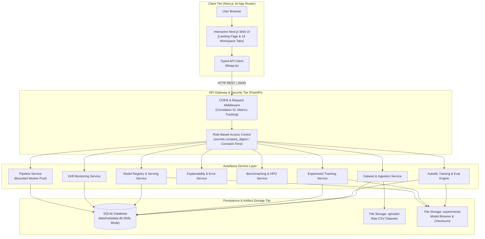

# AutoNexa

<div align="center">

### From Raw Data to Reliable Models

*A visual, research-grade Automated Machine Learning (AutoML) platform engineered for tabular datasets.*

[-0969da?style=flat-square&logo=githubactions&logoColor=white)](https://github.com/Ishitadas03/AutoNexa/actions)
[](https://www.python.org/)
[](https://fastapi.tiangolo.com/)
[](https://nextjs.org/)
[](https://scikit-learn.org/)
[](https://www.sqlite.org/)
[](https://www.docker.com/)

[**Live Web Application**](https://autonexa-orpin.vercel.app) • [**GitHub Repository**](https://github.com/Ishitadas03/AutoNexa) • [**System Architecture**](docs/architecture.md) • [**API Reference**](docs/api_reference.md) • [**Operations Runbook**](docs/operations/autonexa_runbook.md)

</div>

---

## Project at a Glance

- **End-to-End Tabular Pipeline**: Streamlines tabular machine learning from secure CSV ingestion and automated schema profiling to model selection, evaluation, and serving.
- **Leakage-Safe Preprocessing**: Strictly fits all imputers, encoders, and scalers within isolated `ColumnTransformer` pipelines on training partitions only.
- **Statistically Rigorous Evaluation**: Replaces single-split lucky runs with Stratified K-Fold cross-validation, Bessel-corrected variance (`ddof=1`), and untouched final holdout sets.
- **Explainable & Auditable**: Computes global feature importance and instance-level SHAP attributions (`TreeExplainer`/`LinearExplainer`) alongside cryptographic SHA-256 experiment manifests.
- **Research Benchmarking & Drift Monitoring**: Multi-seed hypothesis testing (Wilcoxon, Student-t), Optuna Bayesian HPO, Pareto frontier optimization, and real-time distribution drift detection (KS-test, PSI).

---

## End-to-End AutoML Workflow

The diagram below illustrates how raw tabular data moves through AutoNexa, from ingestion to production serving:

```mermaid
flowchart TD
    subgraph Ingestion ["1. Data Ingestion & Quality Audit"]
        CSV["Raw CSV Dataset"] --> UPLOAD["Chunked Upload & Validation\n(10 MB Limit, Path Guards)"]
        UPLOAD --> PROFILE["Data Profiling & Fingerprinting\n(SHA-256, Schema Inference)"]
        PROFILE --> AUDIT["Dataset Intelligence Audit\n(Missingness, Imbalance, Task Detection)"]
    end

    subgraph CoreML ["2. Leakage-Safe Training & Evaluation"]
        AUDIT --> SPLIT["Data Split Engine\n(Holdout / Stratified K-Fold)"]
        SPLIT --> PREP["ColumnTransformer Pipeline\n(Median Imputer, Scaler, One-Hot)"]
        PREP --> TRAIN["Resource-Aware Model Training\n(Baselines, Linear, Trees, Ensembles)"]
        TRAIN --> EVAL["Leaderboard Evaluation\n(Sample Std ddof=1, Metrics Ranking)"]
    end

    subgraph Tracking ["3. Persistence & Artifact Lineage"]
        EVAL --> REPO["Relational SQLite Catalog\n(Datasets, Runs, Pipelines)"]
        EVAL --> ARTIFACT["Model Artifacts & Checksums\n(.joblib + SHA-256 Manifest)"]
    end

    subgraph ResearchBranches ["4. Post-Training Analysis & Research (On-Demand Branches)"]
        REPO -.-> XAI["Explainability (SHAP)\n(Tree/Linear Attributions)"]
        REPO -.-> ERR["Error Diagnostics\n(Residuals, Confusion Slices)"]
        REPO -.-> HPO["Hyperparameter Optimization\n(Optuna Bayesian Search)"]
        REPO -.-> BM["Repeated-Seed Benchmarks\n(Wilcoxon, Pareto Frontier)"]
        REPO -.-> REG["Model Registry\n(Versioned Stage Promotion)"]
    end

    subgraph Production ["5. Serving & Continuous Quality"]
        REG --> SERVE["Low-Latency Inference\n(Strict Schema, Probabilities)"]
        SERVE --> MON["Drift Monitoring & Gating\n(KS-Test, PSI, Retrain Gate)"]
    end
```



- **Sequential Pipeline**: Every run executes ingestion, leakage-free preprocessing, candidate training, and evaluation.
- **On-Demand Branches**: Explainability (SHAP), error diagnostics, HPO, and benchmarking are run selectively based on experimental needs.
- **Production Gate**: Models must pass artifact verification and retraining performance gates before stage promotion.

---

## System Architecture

The following diagram illustrates the component architecture and persistence boundaries of the AutoNexa platform:



### Request Flow & Storage Boundaries

1. **Client Interaction**: The Next.js 16 frontend issues authenticated requests using the typed API client (`lib/api.ts`).
2. **Gateway & Security**: FastAPI intercepts requests via CORS, correlation ID, and metrics middleware, verifying credentials via constant-time hashing (`secrets.compare_digest`).
3. **Service Execution**: Dedicated services execute asynchronous jobs within a bounded worker threadpool.
4. **Dual Persistence**: Indexed metadata resides in SQLite operating in Write-Ahead Logging (WAL) mode (`data/metadata.db`), while raw CSVs and serialized `.joblib` models reside in filesystem directories (`uploads/`, `experiments/`).

> [!IMPORTANT]
> **Single-Worker Backend Requirement (`--workers 1`)**: AutoNexa relies on in-process thread mutexes (`threading.RLock`), in-memory metrics collectors, and SQLite WAL write concurrency. Run the Uvicorn backend with `--workers 1` per instance. For details, see [docs/architecture.md](docs/architecture.md).

---

## Key Features

| Category | Description | Verified Implementation Details |
| :--- | :--- | :--- |
| **Dataset Intelligence** | Secure ingestion & automated exploratory audit | • Multipart streaming in 64 KB chunks (10 MB default limit)<br>• RFC 4180 parsing with path-traversal guards<br>• SHA-256 fingerprinting and task inference (classification vs. regression) |
| **Automated Training** | Leakage-free candidate estimator training | • Isolated `ColumnTransformer` (median/mode imputer, scaler, one-hot)<br>• Portfolio: Baselines, Logistic/Ridge, Decision Trees, Random Forests, HistGradientBoosting<br>• Wall-clock time budgets and bounded memory limits |
| **Reliable Evaluation** | Statistically grounded model assessment | • Stratified K-Fold / K-Fold with rare-class fallbacks<br>• Unbiased sample standard deviation with Bessel's correction (`ddof=1`)<br>• Untouched holdout test partition reserved for final evaluation |
| **Explainability & Diagnostics** | Auditable decisions & residual error breakdown | • Global importance (native tree impurity or permutation on holdout)<br>• Local instance attributions via SHAP (`TreeExplainer`/`LinearExplainer`) + perturbation fallback<br>• Confusion matrices, calibration curves, and residual slice diagnostics |
| **Research Benchmarking** | Multi-seed verification & optimization | • Matched multi-seed runs (2–10 seeds) with bootstrap confidence intervals<br>• Paired Wilcoxon signed-rank and Student-t hypothesis tests<br>• Optuna Bayesian HPO & Pareto frontier trade-offs (accuracy vs. latency vs. size) |
| **Serving & Monitoring** | Low-latency inference & continuous drift checks | • Model registry with monotonic versions (`v1`, `v2`) and stage exclusivity<br>• Strict feature schema validation and class probability outputs<br>• Real-time KS-test & PSI distribution drift monitoring with retraining gates |

---

## Technology Stack

| Domain | Verified Technologies |
| :--- | :--- |
| **Frontend** | Next.js 16 (App Router), React 19, Tailwind CSS v4, Three.js / React Three Fiber, Recharts, Lucide React |
| **Backend & API** | FastAPI 0.143.3, Uvicorn 0.34.0 (single-worker), Pydantic Settings 2.16.0 |
| **ML & Statistics** | scikit-learn 1.9.1, SHAP 0.51.0, Optuna 5.0.0, SciPy 1.17.1, NumPy 2.4.6, Pandas 3.0.6 |
| **Storage & Persistence** | SQLite (WAL Mode), SQLAlchemy 2.1.4, Local Filesystem Storage (`uploads/`, `experiments/`) |
| **Quality & Operations** | pytest 9.1.1, HTTPX 0.28.1, Docker & Docker Compose, GitHub Actions CI |

---

## Repository Map

```text
AutoNexa/
├── backend/
│   ├── app/
│   │   ├── api/routes/        # REST controllers (health, datasets, experiments, models, serving, etc.)
│   │   ├── core/              # Config, constant-time RBAC security, correlation ID, structured logging
│   │   ├── db/                # SQLAlchemy models, SQLite WAL session engine, reconciliation
│   │   ├── schemas/           # Pydantic request and response contracts
│   │   ├── services/automl/   # Core training engine, preprocessor, registry, XAI, HPO, monitoring
│   │   └── main.py            # FastAPI application factory and lifespan manager
│   ├── scripts/backup_restore.py # Crash-safe SQLite online backup and restore utility
│   ├── requirements-dev.txt   # Complete development, testing, and ML dependencies
│   └── tests/                 # 279 automated unit, integration, and security tests
├── frontend/
│   ├── src/app/               # Next.js 16 pages and global layouts
│   ├── src/components/        # Interactive 3D scene, landing flows, and 16 workspace tabs
│   └── src/lib/api.ts         # Strongly typed backend API client
├── docs/                      # Architectural specs, API reference, runbooks, and research plots
├── data/research_benchmarks/  # Curated benchmark datasets (wine, cancer, diabetes, churn)
└── docker-compose.yml         # Containerized production orchestration
```

---

## Quick Start

### 1. Local Backend Setup

```bash
# Clone the repository
git clone https://github.com/Ishitadas03/AutoNexa.git
cd AutoNexa

# Create and activate Python 3.11 virtual environment
python -m venv backend/.venv
source backend/.venv/bin/activate       # On Windows: .\backend\.venv\Scripts\Activate.ps1

# Install development and testing dependencies
pip install --upgrade pip
pip install -r backend/requirements-dev.txt

# Configure environment template
cp backend/.env.example backend/.env

# Launch FastAPI backend (single-worker)
cd backend
python -m uvicorn app.main:app --host 127.0.0.1 --port 8000 --workers 1
```

- **Interactive Swagger UI**: [http://127.0.0.1:8000/docs](http://127.0.0.1:8000/docs)
- **Liveness Health Probe**: [http://127.0.0.1:8000/api/v1/health](http://127.0.0.1:8000/api/v1/health)

### 2. Local Frontend Setup

In a separate terminal:

```bash
cd AutoNexa/frontend

# Install dependencies reproducibly
npm ci

# Configure local backend URL
echo "NEXT_PUBLIC_API_BASE_URL=http://localhost:8000" > .env.local

# Launch Next.js development server
npm run dev
```

Open [http://localhost:3000](http://localhost:3000) to access the interactive workspace.

### 3. Containerized Setup (Docker Compose)

```bash
# Copy top-level environment template and set secure keys
cp .env.example .env

# Build and start services in the background
docker compose up --build -d

# Verify container liveness
curl -f http://127.0.0.1:8000/api/v1/health
```

---

## API Overview

All routes except the public liveness health check enforce constant-time API-key RBAC via `X-API-Key` or `Authorization: Bearer <key>`:

| Domain | Representative Endpoint | Required Role | Purpose |
| :--- | :--- | :--- | :--- |
| **Health** | `GET /api/v1/health` | **Public** | Process liveness probe without exposing internal server paths. |
| **Readiness** | `GET /api/v1/health/readiness` | `Inference` | Non-blocking probe inspecting SQLite DB, storage writeability, and workers. |
| **Datasets** | `POST /api/v1/datasets/upload` | `Admin` | Chunked CSV stream upload, schema validation, and tabular profiling. |
| **Analysis** | `POST /api/v1/datasets/{id}/analyze` | `Inference` | Data quality audit (missingness, constants, class imbalance, task recommendation). |
| **Training** | `POST /api/v1/datasets/{id}/train` | `Admin` | Dispatches resource-aware AutoML candidate training across models. |
| **Experiments**| `GET /api/v1/experiments/{id}` | `Inference` | Inspects winning pipeline, leaderboard rankings, and SHA-256 integrity hash. |
| **Inference** | `POST /api/v1/experiments/{id}/predict` | `Inference` | Tabular inference on JSON records with feature schema checks and probabilities. |
| **Explainability**| `GET /api/v1/experiments/{id}/explainability/importance`| `Inference` | Computes global feature importance (native tree impurity or permutation). |
| **Benchmarking**| `POST /api/v1/benchmarks/repeated-runs` | `Inference` | Executes multi-seed experimental series with bootstrap confidence intervals. |

> For the complete 24+ endpoint reference with request/response schemas, see [docs/api_reference.md](docs/api_reference.md).

---

## Research & Reliability

- **Leakage Prevention**: All transformations are isolated within `Pipeline` and `ColumnTransformer` steps fitted strictly on training data.
- **Reproducibility Manifests**: Every experiment generates a cryptographic JSON manifest recording dataset fingerprints, random seeds, and package versions.
- **Statistical Testing**: Multi-seed comparisons compute Student's paired t-tests and Wilcoxon signed-rank tests to confirm that performance gains are statistically significant.
- **Multi-Objective Optimization**: Computes non-dominated Pareto frontiers comparing validation accuracy against inference latency and artifact size.

> For mathematical formulas, variance corrections (`ddof=1`), and SHAP explainer selection rules, see [docs/methodology.md](docs/methodology.md).

---

## Verification & Operational Limits

### Automated Test Suite

```text
======================= 279 passed, 12 warnings in 84.16s =======================
```

Run test suite locally:
```bash
pytest backend/tests -v
```

### Operational Limits
- **Single-Worker Execution**: Requires running Uvicorn with `--workers 1` due to in-process mutexes and SQLite concurrency.
- **In-Memory Telemetry**: Real-time request counters and latency histograms reside in memory and reset upon server restart.
- **Volume Persistence**: In containerized environments, `uploads/`, `experiments/`, and `data/` must be mounted to persistent volumes.

> For operational recovery, crash-safe SQLite backups, and runbooks, see [docs/operations/autonexa_runbook.md](docs/operations/autonexa_runbook.md).

---

## Roadmap, Contributing & License

### Roadmap
- [ ] **Distributed Task Queue**: Integration with Celery or Redis for multi-worker distributed training.
- [ ] **PostgreSQL Storage Dialect**: Multi-instance horizontal scaling with PostgreSQL.
- [ ] **Cloud Blob Storage**: S3 and Google Cloud Storage adapters for model artifacts and datasets.
- [ ] **Quantum ML (QML) Benchmarking**: Variational quantum circuit benchmarks via PennyLane (in research design).

### Contributing
Contributions are welcome. Please ensure that all pull requests include tests, maintain 100% test pass rates (`pytest backend/tests`), and adhere to existing code style.

### License
The AutoNexa repository does not currently specify an open-source license. All rights are reserved by the repository owner ([Ishitadas03](https://github.com/Ishitadas03)). An open-source license will be added in a future release.

---

## Contact

- **Author & Maintainer**: Ishita Das ([@Ishitadas03](https://github.com/Ishitadas03))
- **GitHub Repository**: [https://github.com/Ishitadas03/AutoNexa](https://github.com/Ishitadas03/AutoNexa)
- **Live Platform**: [https://autonexa-orpin.vercel.app](https://autonexa-orpin.vercel.app)
