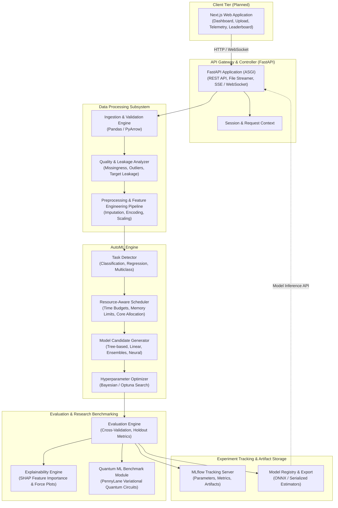

# AutoML Research Lab (AutoNexa) — System Architecture

> [!NOTE]
> **Planned Architecture**: This document outlines the planned high-level system architecture and component design for AutoML Research Lab. This describes the target architecture for future phases, not a fully implemented system in Step 1.

---

## 1. Executive Summary

**AutoML Research Lab** is an extensible, research-oriented automated machine learning platform designed for tabular datasets. It bridges the gap between rapid automated prototyping and empirical research benchmarking.

The platform guides users through an end-to-end workflow:
1. Uploading tabular datasets (CSV, Parquet).
2. Automated schema inference, exploratory data analysis, and leakage detection.
3. Automated model selection, feature engineering, and hyperparameter optimization under resource constraints.
4. Comprehensive model evaluation and model explainability using SHAP.
5. Experiment tracking with MLflow and reproducible artifact registration.
6. Empirical benchmarking between classical ML models and variational Quantum Machine Learning (QML) circuits using PennyLane.

---

## 2. High-Level Architecture Diagram

---

## 3. Subsystem Breakdown

### 3.1 Frontend (Planned Next.js Web App)
- **Role**: Interactive web dashboard for data practitioners and researchers.
- **Key Responsibilities**:
  - Drag-and-drop tabular dataset uploads with instant client-side preview.
  - Interactive Exploratory Data Analysis (EDA) views (distributions, correlations, missing values).
  - AutoML configuration wizard (target variable selection, optimization metric, time/resource budgets).
  - Real-time training telemetry, live training curves, and leaderboard comparison tables.
  - Model explanation dashboards (SHAP summary plots, waterfall plots).
  - Prediction testing playground and one-click model export.

### 3.2 FastAPI Backend
- **Role**: High-performance, asynchronous REST API gateway and orchestration layer.
- **Key Responsibilities**:
  - Validates and streams multipart file uploads securely to disk/storage.
  - Exposes RESTful endpoints for task initialization, job status, and leaderboard queries.
  - Provides streaming real-time status updates via Server-Sent Events (SSE) or WebSockets.
  - Implements dependency injection for core services, ensuring loose coupling and testability.
### 3.3 Data Ingestion, Intelligence & Processing Subsystem (Steps 3, 4, 5 & 6 Implemented)
- **Role**: Robust data validation, tabular profiling, data quality auditing, and ML task detection.
- **Implemented Capabilities**:
  - **Chunked Multipart Streaming**: Ingests `.csv` files in 64 KB chunks, dynamically enforcing a configurable size ceiling (`MAX_UPLOAD_SIZE_BYTES`, default 10 MB) without loading unconstrained files into memory.
  - **Path Traversal & Safe Identifiers**: Isolates client-provided filenames to display metadata; persists files under server-generated UUIDv4 filenames (`{dataset_id}.csv`) strictly within `resolved_upload_dir`.
  - **Pre-Validation**: Rejects non-CSV extensions, empty files (0 bytes), whitespace-only payloads, headerless files, files with no data rows, and structurally inconsistent row lengths.
  - **Automated Summary Profiling**: Automatically computes dataset metrics including total rows, total columns, column names, inferred data types (`dtypes`), missing value counts per column, duplicate row counts, DataFrame memory consumption, and disk file size.
  - **Dataset Intelligence & Role Classification**: Categorizes columns into semantic roles (`numeric`, `categorical`, `identifier`, `datetime`, `text`).
  - **Data Quality Diagnostics**: Evaluates missingness ratios, flags critical missingness (>50%), identifies constant and near-constant features (dominant value >= 95%), and highlights high-cardinality categorical variables.
  - **ML Task Detection & Heuristics**: Analyzes candidate targets, inferring `binary_classification`, `multiclass_classification`, or `regression` based on data types, unique class counts, and cardinality. Detects severe class imbalance (minority class < 10% or ratio > 4:1) and potential target leakage via Pearson correlation (|r| >= 0.98).
  - **Cryptographic Dataset Fingerprinting**: Calculates SHA-256 hash of the stored CSV dataset to track data integrity and detect content changes across experiment runs without logging raw rows or PII.
  - **Memory-Safe Preprocessing Pipelines**: Separate training/testing splits before fitting. `ColumnTransformer` combines `SimpleImputer(strategy="median")` + `StandardScaler()` for numeric columns with `SimpleImputer(strategy="most_frequent")` + `OneHotEncoder(handle_unknown="ignore", sparse_output=False, max_categories=25)` for categorical columns.
  - **Privacy & Safety Guarantees**: Raw row data and internal absolute server paths are never returned in API payloads or logged. Source files are never modified during analysis or training.

### 3.4 AutoML Engine (Steps 5 & 6 Implemented)
- **Role**: Intelligent algorithm selection and resource-budgeted optimization.
- **Implemented Capabilities**:
  - **Model Registry Architecture**: Decoupled estimator factory supporting seamless candidate additions without altering orchestration logic.
  - **Classification Candidate Estimators**:
    - `dummy`: DummyClassifier baseline (`strategy="most_frequent"`).
    - `logistic_regression`: L2-penalized Logistic Regression with bounded iterations.
    - `decision_tree`: DecisionTreeClassifier with depth pruning (`max_depth=10`).
    - `random_forest`: RandomForestClassifier ensemble (`n_estimators=50`, `max_depth=12`, `n_jobs=1`).
    - `hist_gradient_boosting`: HistGradientBoostingClassifier with native categorical handling and early stopping.
  - **Regression Candidate Estimators**:
    - `dummy_regressor`: DummyRegressor baseline (`strategy="mean"`).
    - `linear_regression`: L2-penalized Ridge regression (`alpha=1.0`).
    - `decision_tree_regressor`: DecisionTreeRegressor with depth pruning (`max_depth=10`).
    - `random_forest_regressor`: RandomForestRegressor ensemble (`n_estimators=50`, `max_depth=12`, `n_jobs=1`).
    - `hist_gradient_boosting_regressor`: HistGradientBoostingRegressor with early stopping.
  - **Configurable Evaluation Strategies**:
    - `holdout`: Single split fitting on train partition and evaluating on holdout test partition.
    - `cross_validation`: K-fold CV ($2 \le k \le 10$) with `StratifiedKFold` for classification and `KFold` for regression.
  - **Untouched Test Set Protocol**: In CV mode, candidate selection operates strictly within the training partition. The selected winning model is refitted and evaluated once on the untouched holdout test partition to compute independent final performance metrics (`test_metrics`).
  - **Stratification Fallback**: When classification classes have fewer samples than requested folds, gracefully falls back to non-stratified `KFold` with documented audit warnings, or rejects requests when configured with `cv_rare_class_fallback=false`.
  - **Resource-Aware Scheduling**: Bounded dataset dimensions (`MAX_DATASET_ROWS=100000`, `MAX_DATASET_COLUMNS=500`), bounded wall-clock training budget (5–300s), and thread-controlled fitting (`n_jobs=1`).
  - **Fault Isolation**: Per-candidate and per-fold isolation records sanitized failure diagnostics and distinguishes timeouts (`skipped_timeout`) from model failures (`failed`).

### 3.5 Evaluation, Explainability & Research Benchmarking (Steps 5 & 6 Implemented)
- **Role**: Rigorous empirical validation and interpretability.
- **Implemented Capabilities**:
  - **Multi-Metric Evaluation Engine**:
    - Classification: `accuracy`, `precision_weighted`, `precision_macro`, `recall_weighted`, `recall_macro`, `f1_weighted`, `f1_macro`, `roc_auc`, and `confusion_matrix`.
    - Regression: `rmse`, `mae`, and `r2`.
  - **Statistical Fold Aggregation**: Computes valid fold counts, per-fold scores, mean score (`cv_mean`), and sample standard deviation (`cv_std`, with `ddof=1` only when $\ge 2$ valid scores exist; returns `null` otherwise).
  - **Dynamic & Direction-Aware Ranking**: Configurable primary metric with explicit direction awareness (`higher_is_better` vs `lower_is_better` for error metrics). Never substitutes zero for missing metrics during ranking.
  - **Safe Metric Sanitization**: Guaranteed finite JSON primitives (`NaN` and `Infinity` replaced with `null`).
- **Planned Capabilities**:
  - **Explainable AI (SHAP)**: Global and local SHAP attributions for tree and linear models.
  - **Quantum ML Benchmarking**: PennyLane variational quantum circuits benchmarked against classical baselines.

### 3.6 Experiment Tracking & Model Registry (Steps 5 & 6 Implemented)
- **Role**: Reproducibility, lineage, and deployment readiness.
- **Implemented Capabilities**:
  - **Hierarchical MLflow Experiment Tracking**:
    - **Parent Runs**: Track overall experiment configuration (`dataset_id`, `dataset_fingerprint`, `target_column`, `task_type`, `evaluation_strategy`, `cv_folds`, `test_size`, `random_state`, `primary_metric`), software environment versions, total durations, and winning model tags. Registers `metadata.json` as an artifact.
    - **Nested Child Runs**: One run per evaluated candidate model capturing parameters, durations, CV fold metrics, mean, std, and status.
    - **Fault-Tolerant Resilience**: Tracking errors or unreachable backends are caught gracefully, persisting `tracking_status="failed"` and sanitized warnings without aborting training.
  - **Safe Local Artifact Storage**: Dedicated `experiments/{experiment_id}/` storage with path traversal protection.
  - **Atomic Metadata Persistence**: `metadata.json` written atomically via temporary files to avoid partial or corrupted states.
  - **Pipeline Export**: Complete scikit-learn `Pipeline` (fitted preprocessor + winning estimator) persisted to `best_model.joblib`.
  - **Audit Metadata**: Records dataset ID, SHA-256 fingerprint, target column, task type, split proportions, random seed, candidate results, training durations, test metrics, and software environment package versions.

---

## 4. Architectural Principles

1. **Modularity & Separation of Concerns**: Clear service boundaries allow replacing individual components (e.g., swapping preprocessors or optimizers) without altering the API layer.
2. **Reproducibility by Design**: Every experiment run records exact seeds, package versions, and data hashes to guarantee replicable research results.
3. **Resource Sensitivity**: Automated execution must respect system constraints to prevent out-of-memory crashes on constrained hardware.
4. **Security & Data Privacy**: Safe handling of user-submitted files, strict size limits, and sanitization of file paths without arbitrary code execution.
