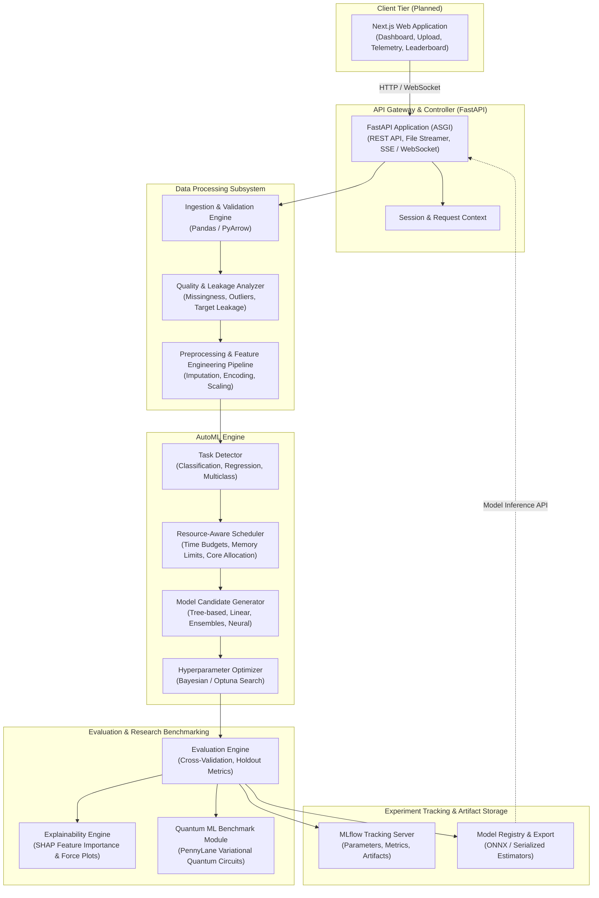

# AutoML Research Lab (AutoNexa) — System Architecture

> [!NOTE]
> **Planned Architecture**: This document outlines the planned high-level system architecture and component design for AutoML Research Lab. This describes the target architecture for future phases, not a fully implemented system in Step 1.

---

## 1. Executive Summary

**AutoML Research Lab** is an extensible, research-oriented automated machine learning platform designed for tabular datasets. It bridges the gap between rapid automated prototyping and empirical research benchmarking.

The platform guides users through an end-to-end workflow:
1. Uploading tabular datasets (CSV, Parquet).
2. Automated schema inference, exploratory data analysis, and leakage detection.
3. Automated model selection, feature engineering, and hyperparameter optimization under resource constraints.
4. Comprehensive model evaluation and model explainability using SHAP.
5. Experiment tracking with MLflow and reproducible artifact registration.
6. Empirical benchmarking between classical ML models and variational Quantum Machine Learning (QML) circuits using PennyLane.

---

## 2. High-Level Architecture Diagram

---

## 3. Subsystem Breakdown

### 3.1 Frontend (Planned Next.js Web App)
- **Role**: Interactive web dashboard for data practitioners and researchers.
- **Key Responsibilities**:
  - Drag-and-drop tabular dataset uploads with instant client-side preview.
  - Interactive Exploratory Data Analysis (EDA) views (distributions, correlations, missing values).
  - AutoML configuration wizard (target variable selection, optimization metric, time/resource budgets).
  - Real-time training telemetry, live training curves, and leaderboard comparison tables.
  - Model explanation dashboards (SHAP summary plots, waterfall plots).
  - Prediction testing playground and one-click model export.

### 3.2 FastAPI Backend
- **Role**: High-performance, asynchronous REST API gateway and orchestration layer.
- **Key Responsibilities**:
  - Validates and streams multipart file uploads securely to disk/storage.
  - Exposes RESTful endpoints for task initialization, job status, and leaderboard queries.
  - Provides streaming real-time status updates via Server-Sent Events (SSE) or WebSockets.
  - Implements dependency injection for core services, ensuring loose coupling and testability.

### 3.3 Data Ingestion & Processing Subsystem (Step 3 Implemented)
- **Role**: Robust data validation, cleaning, and tabular profiling.
- **Implemented Capabilities (Step 3)**:
  - **Chunked Multipart Streaming**: Ingests `.csv` files in 64 KB chunks, dynamically enforcing a configurable size ceiling (`MAX_UPLOAD_SIZE_BYTES`, default 10 MB) without loading unconstrained files into memory.
  - **Path Traversal & Safe Identifiers**: Isolates client-provided filenames to display metadata; persists files under server-generated UUIDv4 filenames (`{dataset_id}.csv`) strictly within `resolved_upload_dir`.
  - **Pre-Validation**: Rejects non-CSV extensions, empty files (0 bytes), whitespace-only payloads, headerless files, files with no data rows, and structurally inconsistent row lengths.
  - **Automated Summary Profiling**: Automatically computes dataset metrics including total rows, total columns, column names, inferred data types (`dtypes`), missing value counts per column, duplicate row counts, DataFrame memory consumption, and disk file size.
  - **Privacy & Safety Guarantees**: Raw row data and internal absolute server paths are never returned in API payloads or logged.
- **Planned Capabilities (Upcoming Phases)**:
  - **Automated Data Quality & Leakage Detection**: Identifies proxy targets, high cardinality risk, and feature drift.
  - **Preprocessing Pipelines**: Implements scikit-learn compatible transformers for missing value imputation, one-hot/target encoding, and feature scaling.

### 3.4 AutoML Engine
- **Role**: Intelligent algorithm selection and resource-budgeted optimization.
- **Key Responsibilities**:
  - **Task Detection**: Automatically determines task type (Binary Classification, Multi-class Classification, Regression).
  - **Candidate Generation**: Evaluates a family of baselines (e.g., Logistic/Ridge regression, Random Forest, Gradient Boosted Trees).
  - **Resource-Aware Scheduling**: Dynamically adapts candidate depth and cross-validation folds according to CPU/memory availability and time limits.
  - **Hyperparameter Optimization (Planned)**: Structured exploration over hyperparameter spaces using adaptive search strategies.

### 3.5 Evaluation, Explainability & Research Benchmarking
- **Role**: Rigorous empirical validation and interpretability.
- **Key Responsibilities**:
  - **Multi-Metric Evaluation**: Computes standard metrics (ROC-AUC, PR-AUC, F1, Log-Loss, RMSE, MAE, R²) with confidence intervals.
  - **Explainable AI (SHAP)**: Computes TreeSHAP and KernelSHAP values to provide global feature importance and local sample-level attribution.
  - **Quantum ML Benchmarking (Planned)**: Encodes tabular features into quantum states using PennyLane variational quantum circuits (VQC) to empirically benchmark classical models against quantum classifiers on standardized datasets.

### 3.6 Experiment Tracking & Model Registry
- **Role**: Reproducibility, lineage, and deployment readiness.
- **Key Responsibilities**:
  - Logs hyperparameter configurations, metrics, and environment fingerprints.
  - Packages the winning model alongside its end-to-end preprocessing pipeline for export.

---

## 4. Architectural Principles

1. **Modularity & Separation of Concerns**: Clear service boundaries allow replacing individual components (e.g., swapping preprocessors or optimizers) without altering the API layer.
2. **Reproducibility by Design**: Every experiment run records exact seeds, package versions, and data hashes to guarantee replicable research results.
3. **Resource Sensitivity**: Automated execution must respect system constraints to prevent out-of-memory crashes on constrained hardware.
4. **Security & Data Privacy**: Safe handling of user-submitted files, strict size limits, and sanitization of file paths without arbitrary code execution.
