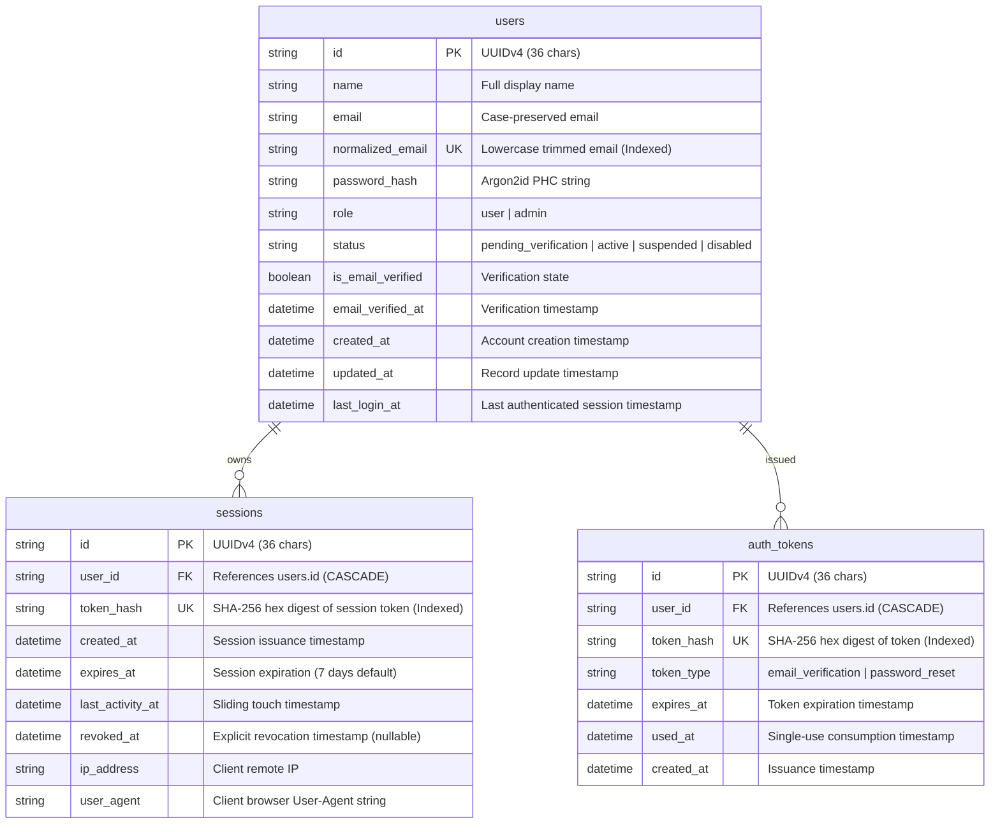

# AutoNexa Phase 17F — Secure Email Authentication & User Identity Architecture

**Phase:** 17F — Secure Email Authentication & User Identity Foundation  
**System:** AutoNexa Machine Learning Research Platform  
**Target Architecture:** Next.js App Router (BFF) + FastAPI Backend + SQLite/Relational Metadata Ledger  
**Status:** Validated & Implemented  
**Date:** November 2026  

---

## 1. Executive Summary & Architectural Motivation

Prior to Phase 17F, AutoNexa relied exclusively on static server-to-server API keys (`API_KEY_ADMIN` and `API_KEY_READ`). While effective for automated CLI pipelines and machine-to-machine integrations, the Phase 17E.2 deployment audit confirmed critical architectural limitations when exposing the application to public internet users:

1. **Shared Catalog Tenancy:** No concept of users or tenants existed. All uploaded datasets, experiments, and model artifacts resided in a global shared catalog accessible to any bearer of a read key.
2. **Confused Deputy & Credential Leaks:** Client browsers stored administrative API keys in `localStorage` to execute mutations (dataset uploads, training jobs, model promotions). Storing root administrative secrets in browser client storage violates OWASP guidelines and exposes the cluster to complete compromise via XSS or browser extension exfiltration.
3. **Absence of User Identity:** Without persistent user records, audit logging, fine-grained access control, and private dataset isolation were architecturally impossible.

Phase 17F establishes a production-grade **User Identity and Session Management Foundation** based on email registration, cryptographic password verification, transactional email activation, opaque session tokens, and secure HttpOnly cookie propagation through the Next.js Backend-for-Frontend (BFF).

---

## 2. Identity & Persistence Schema Architecture

Phase 17F introduces three foundational relational models registered under Schema Version 2 in AutoNexa's database ledger.



### Schema Integrity & Foreign Key Guarantees
- **Cascading Deletions:** Deleting a user automatically cascades to purge all active sessions and pending authentication tokens (`ondelete="CASCADE"`).
- **Index Segregation:** To prevent duplicate index collisions in SQLite and PostgreSQL, indices are defined explicitly in `__table_args__` without redundant column-level `index=True` markers.
- **Ledger Versioning:** `SchemaVersionModel` records Schema Version 2 upon initial setup, ensuring reproducible schema migrations across development, staging, and containerized deployments.

---

## 3. Cryptographic Standards & Token Lifecycle

### 3.1 Argon2id Password Hashing
AutoNexa adopts **Argon2id** (the winner of the Password Hashing Competition and recommended by OWASP) utilizing native cryptography primitives (`cryptography.hazmat.primitives.kdf.argon2.Argon2id`):

| Parameter | Configured Value | OWASP Minimum Recommendation | Security Rationale |
| :--- | :--- | :--- | :--- |
| **Algorithm** | Argon2id (`v=19`) | Argon2id | Hybrid resistance against side-channel and GPU cracking |
| **Memory Cost ($m$)** | 65,536 KB (64 MB) | 19,456 KB (19 MB) | Restricts massive parallel ASIC hardware attacks |
| **Iterations ($t$)** | 3 iterations | 2 iterations | Balanced CPU computational cost (~100–150ms per hash) |
| **Parallelism ($p$)** | 4 lanes | 1 lane | Multi-core compute bound execution |
| **Salt Length** | 16 bytes (128 bits) | 16 bytes | Cryptographically secure CSPRNG (`os.urandom`) |
| **Key Length** | 32 bytes (256 bits) | 32 bytes | Standard AES/SHA256 compatible entropy |

Password policy rules enforce a minimum of 8 characters (max 128), requiring at least one letter and at least one number or special character. Plaintext passwords are never logged, formatted, or persisted in unhashed memory.

### 3.2 Opaque Token Architecture (Anti-DB-Leak Protection)
For sessions, email activation, and password resets, AutoNexa rejects reversible JWTs in favor of **high-entropy opaque tokens**:
1. **Raw Token Delivery:** Generated via `secrets.token_urlsafe(32)` providing 256 bits of CSPRNG entropy. Delivered exclusively to the client (via HttpOnly cookie or emailed URL).
2. **Hashed Persistence:** The database stores only the constant-time SHA-256 hex digest (`hashlib.sha256(raw.encode()).hexdigest()`). If the database or backup snapshots are leaked, attackers cannot reconstruct valid session cookies or verification tokens.
3. **Single-Use Invalidation:** Verification and reset tokens are marked with `used_at = utc_now()` upon consumption. Replay attacks are rejected immediately with HTTP 400.

---

## 4. Session Management & Cookie Propagation

```mermaid
sequenceDiagram
    autonumber
    actor Client as Browser Client
    participant BFF as Next.js BFF (/api/bff)
    participant API as FastAPI Backend (/api/v1)
    participant DB as SQLite / Relational DB

    Client->>BFF: POST /api/bff/auth/login {email, password}
    BFF->>API: Proxy POST /api/v1/auth/login
    API->>DB: Query user by normalized_email
    DB-->>API: UserModel (Argon2id hash, ACTIVE status)
    API->>API: Verify Argon2id password hash
    API->>DB: Persist SessionModel (token_hash, 7-day expiry)
    API-->>BFF: HTTP 200 OK + Set-Cookie: autonexa_session=<raw_token>; HttpOnly; SameSite=Lax
    BFF-->>Client: HTTP 200 OK + Propagate Set-Cookie header
    Note over Client: Browser stores HttpOnly cookie safely.<br/>JavaScript has NO access to session secret.
    
    Client->>BFF: GET /api/bff/auth/me (Cookie attached automatically)
    BFF->>API: Forward Cookie: autonexa_session=<raw_token>
    API->>DB: Lookup session by SHA-256(raw_token)
    DB-->>API: Valid SessionModel & UserModel
    API->>DB: Touch last_activity_at
    API-->>BFF: HTTP 200 OK {user: {id, name, email, role, ...}}
    BFF-->>Client: HTTP 200 OK
```

### Cookie Security Attributes
- **`HttpOnly`:** Prevents client-side scripts from reading session tokens via `document.cookie` (100% immune to XSS token theft).
- **`SameSite=Lax`:** Defends against Cross-Site Request Forgery (CSRF) on cross-origin top-level navigations while permitting normal browser page loads.
- **`Secure`:** Enabled dynamically in production environments (`ENVIRONMENT=production` or `HTTPS` requests) ensuring cookies are transmitted strictly over encrypted TLS connections.
- **`Path=/`:** Available across all application routes.
- **`Max-Age`:** Default 7 days (604,800 seconds).

---

## 5. Next.js Backend-for-Frontend (BFF) Integration

The Next.js App Router route handler (`frontend/src/app/api/bff/[...path]/route.ts`) acts as the security gateway between external browsers and the FastAPI backend:

1. **Authentication Route Exemption:** Requests directed to `/api/bff/auth/*` (register, login, verify-email, forgot-password, reset-password) are exempted from the mandatory client admin key check. Unauthenticated visitors can securely create accounts and sign in.
2. **Session Cookie Forwarding:** Incoming `Cookie` headers are sanitized and forwarded to the FastAPI backend.
3. **Response Header Propagation:** Backend `Set-Cookie` and `X-Session-Token` headers are intercepted and forwarded to the browser response, ensuring seamless session establishment and revocation.
4. **Non-Auth Privileged Route Enforcement:** Privileged mutation endpoints (such as `POST /datasets/{id}/train`, `DELETE /experiments/{id}`) **strictly require an explicit client administrator credential**. Unauthenticated visitors attempting to invoke pipeline training through the BFF are rejected with HTTP 401.

---

## 6. Transactional Email Service

AutoNexa provides a multi-backend transactional email service (`app.services.email_service.EmailService`):

| Backend | Configuration | Typical Environment | Behavior |
| :--- | :--- | :--- | :--- |
| **`console`** | `EMAIL_BACKEND=console` | Local Docker, Dev workstation | Outputs formatted email subject, recipient, and clickable activation URL directly to standard logger/terminal output. |
| **`memory`** | `EMAIL_BACKEND=memory` | Automated Pytest test suites | Queues sent email dictionaries in memory (`get_sent_messages()`) for deterministic verification without network overhead. |
| **`smtp`** | `EMAIL_BACKEND=smtp` | Staging, Production | Delivers multipart plain text and HTML emails via authenticated TLS SMTP (`SMTP_HOST`, `SMTP_PORT`, `SMTP_USER`, `SMTP_PASSWORD`). |

### Anti-Enumeration Protections
To prevent malicious actors from harvesting registered email addresses:
- **Resend Verification:** Submitting an unverified or non-existent email address returns HTTP 200 with an identical generic message (`"If an unverified account exists for this email, a new verification link has been sent."`).
- **Forgot Password:** Submitting any email address returns HTTP 200 with `"If an account is associated with this email, password reset instructions have been sent."`. No timing side-channels or distinguishable response statuses are leaked.

---

## 7. Public Registration Safety Gate

### The Phase 17F / Phase 17G Boundary
While Phase 17F delivers full identity and session infrastructure, AutoNexa's dataset and experiment catalog remains shared until **Phase 17G (Multi-Tenant Data Isolation & Ownership)** adds `user_id` foreign keys to `datasets`, `experiments`, and `pipelines`.

If public registration were open immediately:
- Any visitor could create an account, log in, and view or modify existing research datasets.

**Enforced Safety Control:**
The backend configuration flag `AUTH_PUBLIC_REGISTRATION_ENABLED` defaults to `False`:
```python
if not settings.auth_public_registration_enabled:
    raise HTTPException(
        status_code=status.HTTP_403_FORBIDDEN,
        detail="Public user registration is currently in closed evaluation while Phase 17G multi-tenant data isolation is completed. Administrative onboarding only.",
    )
```
This guarantees zero unintended data exposure during evaluation while allowing administrative user creation and full automated test execution.

