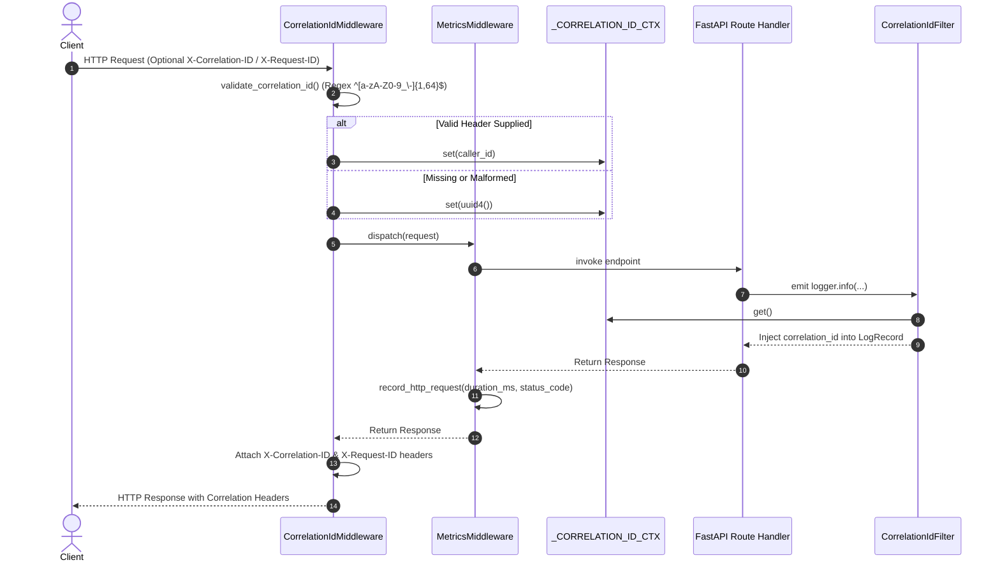
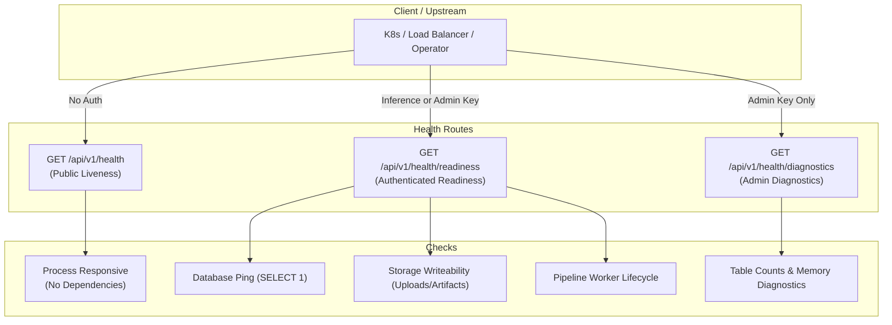

# AutoNexa Phase 16E — Observability, Diagnostics & Operational Architecture

**Document ID:** `ANX-ARCH-PHASE-16E-2026`  
**Date:** October 2026  
**Scope:** Observability, Request Correlation, Structured Logging & Diagnostics Architecture  
**Repository:** `C:\Users\ishit\AutoNexa`  

---

## 1. Architectural Overview & Design Principles

AutoNexa Phase 16E establishes production observability and operational diagnostics tailored for the single-worker AutoNexa server deployment.

### Core Architectural Principles:
1. **Zero External Infrastructure Overhead:** Avoid introducing external metric collectors (Prometheus server, OpenTelemetry collector, StatsD daemon) or log forwarders. All metrics and correlation capabilities are self-contained within the Python runtime.
2. **Deterministic Request Traceability:** Every incoming HTTP interaction is assigned or resolved to a validated correlation identifier that propagates through async tasks, thread pools, and structured log records.
3. **Defense-in-Depth Confidentiality:** Exception sanitizers and logging formatters scrub credentials, Bearer tokens, and sensitive system paths automatically before emitting output to stdout or file streams.
4. **Separation of Concerns for Health & Probing:** Public liveness probes remain decoupled from internal dependency states, while deep diagnostics are restricted to authenticated operators to avoid information leakage.
5. **Bounded Cardinality Telemetry:** All metric counters, gauges, and latency buckets use bounded whitelist labels to prevent memory bloat.

---

## 2. Request Correlation & Context Propagation

The correlation subsystem ensures end-to-end trace correlation across all asynchronous request handlers, background threads, and logging statements.



### Key Components:
- **`validate_correlation_id(raw_id: Optional[str]) -> Optional[str]`:**
  Enforces a strict regex whitelist (`^[a-zA-Z0-9_\-]{1,64}$`). Any value with spaces, newlines, control characters, or length exceeding 64 characters is rejected.
- **`resolve_correlation_id(header_val: Optional[str]) -> str`:**
  Resolves valid caller-provided headers or falls back to `str(uuid.uuid4())`.
- **`ContextVar("correlation_id", default="-")`:**
  Ensures thread-safe, coroutine-local propagation across async FastAPI endpoints.
- **`CorrelationIdFilter(logging.Filter)`:**
  Automatically extracts the active correlation ID from `ContextVar` and injects it into every Python `LogRecord` as `record.correlation_id`.
- **`CorrelationIdMiddleware(BaseHTTPMiddleware)`:**
  ASGI middleware that resolves the correlation identifier, stores it in `request.state.correlation_id`, sets the context variable, and attaches both `X-Correlation-ID` and `X-Request-ID` to outbound responses.

---

## 3. Structured Logging & Secret Sanitization Subsystem

All log events pass through a centralized redaction filter before formatting.

### Sanitization Rules (`sanitize_log_message`):
1. **Bearer Tokens:** Matches `(?i)Bearer\s+[A-Za-z0-9_\-\.]{8,}` and replaces with `Bearer [REDACTED_TOKEN]`.
2. **AutoNexa API Keys:** Matches `(?i)\b(autonexa[-_][a-zA-Z0-9_\-]{8,})\b` and `\b(ak[-_][a-zA-Z0-9_\-]{8,})\b` and replaces with `[REDACTED_API_KEY]`.
3. **Key-Value Credentials:** Matches `(?i)\b(api[_-]?key|secret|password|token|authorization)\b\s*([:=])\s*['"]?([^\s,'"]+)['"]?` and replaces the value with `[REDACTED]`.
4. **Sensitive Absolute Paths:** Replaces Windows user profiles (`C:\Users\<username>\`) and Unix homes (`/home/<username>/`) with `[HOME]\` and `[HOME]/`.

### Structured Log Record Format:
```text
%(asctime)s | %(levelname)-7s | [%(correlation_id)s] | %(name)s | %(message)s
```
*Example Log Output:*
```text
2026-10-23 22:21:38 | INFO    | [7dbfcd9a-1c6c-4b77-98e8-f6ee34316870] | app.services.automl.training_service | Training experiment started | experiment_id=fd27e4d5-f386-4461-88ea-0a902426212b dataset_id=db0e1183-f237-4420-a010-d651c02b196c task_type=regression target_column=y candidates=2
```

---

## 4. Multi-Tiered Health & Diagnostics Architecture

AutoNexa implements a clear hierarchy distinguishing liveness, readiness, and privileged diagnostics:



### Health Tiers Breakdown:
1. **Tier 1: Public Liveness Probe (`GET /api/v1/health`)**
   - **Role:** Kubernetes / process supervisor liveness.
   - **Characteristics:** Unauthenticated, zero external dependencies, fast execution (< 2ms), outputs public status, application name, and version.
2. **Tier 2: Authenticated Readiness Probe (`GET /api/v1/health/readiness`)**
   - **Role:** Ingress router / deployment readiness.
   - **Access:** Requires `Inference` or `Admin` role.
   - **Behavior:** Executes a bounded SQLite ping (`SELECT 1`), confirms directory writeability, and verifies that pipeline service is not shutting down. Returns `200 OK` when ready; returns `503 Service Unavailable` with degraded status when dependencies fail.
3. **Tier 3: Privileged Operational Diagnostics (`GET /api/v1/health/diagnostics`)**
   - **Role:** Deep operator inspection.
   - **Access:** Restricted strictly to `Admin` role.
   - **Behavior:** Queries table row counts across `datasets`, `experiments`, `pipelines`, and `schema_versions`; reports Python runtime environment, process ID, uptime, and thread pool worker states.

---

## 5. In-Memory Operational Metrics Subsystem

The metrics subsystem provides high-precision operational measurements without external daemon dependencies.

### Design Details:
- **Thread Safety:** All metric counters, gauges, and timing statistics are protected by a re-entrant lock (`threading.RLock()`).
- **Bounded Label Sets:**
  - `methods`: `{"GET", "POST", "PUT", "DELETE", "PATCH", "OPTIONS", "HEAD", "OTHER"}`
  - `status_families`: `{"1xx", "2xx", "3xx", "4xx", "5xx", "unknown"}`
  - `task_types`: `{"tabular_classification", "tabular_regression", "clustering", "time_series", "unknown"}`
  - `run_statuses`: `{"started", "completed", "failed", "cancelled", "retried", "unknown"}`
  - `stages`: `{"staging", "production", "archived", "unknown"}`
  - `retrain_outcomes`: `{"triggered", "skipped_threshold", "skipped_busy", "failed", "unknown"}`
- **Durability Contract:**
  Metrics are intentionally stored in-process memory. Process restarts reset metrics to zero; the snapshot payload explicitly declares `"durable": false, "storage": "in_memory"`.

### Metrics Endpoint (`GET /api/v1/metrics` & `/api/v1/health/metrics`):
Returns a complete JSON snapshot including:
- Process uptime in seconds
- Total HTTP request count, method breakdown, status family distribution, and min/max/avg latency (ms)
- Training experiment count, status distribution, task type distribution, and duration statistics (s)
- Pipeline orchestrations total, status counts, active gauge, queued gauge, and duration statistics (s)
- Metadata database operations count, error counts, and reconciliation outcomes
- Governance events (model promotions by stage, retraining triggers by outcome)

---

## 6. Service Layer Instrumentation Touchpoints

| Service | Operation | Structured Log Fields | Metrics Recorded |
| :--- | :--- | :--- | :--- |
| **`DatasetService`** | Upload & Validation | `dataset_id`, `filename`, `bytes`, `sha256` | Latency tracked via HTTP middleware |
| **`DatasetService`** | Profile Generation | `dataset_id`, `rows`, `cols` | - |
| **`TrainingService`** | Experiment Start | `experiment_id`, `dataset_id`, `task_type`, `target_column`, `candidates` | `record_training_event("started", task_type)` |
| **`TrainingService`** | Experiment Complete | `experiment_id`, `dataset_id`, `best_model`, `score`, `duration_s`, `models` | `record_training_event("completed", task_type, duration)` |
| **`TrainingService`** | Experiment Failed | `experiment_id`, `dataset_id`, `error` | `record_training_event("failed", task_type)` |
| **`PipelineService`** | Pipeline Creation | `pipeline_id`, `model_name`, `dataset_id`, `stages` | `record_pipeline_event("created")` |
| **`PipelineService`** | Pipeline Execution | `pipeline_id`, `model_name`, `dataset_id` | `record_pipeline_event("started")`, active gauge |
| **`PipelineService`** | Pipeline Succeeded | `pipeline_id`, `model_name`, `duration_s` | `record_pipeline_event("completed", duration)` |
| **`PipelineService`** | Pipeline Cancelled | `pipeline_id`, `duration_s` | `record_pipeline_event("cancelled", duration)` |
| **`PipelineService`** | Pipeline Retry | `pipeline_id`, `retry_count` | `record_pipeline_event("retried")` |
| **`ModelRegistryService`** | Stage Transition | `model_name`, `version`, `from`, `to`, `reason` | `record_stage_transition(new_stage)` |
| **`ModelMonitoringService`**| Retrain Trigger | `job_id`, `model_name`, `source_version`, `policy`, `reason` | `record_retraining_trigger("triggered")` |
| **`ModelMonitoringService`**| Retrain Skipped | `model_name`, `active_job` | `record_retraining_trigger("skipped_busy")` |

---

## 7. Operational Limitations & Boundaries

1. **Single-Worker Uvicorn Architecture:** Metrics are maintained in the memory of the active worker. If multi-process deployment is introduced in the future, an external telemetry store (e.g., Redis or Prometheus multiprocess exporter) would be required.
2. **Non-Durable Telemetry:** Operational metrics reset on server restart. For historical trend analysis, external pollers should periodically ingest `/api/v1/metrics`.
3. **Log Rotation:** Application logs are formatted and emitted to standard streams; log rotation, retention, and shipping should be managed by the host environment (Docker logging driver or systemd journald).
