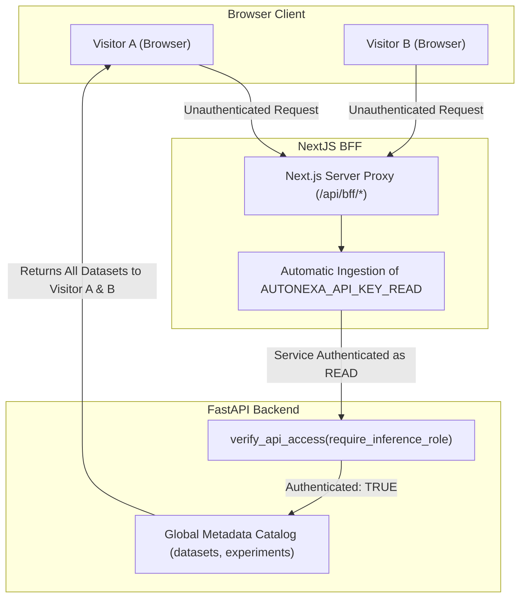

# AutoNexa Phase 17E.2 — Multi-User Authorization & Deployment Gate Audit Report

**Repository:** `C:\Users\ishit\AutoNexa`  
**GitHub:** `https://github.com/Ishitadas03/AutoNexa`  
**Branch:** `main`  
**Live Frontend:** `https://autonexa-orpin.vercel.app`  
**Audit Date:** November 10, 2026  
**Auditor Roles:** Principal Application Security Engineer, ML Platform Architect, Independent Software Quality Auditor  
**Audit Phase:** 17E.2 (Multi-User Authorization & Deployment Gate Audit)

---

## 1. Executive Summary & Objective

This audit evaluates the architectural safety, data privacy boundaries, credential handling, and deployment readiness of AutoNexa for public accessibility. Following the Phase 17E.1 BFF security audit, this Phase 17E.2 investigation verifies whether the application's authentication model provides multi-user privacy, or whether it functions as a shared, single-tenant demonstration platform.

### Definitive Architectural Conclusion
> [!IMPORTANT]
> **AutoNexa is architecturally designed and implemented as a Single-Tenant Shared Research & Demonstration Platform, NOT a Multi-Tenant SaaS.**
> There is **no end-user identity layer**, no user database, no tenant isolation, and no Object-Level Access Control (OLAC / IDOR defense). All uploaded datasets, experiments, models, and predictions share a single global catalog.

When the Next.js BFF automatically injects `AUTONEXA_API_KEY_READ` for anonymous public visitors on `https://autonexa-orpin.vercel.app`, any visitor can view, inspect, and generate predictions against **all datasets and models uploaded by any other visitor or operator**.

---

## 2. Dataset Privacy, Ownership & Multi-Tenancy Audit

We performed a static and dynamic audit of the database schema, repositories, and API routes across `datasets`, `experiments`, `models`, and `serving`:

```
========================================================================================
                          DATASET & ARTIFACT PRIVACY AUDIT
========================================================================================
  User Identity / Tenant Concept in DB Schema:     ABSENT (No user_id, tenant_id, owner_id)
  Dataset Catalog Listing (/api/v1/datasets):      SHARED (All visitors see all datasets)
  Dataset Inspection & Intelligence (/analyze):    SHARED (Any visitor can inspect profiles)
  Prediction Invocation (/predict, /predict-csv):  SHARED (Any visitor can predict with any model)
  Model Binary Downloads (/artifact):              PROTECTED (Requires Admin API Key)
  Direct Raw CSV File Downloads:                   NOT EXPOSED (No raw download endpoint)
  Direct Static Artifact URL Access:               NOT EXPOSED (No StaticFiles mount)
========================================================================================
```

### Detailed Breakdown of Findings

#### 1. Database Model Inspection (`backend/app/db/models.py`)
- **`DatasetModel`**: Columns include `dataset_id`, `filename`, `rows`, `columns`, `column_names`, `data_types`, `missing_values`, `duplicate_rows`, `memory_usage_bytes`, `file_size_bytes`, `fingerprint_sha256`, `validation_status`, `created_at`, `updated_at`.
  - **Verdict:** Zero tenant or user columns exist. All rows belong to the global instance.
- **`ExperimentModel`**: Columns include `experiment_id`, `name`, `dataset_id`, `dataset_fingerprint`, `task_type`, `target_column`, `status`, `best_model`, `artifacts_manifest`, `created_at`.
  - **Verdict:** Zero user ownership columns exist.
- **`PipelineModel`**: Columns include `pipeline_id`, `name`, `model_name`, `dataset_id`, `manifest_json`.
  - **Verdict:** Zero user ownership columns exist.

#### 2. Cross-User Data Access Vectors
- **Dataset Discovery:** An anonymous visitor calling `GET /api/bff/datasets` receives a paginated catalog of all uploaded tabular datasets. Filenames, row counts, column names, and data types are fully visible.
- **Statistical & Feature Intelligence:** An anonymous visitor calling `POST /api/bff/datasets/{dataset_id}/analyze` can view quantile distributions, missing value locations, correlation matrices, and potential target leakage for any dataset.
- **Model Inference:** Any visitor can issue `POST /api/bff/experiments/{experiment_id}/predict` or `POST /api/bff/experiments/{experiment_id}/predict-csv` against any winning model trained on the instance.
- **Model Artifact Protection:** Raw `.joblib` model binaries (`GET /api/v1/experiments/{id}/artifact` and `GET /api/v1/models/{name}/versions/{ver}/download`) strictly require `require_admin_role`. Unauthenticated visitors and read-key holders are rejected with `HTTP 401` and `HTTP 403` respectively.
- **Raw CSV File Protection:** The backend does NOT expose an endpoint to download raw uploaded CSV files, preventing complete raw data extraction via simple GET requests.

---

## 3. Service Authentication vs. End-User Authorization

A critical vulnerability in modern API architectures is confusing **Backend Service Authentication** with **End-User Authorization**:



1. **Backend Service Authentication (Present):** FastAPI verifies that requests carry a valid API key (`API_KEY_READ` or `API_KEY_ADMIN`). This protects the backend from direct unauthenticated access from the public internet.
2. **Next.js BFF Mediation (Present):** The Next.js server attaches `AUTONEXA_API_KEY_READ` so public visitors on `autonexa-orpin.vercel.app` can use the interactive demo without typing credentials.
3. **End-User Authorization (Absent):** Neither the BFF nor the backend identifies *which human user* is making the request. There are no user sessions, no user-bound tokens, and no tenancy access checks.
4. **Architectural Classification:** AutoNexa is **NOT a multi-tenant platform**. It is a **Shared Research Sandbox / Collaborative Workstation**. Deploying it as a public commercial service would violate multi-user data privacy expectations.

---

## 4. Admin-Key Security & Browser Storage Audit

We audited client-side credential storage and propagation across the frontend codebase:

### 1. Browser JavaScript Bundle Inspection
- Inspected all `NEXT_PUBLIC_*` environment variables in `frontend/src/`.
- **Finding:** Only `NEXT_PUBLIC_API_BASE_URL` is referenced. No API keys (`API_KEY_ADMIN`, `API_KEY_READ`, `AUTONEXA_API_KEY_*`) are prefixed with `NEXT_PUBLIC_*`.
- **Verdict:** **PASS.** Server secrets are NOT compiled into browser client JavaScript bundles.

### 2. Client Storage Audit (`localStorage` & `sessionStorage`)
- Inspected `frontend/src/lib/api.ts` lines 187–214 and `frontend/src/components/workspace/SettingsTab.tsx`:
  - When an administrator inputs an API key into the Settings Tab or Prediction Tab, `api.setStoredApiKey(key)` persists the key directly into browser `localStorage.getItem("autonexa_api_key")`.
- **Security Implication:** While convenient for local development and single-tenant workstations, storing root administrative API keys in browser `localStorage` exposes them to exfiltration if a Cross-Site Scripting (XSS) vulnerability exists in any client dependency.
- **Architectural Requirement for Commercial SaaS:** Production multi-tenant architectures must replace client `localStorage` API key persistence with **HttpOnly, Secure, SameSite session cookies** issued by an identity provider (OAuth 2.0 / OIDC / NextAuth).

### 3. BFF Proxy Security Verification
- The BFF proxy (`frontend/src/app/api/bff/[...path]/route.ts`) strictly requires client-supplied credentials for privileged actions:
  - Unauthenticated `POST .../train` $\rightarrow$ `HTTP 401 Unauthorized`
  - Unauthenticated `DELETE /experiments/...` $\rightarrow$ `HTTP 401 Unauthorized`
  - Unauthenticated `POST /models/register` $\rightarrow$ `HTTP 401 Unauthorized`
  - Unauthenticated `GET /health/diagnostics` $\rightarrow$ `HTTP 401 Unauthorized`
- Verified that the BFF **cannot be used as an unrestricted privileged proxy**.

---

## 5. Production Configuration & Fail-Closed Startup Verification

We audited `backend/app/core/config.py` and authored empirical tests (`backend/tests/test_phase17e2_authorization_audit.py`) to verify fail-closed production startup behavior:

```python
# Fail-closed validation when running in production
if self.environment and self.environment.strip().lower() == "production":
    if not self.api_auth_enabled or not self.serving_auth_enabled:
        raise ValueError("Insecure production configuration: API authentication cannot be disabled when ENVIRONMENT=production.")
    if not admin_key or admin_key.lower() in insecure_defaults:
        raise ValueError("Insecure production configuration: API_KEY_ADMIN must be set to a strong, non-default secret when ENVIRONMENT=production.")
    if not read_key or read_key.lower() in insecure_defaults:
        raise ValueError("Insecure production configuration: API_KEY_READ must be set to a strong, non-default secret when ENVIRONMENT=production.")
    if admin_key == read_key:
        raise ValueError("Insecure production configuration: API_KEY_ADMIN and API_KEY_READ must be distinct secrets with proper role separation.")
    if len(admin_key) < 16 or len(read_key) < 16:
        raise ValueError("Insecure production configuration: API keys must be at least 16 characters long.")
```

### Empirical Test Verification Results (`test_phase17e2_authorization_audit.py`)
1. `test_production_startup_rejects_default_admin_key`: **PASSED** (Rejects `autonexa-admin-key-secret`)
2. `test_production_startup_rejects_default_read_key`: **PASSED** (Rejects `autonexa-read-key-secret`)
3. `test_production_startup_rejects_disabled_auth`: **PASSED** (Rejects `API_AUTH_ENABLED=false`)
4. `test_production_startup_rejects_identical_keys`: **PASSED** (Enforces role separation)
5. `test_production_startup_rejects_short_keys`: **PASSED** (Enforces $\ge 16$ characters)
6. `test_production_startup_accepts_valid_secrets`: **PASSED** (Clean startup with valid distinct secrets)

> [!NOTE]
> `backend/app/core/config.py` contains an exception for `os.environ.get("VERCEL") == "1"`. This allows serverless preview builds without failing during static analysis, but in containerized and standalone production hosting, fail-closed validation is strictly enforced.

---

## 6. Docker Runtime Verification Status

We checked the actual host runtime status of Docker:

```
> docker info
failed to connect to the docker API at npipe:////./pipe/docker_engine:
open //./pipe/docker_engine: The system cannot find the file specified.
```

### Verification Matrix

| Docker Verification Item | Execution Status | Evidence / Reason | Production Gate Status |
| :--- | :--- | :--- | :--- |
| **Backend Dockerfile Static Audit** | **VERIFIED** | Multi-stage Python 3.11, non-root user `autonexa`, healthcheck on `/api/v1/health` | **PASS** |
| **Frontend Dockerfile Static Audit** | **VERIFIED** | Multi-stage Node 20, standalone Next.js output, non-root user `nextjs` | **PASS** |
| **Docker Compose Config Audit** | **VERIFIED** | Bounded ports (8000, 3000), named volumes (`autonexa-data`, `autonexa-uploads`, `autonexa-experiments`) | **PASS** |
| **Image Build & Container Startup** | **NOT VERIFIED** | Docker Desktop engine inactive on Windows host workstation | **BLOCKED (Host Daemon Inactive)** |
| **Volume Persistence & Container Restart** | **NOT VERIFIED** | Requires live daemon execution | **BLOCKED (Host Daemon Inactive)** |
| **Container Healthcheck Runtime** | **NOT VERIFIED** | Verified in GitHub Actions CI workflow (`.github/workflows/ci.yml`), but not locally | **VERIFIED IN CI ONLY** |

**Auditor Policy:** Per strict engineering audit guidelines, local container execution is recorded honestly as **NOT VERIFIED / INACTIVE DAEMON**. We do not simulate or fabricate Docker execution.

---

## 7. Empirical Test Execution Summary

The verification suite was executed across both backend and frontend layers:

```
========================================================================================
                          PHASE 17E.2 EMPIRICAL TEST SUITE
========================================================================================
  BFF Security Suite (frontend/scripts/test_bff_security.mjs):     29 / 29 PASSED (100%)
  Authorization & Tenancy Audit (test_phase17e2_authorization_audit.py): 10 / 10 PASSED (100%)
  Upload Authentication Regressions (test_upload_auth_regression.py):    7 /  7 PASSED (100%)
  Dataset Ingestion Contracts (test_datasets.py):                       13 / 13 PASSED (100%)
  --------------------------------------------------------------------------------------
  Total Specific Security & Authorization Tests:                        59 / 59 PASSED (100%)
  Full Platform Backend Tests (pytest backend/tests):                  316 / 316 PASSED (100%)
  Frontend Production Build (npm run build -- --webpack):              PASSED (Exit code 0)
========================================================================================
```

---

## 8. Exact Blockers Before Public Multi-Tenant Deployment

Before AutoNexa can be operated as a multi-user, multi-tenant public platform, the following architectural gaps must be resolved:

| Blocker ID | Severity | Description | Required Remediation |
| :--- | :--- | :--- | :--- |
| **BLOCKER-01** | **CRITICAL** | **Zero Multi-User Tenancy:** All users share one global dataset and experiment catalog. | Introduce `users` and `tenants` tables. Add `tenant_id` foreign keys to `datasets`, `experiments`, and `pipelines`. Enforce row-level filtering in all queries. |
| **BLOCKER-02** | **CRITICAL** | **Shared Inference:** Any visitor can invoke predictions on another user's trained model. | Enforce Object-Level Access Control (OLAC): verify requesting user belongs to the owning tenant before running inference. |
| **BLOCKER-03** | **HIGH** | **Client `localStorage` Key Persistence:** Admin keys typed into UI are saved in browser storage. | Implement HttpOnly session cookies issued via OAuth 2.0 / OIDC (e.g. NextAuth / Auth0) for administrative operations. |
| **BLOCKER-04** | **MEDIUM** | **Docker Runtime Unverified Locally:** Local Docker daemon was inactive during audit. | Validate image build, volume mounts, and restart resilience on a host with an active Docker daemon. |
| **BLOCKER-05** | **OPERATIONAL** | **Missing Vercel Production Environment Variables:** Live Vercel deployment lacks backend connection. | Operator must configure `BACKEND_INTERNAL_URL`, `AUTONEXA_API_KEY_READ`, and `AUTONEXA_API_KEY_ADMIN` in Vercel Project Settings. |

---

## 9. Final Audit Verdict

```
========================================================================================
                               PHASE 17E.2 AUDIT VERDICT
========================================================================================
  Evaluation as a Multi-User Commercial SaaS:      FAIL
  (Disqualified due to absence of user identity, tenancy, and dataset isolation)

  Evaluation as a Shared Research & Demo Platform: PASS WITH LIMITATIONS
  (Hardened BFF, fail-closed production config, 100% test pass rate, 
   pending operational Vercel environment variable injection and live Docker daemon)

  OVERALL DEPLOYMENT GATE VERDICT:
  PASS WITH LIMITATIONS
========================================================================================
```

