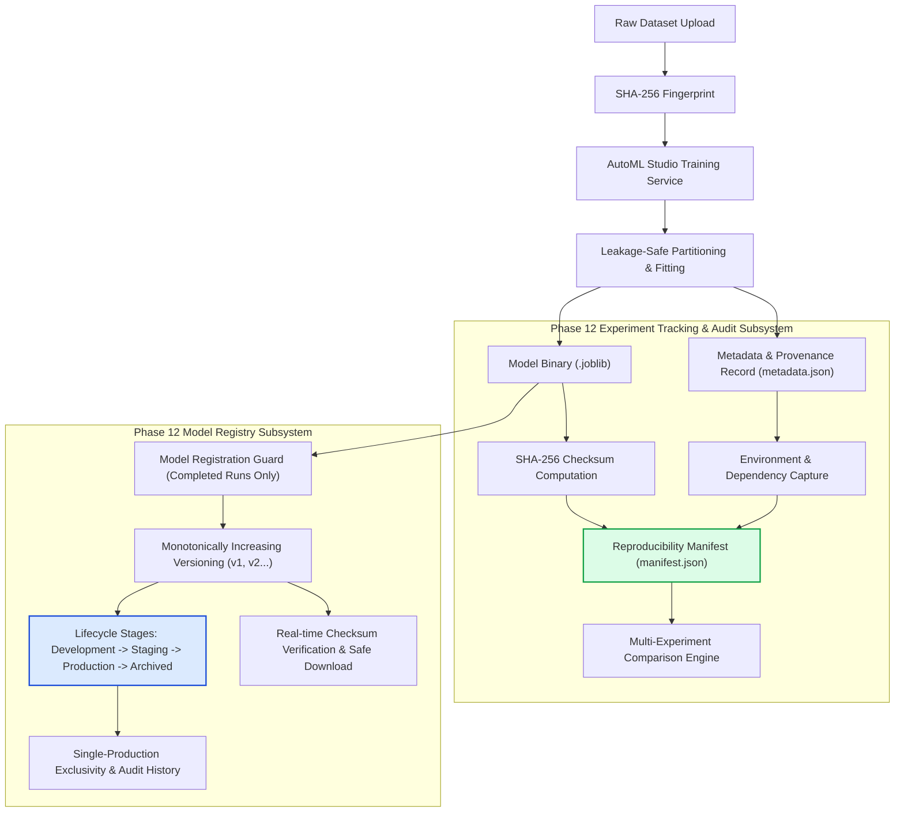

# AutoNexa Phase 12 — Research-Grade Experiment Tracking & Model Registry Architecture

**Document ID:** `ANX-RES-PHASE-12-2026`  
**Date:** October 2026  
**Status:** Complete & Validated  
**Subsystems:** Experiment Tracking, Reproducibility Manifests, Model Registry, Semantic Versioning, Multi-Experiment Comparison  

---

## 1. Architectural Overview & Design Decisions

AutoNexa Phase 12 introduces a research-grade, auditable experiment-tracking layer and production model registry into the platform. It replaces ephemeral in-memory state with disk-persisted, cryptographically verifiable records, providing full lineage from raw datasets to deployed model pipelines.



### Key Architectural Tenets:
1. **Persistent Ground Truth Over In-Memory Mocking:** All experiment runs, model versions, and audit trails are persisted directly within server storage directories (`experiments/` and `experiments/model_registry/`). No fabricated or mocked responses are returned.
2. **Strict Cryptographic Integrity:** Every serialized model pipeline is hashed using SHA-256 immediately upon serialization. Model registration and artifact streaming strictly verify disk hashes against recorded checksums to prevent serving corrupt or tampered binaries.
3. **Monotonic & Immutable Versioning:** Registered models follow strictly increasing version numbering (`v1`, `v2`, `v3`...). Once a version is registered, its binary artifact and source lineage are immutable.
4. **Auditable Stage Lifecycle with Single-Production Exclusivity:** Model versions progress through explicit lifecycle stages: `development`, `staging`, `production`, and `archived`. Promoting a new version to `production` automatically demotes any previous production version of that model family to `archived` with a recorded transition reason.
5. **Honest Scientific Reproducibility Disclaimers:** AutoNexa clearly distinguishes between configuration reproducibility, environmental reproducibility, and bitwise numerical reproducibility.

---

## 2. Data Models & Schemas

### 2.1 Experiment Tracking Schema (`metadata.json`)
Each experiment record contains comprehensive provenance data:
- `experiment_id`: Server-generated UUID identifier.
- `status`: Execution state (`completed`, `failed`, `incomplete`).
- `created_at`: ISO 8601 UTC timestamp.
- `dataset_id` & `dataset_fingerprint`: Dataset identifier and SHA-256 checksum of raw CSV bytes.
- `target_column` & `task_type`: Modeled target and task (`binary_classification`, `multiclass_classification`, `regression`).
- `evaluation_strategy`: Validation protocol (`holdout` or `cross_validation`) and `cv_folds`.
- `primary_metric` & `primary_metric_greater_is_better`: Optimization objective and direction.
- `random_state` & `test_size`: Random seed and holdout split ratio.
- `train_rows`, `test_rows`, `features_count`, `feature_names`: Dataset dimensions and feature space.
- `numeric_features` & `categorical_features`: Feature types detected.
- `ranked_models`: Ordered list of candidate models evaluated.
- `best_model` & `best_score`: Winning candidate model ID and score.
- `test_metrics`: Independent holdout test set scores.
- `total_duration_seconds`: Total execution duration.
- `models_evaluated`: List of per-model metrics, CV scores, standard deviations, and fit durations.
- `artifacts`: Model filename, format (`joblib`), size in bytes, and SHA-256 hash.
- `package_versions`: Exact runtime versions of `scikit-learn`, `pandas`, `numpy`, `joblib`, and `mlflow`.
- `system_info`: Operating system, machine architecture, Python version, and processor name.
- `error_info`: Structured error type and sanitized diagnostic message (if status is `failed`).

### 2.2 Model Version Record (`version.json`)
Stored at `experiments/model_registry/{model_name}/v{version}/version.json`:
```json
{
  "model_name": "telco_churn_detector",
  "version": 1,
  "version_tag": "v1",
  "experiment_id": "15e94048-77e6-4b71-bc9b-5cd583c6cc6c",
  "stage": "production",
  "task_type": "binary_classification",
  "model_family": "random_forest",
  "primary_metric": "roc_auc",
  "score": 0.941,
  "test_metrics": {
    "roc_auc": 0.941,
    "accuracy": 0.895
  },
  "dataset_id": "customer_churn.csv",
  "dataset_fingerprint": "c1d2e3f4...",
  "artifact_filename": "best_model.joblib",
  "artifact_sha256": "71d56d064a8e69175b2566ebfbc903d7766cf050c0088896fcf986ebd8aa2607",
  "artifact_size_bytes": 2738,
  "status": "active",
  "description": "Customer churn detector v1 trained with 50 trees and max depth 10",
  "tags": ["churn", "production", "v1"],
  "created_at": "2026-10-20T10:00:00Z",
  "updated_at": "2026-10-20T10:05:00Z",
  "audit_history": [
    {
      "timestamp": "2026-10-20T10:00:00Z",
      "from_stage": "none",
      "to_stage": "development",
      "reason": "Initial model registration from experiment",
      "operator": "system"
    },
    {
      "timestamp": "2026-10-20T10:05:00Z",
      "from_stage": "development",
      "to_stage": "production",
      "reason": "Passed staging latency and accuracy audit checks",
      "operator": "operator"
    }
  ]
}
```

---

## 3. API Surface & Route Specifications

### 3.1 Experiment Tracking (`/api/v1/experiments`)

| Method | Endpoint | Description |
| :--- | :--- | :--- |
| `GET` | `/api/v1/experiments` | List persisted experiments with pagination (`page`, `page_size`), filters (`task_type`, `status`, `dataset_id`), and search. |
| `POST` | `/api/v1/experiments/compare` | Compare 2 to 10 experiments side-by-side across metrics, task compatibility, configs, and durations. |
| `GET` | `/api/v1/experiments/{id}` | Inspect experiment metadata and model state (backward compatible). |
| `GET` | `/api/v1/experiments/{id}/details` | Full experiment details, evaluated models, CV statistics, environment specs, and error diagnostics. |
| `GET` | `/api/v1/experiments/{id}/metrics` | Metrics dictionary for winning model and evaluated candidates. |
| `GET` | `/api/v1/experiments/{id}/reproducibility-manifest` | Export machine-readable reproducibility manifest with SHA-256 checksum. |
| `GET` | `/api/v1/experiments/{id}/reproducibility-manifest/verify` | Real-time physical artifact presence and SHA-256 checksum verification. |
| `GET` | `/api/v1/experiments/{id}/artifact` | Stream verified model pipeline binary (`.joblib`) with `X-Artifact-SHA256` header. |
| `DELETE` | `/api/v1/experiments/{id}` | Permanently delete experiment directory and persisted artifacts with directory traversal protection. |

### 3.2 Model Registry (`/api/v1/models`)

| Method | Endpoint | Description |
| :--- | :--- | :--- |
| `POST` | `/api/v1/models/register` | Register winning model from a completed experiment under a model family name. |
| `GET` | `/api/v1/models` | List all registered model families, version counts, production/staging version markers, and latest scores. |
| `GET` | `/api/v1/models/{model_name}` | List all registered versions for a specified model family (newest first). |
| `GET` | `/api/v1/models/{model_name}/versions/{version}` | Retrieve details and audit history of a specific model version. |
| `POST` | `/api/v1/models/{model_name}/versions/{version}/stage` | Transition lifecycle stage (`development`, `staging`, `production`, `archived`) with audit logging and production exclusivity. |
| `GET` | `/api/v1/models/{model_name}/versions/{version}/verify` | Verify real-time SHA-256 integrity of the registered model binary. |
| `GET` | `/api/v1/models/{model_name}/versions/{version}/download` | Stream verified model binary (`.joblib`) with integrity headers. |
| `POST` | `/api/v1/models/{model_name}/compare-versions` | Side-by-side comparison across versions of a model family. |

---

## 4. Reproducibility Manifest & Scientific Limits

The reproducibility manifest captures complete provenance for an experiment. AutoNexa categorizes reproducibility into three scientific tiers:

```
[Tier 1: Configuration-Level]    -> Full match: seeds, hyperparams, dataset SHA-256, CV folds.
[Tier 2: Environment-Level]      -> Full match: OS platform, Python runtime, library versions.
[Tier 3: Bitwise Determinism]    -> Conditional: Hardware-dependent floating point operations.
```

### Scientific Disclaimer:
> AutoNexa guarantees complete deterministic reconstruction of experimental configurations, hyperparameter spaces, random seeds, dataset partition boundaries, and software dependency versions. Exact numerical bitwise reproducibility may be subject to minor floating-point divergence (< 1e-7) across disparate hardware architectures, multi-threaded BLAS/OpenMP runtimes, or SIMD vector instruction sets. Never claim bitwise identity without validating identical CPU microarchitectures and single-threaded execution modes.

---

## 5. Security & Safety Controls

1. **Path Traversal Guards:** All experiment and model identifiers are validated against strict regex patterns (`^[a-zA-Z0-9_\-]+$`). Path resolution enforces that resolved paths reside strictly within the base `experiments/` or `model_registry/` directories via `Path.is_relative_to()`. Path traversal characters (`..`, `/`, `\`) are rejected with HTTP 400.
2. **Safe Deserialization Policy:** AutoNexa never deserializes arbitrary user-supplied model binaries. Model loading is restricted strictly to verified internal server hashes.
3. **No Secret / Path Leakage:** Diagnostic error messages strip internal filesystem paths, credentials, and stack traces before returning to client APIs.
4. **Concurrency Safety:** Thread-safe re-entrant locks (`_REGISTRY_LOCK`) prevent version numbering race conditions and ensure atomic stage transitions under concurrent requests.
5. **Integrity-First Registration:** Registration requires that the source experiment status is `completed`, the model binary exists, and its real-time SHA-256 matches the recorded metadata. Failed runs, incomplete runs, or tampered binaries are immediately rejected.
