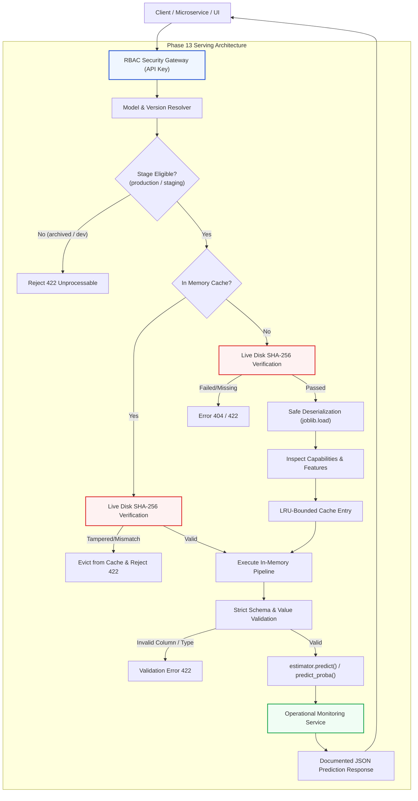

# AutoNexa Phase 13 — Secure Model Serving & Deployment Architecture

**Document ID:** `ANX-RES-PHASE-13-2026`  
**Date:** October 2026  
**Status:** Complete & Validated  
**Subsystems:** Model Serving, Cryptographic Verification, Lifecycle Eligibility, Role-Based Access Control, Operational Monitoring, Frontend Serving Workspace  

---

## 1. Architectural Overview & Design Philosophy

AutoNexa Phase 13 introduces a high-performance, secure model serving and inference subsystem into the platform. Bridging the gap between registered offline model artifacts and real-time operational deployment, Phase 13 enables low-latency tabular predictions driven by verified registered model versions.



### Core Design Principles:
1. **Zero Fabricated Inference:** All predictions are produced strictly by executing verified Scikit-Learn pipelines serialized during empirical AutoML training runs. No simulated, interpolated, or fabricated responses are returned.
2. **Pre-Invocation Disk Cryptographic Integrity:** In-memory caching does not bypass artifact integrity. Every inference request cryptographically re-verifies the on-disk `.joblib` binary against the canonical SHA-256 recorded in `version.json`. If a binary on disk is modified or corrupted after being cached, the cache entry is immediately evicted and an integrity error is returned.
3. **Explicit Deployment Lifecycle Enforcement:** Only versions promoted to explicit serving stages (by default `production` and `staging`) can serve live predictions. `development` and `archived` models are strictly barred from inference to eliminate deployment errors.
4. **Defense-in-Depth Authentication (RBAC):** Endpoints enforce API Key authentication via `X-API-Key` or `Authorization: Bearer <key>` headers with constant-time cryptographic verification (`secrets.compare_digest`), distinguishing `inference` read privileges from `admin` operational privileges (e.g., cache invalidation).
5. **Strict Schema & Type Enforcement:** Input feature columns are strictly validated against model metadata: unexpected columns, missing required features, and non-scalar JSON values (nested dictionaries/lists) are rejected with clear, safe error messages that never leak server filesystem paths.
6. **Privacy-Conscious Operational Telemetry:** Real-time request counts, success/failure counts, validation errors, and microsecond latency statistics are tracked using bounded in-memory sliding windows. Raw feature values and inference payloads are never logged or stored.

---

## 2. Security Boundaries & Authentication

AutoNexa provides an authentication and authorization layer dedicated to serving operations.

### 2.1 Role-Based Access Control (RBAC) Hierarchy

| Role | Scope | Permitted Endpoints | Credentials |
| :--- | :--- | :--- | :--- |
| **Anonymous** | Unprotected / Disabled mode | When `serving_auth_enabled=False`, all endpoints are open for local dev. | None |
| **Inference / Read** | Read-only serving | `GET /api/v1/serving/models`<br>`GET /api/v1/serving/models/{name}/versions/{ver}`<br>`GET /api/v1/serving/models/{name}/versions/{ver}/health`<br>`POST /api/v1/serving/models/{name}/predict`<br>`POST /api/v1/serving/models/{name}/versions/{ver}/predict`<br>`GET /api/v1/serving/metrics` | Header: `X-API-Key: <read-key>` or `Authorization: Bearer <read-key>` |
| **Admin** | Privileged maintenance | All Inference endpoints **plus**:<br>`POST /api/v1/serving/cache/invalidate`<br>`POST /api/v1/serving/models/{name}/versions/{ver}/cache/invalidate` | Header: `X-API-Key: <admin-key>` or `Authorization: Bearer <admin-key>` |

### 2.2 Credential Configuration

API keys are configured through environment variables or `.env` files:
- `AUTONEXA_SERVING_AUTH_ENABLED`: Boolean toggle (default `True`).
- `AUTONEXA_SERVING_API_KEY_READ`: Shared secret for inference callers (default: `autonexa-read-key-secret`).
- `AUTONEXA_SERVING_API_KEY_ADMIN`: High-privilege secret for operational cache flushing (default: `autonexa-admin-key-secret`).

### 2.3 Timing-Attack Resistance

All API key checks utilize Python's `secrets.compare_digest(provided_key, configured_key)` to guarantee constant-time string comparison and mitigate timing-based side-channel attacks.

---

## 3. Deployment Lifecycle & Version Resolution

AutoNexa supports explicit model deployment states managed through the versioned model registry.

### 3.1 Stage Progression & Serving Eligibility

```
[Development]  ---- (Promote) ---> [Staging] ---- (Promote) ---> [Production]
      |                                |                               |
      +-------- (Demote/Retire) -------+-------------------------------+
                                       |
                                       v
                                  [Archived] (Inference Ineligible)
```

- **Production:** The primary operational version for real-time serving. Under single-production exclusivity, promoting a new version to `production` automatically archives the preceding production version.
- **Staging:** Pre-release verification version, eligible for inference testing and shadow traffic.
- **Development & Archived:** Ineligible for inference. If a client attempts to invoke `/predict` on an archived or development model version, the serving engine rejects the request with HTTP `422 Unprocessable Entity`.

### 3.2 Dynamic Active Version Resolution

Clients can target specific versioned endpoints:
`POST /api/v1/serving/models/{model_name}/versions/{version}/predict`

Or call the active deployment gateway:
`POST /api/v1/serving/models/{model_name}/predict`

The active gateway resolves versions in deterministic order:
1. Active version in `production` stage.
2. If no version is currently in `production`, falls back to the highest active version in `staging`.
3. If no eligible versions exist in either stage, returns HTTP `404 Not Found` with a clear explanation that no eligible serving version is available.

---

## 4. Cryptographic Integrity & Model Caching

### 4.1 Live Disk SHA-256 Verification

To guard against unauthorized filesystem tampering, malware insertion, or silent bitrot:
1. Prior to loading a model from disk, `ModelServingService` calculates the SHA-256 hash of the `.joblib` binary file.
2. The calculated hash is compared against `artifact_sha256` recorded in the version's immutable `version.json` metadata.
3. If the hash differs or the file cannot be accessed, model deserialization is aborted and HTTP `422 Unprocessable Entity` is returned with `integrity_verified=false`.

### 4.2 Cache Consistency Under Tampering

```python
# Verification precedence in _get_or_load_model:
# 1. Always verify the physical file on disk first
verified, actual_hash, _ = self.registry.verify_version_artifact(model_name, version)
if not verified:
    # If file was modified or deleted on disk, invalidate any existing in-memory cache
    if cache_key in _GLOBAL_MODEL_CACHE:
        del _GLOBAL_MODEL_CACHE[cache_key]
    raise HTTPException(status_code=422, detail="Artifact verification failed...")
```

If an adversary alters a model file on disk after it has been cached in memory, subsequent prediction calls immediately fail the disk SHA-256 check, purge the compromised pipeline from memory, and record an integrity error metric.

---

## 5. Model Capability & Schema Inspection

Registered models vary across algorithms, task types, and library versions. Phase 13 dynamically inspects pipeline capabilities upon loading:

- **Estimator Capability Inspection:** Inspects `hasattr(model, "predict_proba")` or terminal estimator within a `Pipeline`. If present, probability distributions are computed and returned as a list of class-probability mappings. If absent (or for regression tasks), `probabilities` is safely set to `None`.
- **Target & Class Labels:** Detects `classes_` attribute on classifiers to map numeric outputs to meaningful class labels.
- **Strict Schema Validation:**
  - Feature count must match `feature_names`.
  - All expected columns must be present in every record.
  - Unexpected extra columns are rejected to prevent parameter smuggling and silent column shifts.
  - Non-scalar values (nested JSON objects, lists) are rejected.
  - Batch sizes are capped at 1,000 records per request to prevent denial-of-service exhaustion.

---

## 6. Operational Telemetry & Monitoring

AutoNexa incorporates a lightweight `ServingMonitoringService` singleton:

- **Metrics Tracked:** Total requests, successful requests, failed requests, validation errors, integrity errors, minimum latency, maximum latency, average latency, and p50/p95 latency percentiles.
- **Per-Model Sub-counters:** Tracks traffic volume, error rates, and average latency per model version.
- **Bounded In-Memory Buffer:** Latency measurements are stored in a fixed-size circular buffer (`deque(maxlen=1000)`), preventing memory leaks in high-throughput environments.
- **Distinction from Drift Monitoring:** This telemetry represents *operational service performance* (availability, error rates, latencies). It does not claim statistical dataset drift detection (e.g. KS tests or PSI), which belongs in dedicated data quality services.

---

## 7. API Specification & Examples

### 7.1 List Serving Models
```http
GET /api/v1/serving/models HTTP/1.1
Host: localhost:8000
X-API-Key: autonexa-read-key-secret
```

Response (`200 OK`):
```json
[
  {
    "model_name": "customer_churn_model",
    "active_version": 2,
    "active_stage": "production",
    "task_type": "binary_classification",
    "model_family": "Random Forest Classifier",
    "primary_metric": "roc_auc",
    "score": 0.942,
    "serving_status": "active",
    "available_versions": [1, 2],
    "production_version": 2,
    "staging_version": 1
  }
]
```

### 7.2 Model Version Health Check
```http
GET /api/v1/serving/models/customer_churn_model/versions/2/health HTTP/1.1
Host: localhost:8000
X-API-Key: autonexa-read-key-secret
```

Response (`200 OK`):
```json
{
  "status": "healthy",
  "model_name": "customer_churn_model",
  "version": 2,
  "stage": "production",
  "artifact_verified": true,
  "loaded_in_cache": true,
  "message": "Model version 2 is verified on disk and ready for inference."
}
```

### 7.3 Real-Time Prediction
```http
POST /api/v1/serving/models/customer_churn_model/versions/2/predict HTTP/1.1
Host: localhost:8000
Content-Type: application/json
X-API-Key: autonexa-read-key-secret

{
  "records": [
    {
      "tenure": 24,
      "monthly_charges": 65.5,
      "contract": "One year",
      "internet_service": "Fiber optic",
      "tech_support": "Yes"
    }
  ]
}
```

Response (`200 OK`):
```json
{
  "model_name": "customer_churn_model",
  "version": 2,
  "version_tag": "v2",
  "stage": "production",
  "task_type": "binary_classification",
  "records_count": 1,
  "predictions": [0],
  "probabilities": [
    {
      "0": 0.842,
      "1": 0.158
    }
  ],
  "latency_ms": 1.94,
  "timestamp": "2026-10-20T14:40:00Z"
}
```

### 7.4 Invalidate Model Cache (Admin Privileged)
```http
POST /api/v1/serving/models/customer_churn_model/versions/2/cache/invalidate HTTP/1.1
Host: localhost:8000
X-API-Key: autonexa-admin-key-secret
```

Response (`200 OK`):
```json
{
  "model_name": "customer_churn_model",
  "version": 2,
  "evicted": true,
  "message": "Cached instance for customer_churn_model v2 successfully evicted."
}
```

---

## 8. Critical Infrastructure Boundaries & Limitations

To ensure absolute transparency and prevent misleading claims regarding cloud architecture:

1. **Local Host Serving vs Cloud Orchestration:** AutoNexa Phase 13 serves predictions directly from the active FastAPI server process on the host machine. It **does not** automatically provision Kubernetes clusters, AWS SageMaker endpoints, Google Cloud Vertex AI, or Knative serverless runtimes.
2. **In-Process Concurrency & Multi-Process Caching:** The in-memory cache is maintained in the FastAPI application process. In a multi-worker deployment (e.g. `gunicorn -w 4`), each worker process maintains its own independent in-memory cache. Cache invalidation on one worker does not broadcast to sibling workers without an external message broker (e.g., Redis pub/sub).
3. **Filesystem Persistence:** Model binaries and registry metadata are persisted on the local filesystem (`experiments/model_registry/`). Artifact persistence is not distributed across S3, GCS, or Azure Blob Storage unless the local volume is mapped to a cloud mount.
4. **Network Exposure:** AutoNexa should be deployed behind a secure reverse proxy (e.g., NGINX, Cloudflare) with HTTPS termination and rate limiting when exposed beyond private development environments.
