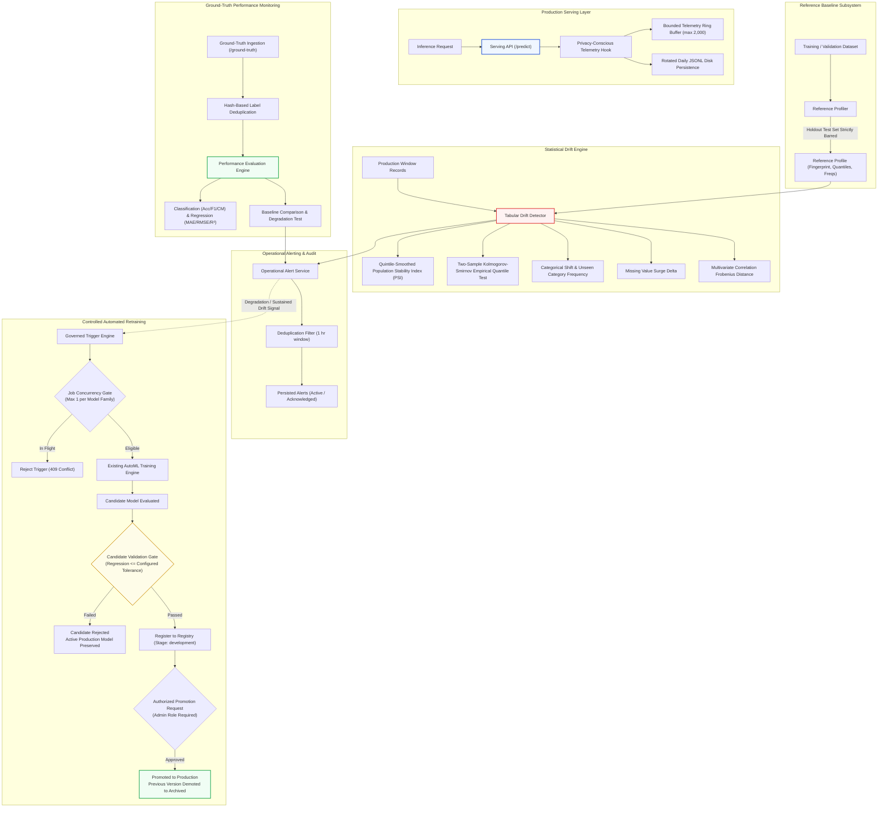

# AutoNexa Phase 14 — Model Monitoring, Drift Detection & Automated Retraining Architecture

**Document ID:** `ANX-RES-PHASE-14-2026`  
**Date:** October 2026  
**Status:** Complete & Validated  
**Subsystems:** Inference Telemetry, Baseline Reference Profiling, Statistical Drift Detection, Ground-Truth Performance Monitoring, Operational Alerting, Controlled Automated Retraining, Candidate Validation Gate, Role-Based Access Control, Frontend Monitoring Workspace  

---

## 1. Architectural Overview & Design Philosophy

AutoNexa Phase 14 establishes an enterprise-grade model monitoring, statistical data drift detection, ground-truth evaluation, and controlled automated retraining subsystem. Operating downstream from the model training, experiment tracking, model registry, and authenticated serving layers, Phase 14 enables continuous operational surveillance and governed lifecycle iteration for deployed tabular models.

### Core Design Principles:

1. **Zero Fabricated Metrics:** Drift statistics, p-values, ground-truth metrics, and candidate evaluation scores are calculated exclusively through deterministic mathematical algorithms and standard SciPy/Scikit-Learn routines. No synthetic scores or mocked dashboard placeholders are returned.
2. **Drift Does Not Equal Degradation:** Distribution drift indicates that incoming production data diverges statistically from the reference distribution. AutoNexa explicitly treats drift as an operational warning signal, never automatically equating feature drift with deteriorated model predictive quality.
3. **Strict Baseline Holdout Isolation:** Reference profiles are built exclusively from designated training, validation, or approved baseline data. The untouched holdout test partition is strictly prohibited from baseline profiling to prevent scientific data leakage.
4. **Controlled, Policy-Governed Retraining:** Retraining cannot be triggered unconditionally on single drift alerts or raw predictions. Trigger policies require confirmed ground-truth performance degradation, verified sustained drift, or explicit administrative authorization.
5. **Mandatory Candidate Validation Gate:** Retrained models are treated strictly as unverified candidates. A candidate model is never promoted automatically upon training completion; it must satisfy a mathematical validation gate against the active production model's baseline score before registration, followed by explicit administrative promotion.
6. **Privacy-Preserving Telemetry:** Telemetry records capture timestamps, model version, task type, record counts, latencies, and outcome codes. Raw customer feature vectors, confidential payloads, and API credentials are never logged by default.

---

## 2. Statistical Drift Detection Methodology

Tabular drift analysis compares feature distributions in an evaluated production monitoring window $Q$ against a reference baseline profile $P$.

### 2.1 Numerical Features

#### Population Stability Index (PSI)
For numerical features, reference values are partitioned into $k = 5$ quantile bins (quintiles, each encompassing approximately 20% of the baseline mass). To prevent truncation of tail values, boundary edges are extended to $(-\infty, \text{edge}_1]$ and $[\text{edge}_{k-1}, +\infty)$.

Given baseline bin proportions $p_i$ and current window bin proportions $q_i$, a Laplace smoothing parameter $\epsilon = 10^{-4}$ is added:

$$\tilde{p}_i = \frac{c_{p,i} + \epsilon}{\sum_j c_{p,j} + k\epsilon}, \quad \tilde{q}_i = \frac{c_{q,i} + \epsilon}{\sum_j c_{q,j} + k\epsilon}$$

The Population Stability Index is computed as:

$$\text{PSI} = \sum_{i=1}^k (\tilde{q}_i - \tilde{p}_i) \ln\left(\frac{\tilde{q}_i}{\tilde{p}_i}\right)$$

**Standard Operational Thresholds:**
- $\text{PSI} < 0.10$: Stable distribution (No Drift).
- $0.10 \le \text{PSI} < 0.20$: Moderate distribution shift (Warning).
- $\text{PSI} \ge 0.20$: Significant distribution shift (Drift Detected).

#### Two-Sample Kolmogorov-Smirnov (KS) Test
The two-sample KS test evaluates the null hypothesis that reference and current samples originate from the same continuous distribution:

$$D = \sup_x |F_{\text{ref}}(x) - F_{\text{cur}}(x)|$$

AutoNexa reconstructs the empirical reference cumulative distribution function using preserved quartile landmarks $(\text{min}, p_{25}, p_{50}, p_{75}, \text{max})$, performing monotonic piecewise interpolation to avoid assuming Gaussianity on uniform, exponential, or skewed features.

**Threshold:** Two-sided $p\text{-value} < 0.05$ flags statistical significance when combined with $\text{PSI} \ge 0.10$.

#### Constant Feature & Missingness Handling
- Features with near-zero reference standard deviation ($\sigma_{\text{ref}} \le 10^{-5}$) are treated as constant. If incoming samples maintain the exact constant value ($\Delta \le 10^{-3}$), $\text{PSI} = 0.0$ and $p = 1.0$. If the constant value changes, critical drift ($\text{PSI} = 1.0$) is flagged.
- Surges in missing value rates exceeding the configured delta threshold ($\Delta_{\text{missing}} \ge 0.20$) trigger automated data quality warnings.

### 2.2 Categorical Features

#### Categorical Frequency Shift & Categorical PSI
For discrete categories $\mathcal{C} = \mathcal{C}_{\text{ref}} \cup \mathcal{C}_{\text{cur}}$:

$$\text{PSI}_{\text{cat}} = \sum_{c \in \mathcal{C}} (q_c - p_c) \ln\left(\frac{q_c}{p_c}\right)$$

#### Unseen Category Detection
Categories present in the production window but entirely absent from the reference profile are tracked. When the frequency of unseen categories exceeds the configured threshold ($r_{\text{unseen}} \ge 0.10$), critical drift is triggered.

### 2.3 Multivariate Drift (Frobenius Correlation Shift)
To detect alterations in joint feature covariance without incurring prohibitive computational overhead, AutoNexa tracks the relative Frobenius distance between the Pearson correlation matrices of variance-bearing numerical features:

$$\Delta_{\text{corr}} = \frac{\|R_{\text{cur}} - R_{\text{ref}}\|_F}{\max(\|R_{\text{ref}}\|_F, 10^{-5})}, \quad \|A\|_F = \sqrt{\sum_{i,j} a_{ij}^2}$$

Columns with zero variance are purged prior to matrix calculation to eliminate divide-by-zero runtime errors. A relative shift exceeding $0.45$ flags a joint dependency alteration.

---

## 3. Ground-Truth Performance Monitoring

When verified ground-truth labels become available for historical predictions, AutoNexa computes genuine task-specific performance metrics.

### 3.1 Supported Evaluation Metrics

| Task Type | Primary & Secondary Metrics | Baseline Degradation Comparison |
| :--- | :--- | :--- |
| **Binary Classification** | Accuracy, Weighted Precision, Weighted Recall, Weighted F1, Confusion Matrix | Relative drop from baseline validation score |
| **Multiclass Classification** | Accuracy, Macro F1, Weighted F1, Confusion Matrix, Unique Class Sets | Relative drop from baseline validation score |
| **Regression** | Mean Absolute Error (MAE), Root Mean Squared Error (RMSE), $R^2$ Score | Relative surge in error metric (lower is better) |

### 3.2 Label Ingestion & Deduplication
- Labels are ingested via `POST /api/v1/monitoring/ground-truth`.
- Duplicate submissions for identical prediction IDs within the same model family are deduplicated, updating the recorded true label without inflating evaluation counts.
- Performance evaluation warns when sample size is below recommended statistical thresholds ($N < 30$), highlighting wide confidence bounds.

---

## 4. Controlled Automated Retraining Subsystem

### 4.1 Trigger Policies & Safeguards

Automated retraining is initiated through three governed policies:

1. `manual`: Explicit operational request triggered by an authorized administrator.
2. `performance_degradation`: Initiated only when confirmed performance degradation has been recorded in ground-truth evaluations.
3. `sustained_drift`: Initiated only when recent validated drift reports confirm significant distribution shift across multiple features.

### 4.2 Concurrency & Idempotency Safeguards
- Only **one** active retraining job (`queued` or `running`) is permitted per model family at any given time. Concurrent trigger requests for the same model family are rejected with `HTTP 409 Conflict`.
- Global re-entrant thread locking (`_MONITORING_LOCK`) protects job state transitions and file persistence.

### 4.3 Candidate Validation Gate
Upon completion of retrained AutoML model selection, the winning candidate estimator is evaluated against the active production model:

$$\text{Regression \%} = \begin{cases} 
\frac{\text{Score}_{\text{prod}} - \text{Score}_{\text{candidate}}}{\max(|\text{Score}_{\text{prod}}|, 10^{-4})} \times 100 & \text{if metric is greater-is-better (Accuracy, F1, } R^2) \\
\frac{\text{Score}_{\text{candidate}} - \text{Score}_{\text{prod}}}{\max(|\text{Score}_{\text{prod}}|, 10^{-4})} \times 100 & \text{if metric is lower-is-better (RMSE, MAE)}
\end{cases}$$

- If $\text{Regression \%} \le \text{Tolerance \%}$ (default: $5.0\%$), the validation gate is **PASSED**, and the candidate model is registered in the Model Registry under stage `development`.
- If $\text{Regression \%} > \text{Tolerance \%}$, the validation gate is **REJECTED**, the candidate is marked as unpromotable, and the active production model is preserved intact.

### 4.4 Authorized Production Promotion & Rollback
- Promoted models require an explicit administrative call to `POST /api/v1/monitoring/retraining/jobs/{job_id}/promote`.
- Promotion enforces production exclusivity via `ModelRegistryService`: the newly validated version transitions to `production`, while the prior production version is demoted to `archived` with an auditable transition entry.
- Rollback is supported by transitioning any historical version back to `production` using standard Model Registry APIs.

---

## 5. Security Architecture & RBAC Boundaries

1. **Role Separation:**
   - `require_inference_role`: Read-only operational metrics, overview inspection, drift analysis execution, ground-truth ingestion, and retraining history queries.
   - `require_admin_role`: Reference profile creation, alert acknowledgement, retraining trigger execution, and candidate model promotion.
2. **Timing-Attack Resistance:** Constant-time verification (`secrets.compare_digest`) for all API token checks.
3. **Path Traversal Protection:** Identifiers for model names, profiles, windows, and jobs are validated against strict regex patterns (`^[a-zA-Z0-9_\-]+$`) and checked with `is_relative_to(base_dir)` to guarantee no filesystem escape.
4. **Data Redaction:** Error messages, telemetry records, and monitoring responses never expose system filepaths, raw feature matrices, or API credentials.

---

## 6. Persistence & Bounded Resource Guarantees

| Data Component | Persistence Mechanism | Bounded Storage Limit | Concurrency Protection |
| :--- | :--- | :--- | :--- |
| **Inference Telemetry** | In-memory `deque` + daily JSONL logs | 2,000 queue elements; daily log rotation | Thread-safe queue operations |
| **Reference Profiles** | Formatted JSON in `profiles/` | 1 active baseline per model version | Thread re-entrant lock |
| **Monitoring Windows** | Formatted JSON in `windows/` | Bounded batch sizes (max 5,000 records) | Thread re-entrant lock |
| **Drift Reports** | Formatted JSON in `drift_reports/` | Pruned on retention schedule | Thread re-entrant lock |
| **Ground-Truth Labels** | Formatted JSON in `ground_truth/` | Indexed by prediction ID dictionary | Atomic file write via `tempfile` |
| **Operational Alerts** | Formatted JSON in `alerts/` | Deduplicated per model/type within 1 hr | Thread re-entrant lock |
| **Retraining Jobs** | Formatted JSON in `retraining_jobs/` | Serialized job state records | Re-entrant lock + 1 in-flight per model |

---

## 7. Limitations & Future Roadmap

- **Distributed Storage:** Monitoring records and telemetry logs currently reside on the local host filesystem. Multi-node cloud deployments will require an object store (e.g., GCS, S3) and an external metadata database.
- **Background Task Workers:** Retraining jobs currently execute via synchronous background threads within the application process. Future distributed production will benefit from Celery or temporal task queues.
- **Multivariate Drift Algorithms:** Future releases can incorporate Maximum Mean Discrepancy (MMD) with kernel approximation and Wasserstein-distance projections for high-dimensional feature spaces.
