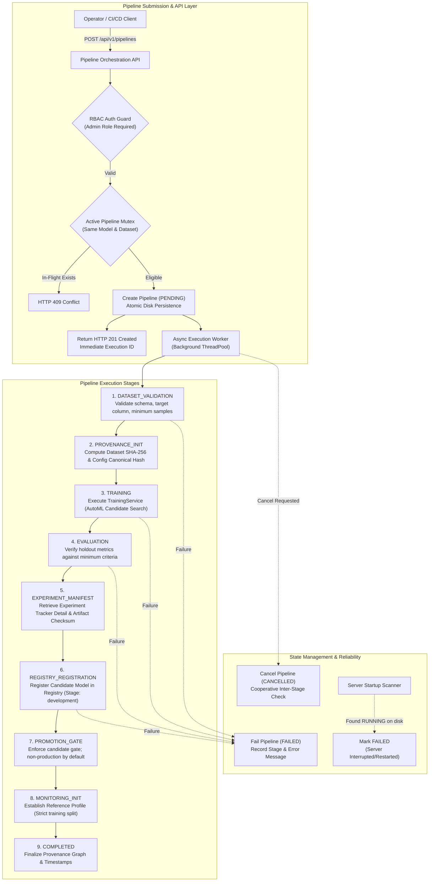

# AutoNexa Phase 15 — End-to-End Pipeline Orchestration, Integration & Reproducibility Architecture

**Document ID:** `ANX-RES-PHASE-15-2026`  
**Date:** October 2026  
**Status:** Approved Architecture & Specification  
**Subsystems:** End-to-End Workflow Orchestration, Deterministic Provenance Graphs, Asynchronous Pipeline State Machine, Candidate Registry Integration, Automatic Baseline Monitoring Linkage, Cooperative Cancellation & Idempotent Failure Recovery  

---

## 1. Architectural Overview & Motivation

AutoNexa Phases 1 through 14 established specialized subsystems:
- **Phase 1–8:** Core dataset profiling, exploratory data analysis, AutoML model candidate search, holdout & cross-validation protocols, and hyperparameter optimization.
- **Phase 9–11:** Model explainability (SHAP/permutation importance), error analysis, multi-objective optimization (Pareto frontiers), and robust multi-seed statistical benchmarking.
- **Phase 12:** Research-grade experiment tracking, cryptographic reproducibility manifests, artifact SHA-256 verification, and versioned model registry lifecycle management.
- **Phase 13:** Authenticated model serving (FastAPI inference routes, API-key role separation, artifact verification cache, and low-latency prediction).
- **Phase 14:** Tabular model monitoring, empirical 2-sample Kolmogorov-Smirnov drift detection, population stability index (PSI), ground-truth degradation monitoring, and candidate retraining gates.

### 1.1 Confirmed Integration Gaps
Despite these powerful capabilities, the subsystems currently operate in a disconnected manner:
1. **Manual Glue Work:** An operator must separately upload a dataset, run training, capture the resulting experiment ID, manually register a model candidate version in the registry, manually transition its lifecycle stage, and manually establish a baseline reference profile in the monitoring subsystem.
2. **Synchronous Coupling:** Training execution in `POST /api/v1/training/train` is coupled to the HTTP request lifecycle. Under large datasets or multi-seed trials, long-running requests risk HTTP socket timeouts or disconnects.
3. **Fragmented Provenance:** While individual experiments record dataset SHA-256 and model checksums, there is no end-to-end provenance graph linking dataset selection $\rightarrow$ preprocessing $\rightarrow$ training $\rightarrow$ evaluation verification $\rightarrow$ registry candidate version $\rightarrow$ baseline monitoring profile.
4. **Lack of Lifecycle Failure Recovery:** If a step fails mid-workflow, there is no standardized pipeline entity to record failure stage history, prevent partial state corruption, or allow safe, idempotent retries.
5. **No Production Guardrail in Pipeline Automation:** Without an explicit orchestration pipeline, automated retraining risks deploying directly to production without passing candidate evaluation gates.

Phase 15 unifies these components into a unified, reliable, asynchronous, and auditable **AutoML Pipeline Orchestration Layer**.

---

## 2. End-to-End Pipeline Architecture & Workflow



---

## 3. Pipeline State Machine Specification

### 3.1 Pipeline States
```
       ┌───────────┐
       │  PENDING  │ ──────────────┐
       └─────┬─────┘               │
             │                     │ (Cancel)
             ▼                     ▼
       ┌───────────┐         ┌───────────┐
       │  RUNNING  │ ──────> │ CANCELLED │
       └─────┬─────┘ (Cancel)└─────┬─────┘
             │                     │ (Retry)
     ┌───────┴───────┐             │
     ▼               ▼             │
┌───────────┐  ┌───────────┐       │
│ SUCCEEDED │  │  FAILED   │ <─────┘
└───────────┘  └─────┬─────┘
                     │ (Retry)
                     ▼
               ┌───────────┐
               │  PENDING  │
               └───────────┘
```

- **`PENDING`**: Pipeline execution created, configuration validated, placed in execution queue.
- **`RUNNING`**: Actively executing one of the sequential pipeline stages.
- **`SUCCEEDED`**: All enabled pipeline stages completed without error.
- **`FAILED`**: An unhandled exception or quality gate violation occurred during stage execution.
- **`CANCELLED`**: An operator explicitly requested cancellation, and execution was cleanly aborted prior to next stage entry.

### 3.2 Logical Stages & Transition Criteria
1. **`DATASET_VALIDATION`:**
   - Precondition: `dataset_id` provided.
   - Validation: File exists on disk via `AnalysisService.resolve_dataset_file()`; DataFrame parses successfully; `target_column` exists; row count $\ge 20$; classification target has $\ge 2$ classes.
   - Failure: Invalid dataset, missing columns, or degenerate targets.
2. **`PROVENANCE_INITIALIZATION`:**
   - Computes SHA-256 fingerprint of source data.
   - Canonicalizes JSON of training configuration and computes SHA-256 fingerprint.
   - Captures runtime environment: Python version, operating system, and package versions (`scikit-learn`, `pandas`, `numpy`, `scipy`, `fastapi`, `pydantic`).
3. **`TRAINING`:**
   - Executes `TrainingService.train(dataset_id, training_request)`.
   - Obtains candidate model scores, execution times, and best model selection.
4. **`EVALUATION`:**
   - Extracts primary evaluation metric (e.g. F1-score or RMSE).
   - Validates that metric values are mathematically valid (not NaN, not Inf).
5. **`EXPERIMENT_MANIFEST`:**
   - Links experiment ID created by `TrainingService`.
   - Verifies model binary artifact presence and computes SHA-256 checksum.
6. **`REGISTRY_REGISTRATION`:**
   - If `auto_register=True`, registers candidate model in `ModelRegistryService`.
   - Initial stage is always non-production (`development` or `staging`).
   - Prevents unvalidated replacement of existing production models.
7. **`PROMOTION_GATE`:**
   - Evaluates candidate against existing production model if present.
   - Checks degradation tolerance (default: candidate must perform within 5% of incumbent baseline).
   - Unless explicitly configured and passing, candidate remains in `development` or `staging`.
8. **`MONITORING_INITIALIZATION`:**
   - If `create_reference_profile=True`, establishes baseline distribution profile using `ModelMonitoringService.create_reference_profile()`.
   - Enforces Phase 14 holdout test set protection: strictly uses `split_source="training"` or `"validation"`.
9. **`COMPLETED`:**
   - Assembles end-to-end provenance record. Total runtime recorded.

---

## 4. API Design & Security Architecture

### 4.1 Endpoints
Mounted at `/api/v1/pipelines`:

| Method | Endpoint | Authorization | Description |
|:---|:---|:---|:---|
| `POST` | `/api/v1/pipelines` | `Admin` | Validate and initiate an end-to-end pipeline run. Returns HTTP 201 with `PipelineResponse`. |
| `GET` | `/api/v1/pipelines` | `Read` / `Admin` | List pipeline executions with pagination (`limit`, `offset`) and status filtering. |
| `GET` | `/api/v1/pipelines/{id}` | `Read` / `Admin` | Retrieve full status, current stage, configuration, and provenance details. |
| `GET` | `/api/v1/pipelines/{id}/events` | `Read` / `Admin` | Retrieve chronological timeline events for execution debugging. |
| `POST` | `/api/v1/pipelines/{id}/cancel` | `Admin` | Request cooperative cancellation of an active pipeline. |
| `POST` | `/api/v1/pipelines/{id}/retry` | `Admin` | Safely retry an eligible failed or cancelled pipeline. |

### 4.2 Security & Authorization (RBAC)
- **Role Enforcement:** Reuses `require_admin_key` and `require_read_key` dependencies established in Phase 13.
  - Read-only keys can view status and events.
  - Admin keys are required to initiate, cancel, or retry pipelines.
- **Path Sanitization:** All file access utilizes `_sanitize_path(base_dir, filename)` to prevent directory traversal attacks.
- **Resource Limits:** In-memory event lists are bounded; disk storage uses isolated JSON manifests; listing queries enforce maximum page size (default 50, max 100).

---

## 5. Failure Recovery & Concurrency Guarantees

1. **Atomic File Persistence:** All pipeline state transitions are serialized to disk via `NamedTemporaryFile` + `os.replace` within `experiments/pipelines/`.
2. **Crash & Restart Recovery:** During `PipelineService` initialization on startup, any persisted pipeline found in `RUNNING` or `PENDING` status is transitioned to `FAILED` with failure reason: `"Process interrupted or restarted while pipeline was running."`
3. **Cooperative Cancellation:** Cancellation sets an in-memory event flag. Each stage boundary checks `_is_cancelled(pipeline_id)`. If cancelled, intermediate artifacts are preserved, and state transitions cleanly to `CANCELLED`.
4. **Concurrency Gate:** Only one active pipeline (`PENDING` or `RUNNING`) is permitted per `(model_name, dataset_id)` pair, rejecting concurrent conflicts with `HTTP 409 Conflict`.
5. **Process-Local Concurrency Boundary:** Mutex protection uses `threading.Lock`. As in previous phases, horizontal multi-worker clusters require an external distributed lock coordinator (e.g. Redis).

---

## 6. Acceptance Criteria

- [x] Preflight test suite passes: 217 passed, 12 warnings.
- [x] Preflight frontend build passes: Exit code 0, 0 TypeScript errors.
- [x] Core orchestration service connects `Dataset` $\rightarrow$ `Training` $\rightarrow$ `Evaluation` $\rightarrow$ `Experiment Tracker` $\rightarrow$ `Model Registry` $\rightarrow$ `Monitoring Profiler`.
- [x] Background asynchronous execution prevents HTTP socket timeouts.
- [x] State machine enforces valid transitions (`PENDING`, `RUNNING`, `SUCCEEDED`, `FAILED`, `CANCELLED`).
- [x] Strict holdout test set leakage prevention is maintained during monitoring initialization.
- [x] Production models are never replaced without candidate gate validation.
- [x] Clean, responsive frontend tab (`PipelinesTab.tsx`) with blue-and-white theme, stage timeline, and control dialogs.
- [x] Full regression test suite remains 100% green with new dedicated pipeline tests.
- [x] Validation report and independent audit report authored with evidence-based verdicts.
