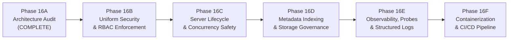

# AutoNexa — Phase 16A: Production Readiness & Scalability Architecture Audit

**Document ID:** `ANX-AUDIT-PHASE-16A-2026`  
**Date:** October 21, 2026  
**Auditor:** Independent Antigravity Scientific, Security & Systems Architecture Reviewer  
**Repository:** `C:\Users\ishit\AutoNexa`  
**Branch:** `main`  
**Commit:** `4d4bc58fb9ada6e7bbe2c4d9c7c2c8a50bafc53e`  
**Remote:** `https://github.com/Ishitadas03/AutoNexa.git`  
**Overall Verdict:** `READY WITH PREREQUISITES`

---

## 1. Executive Summary

This architecture and production-readiness audit provides a comprehensive, evidence-based evaluation of the AutoNexa automated machine learning (AutoML) platform following the completion of Phase 15 (*End-to-End Pipeline Orchestration, Integration & Reproducibility*).

Rather than relying on historical claims or assuming production deployment capabilities, this audit directly inspected the live repository, active Git state, backend Python services, FastAPI route configurations, data access boundaries, frontend client implementation, test suites, and operational infrastructure.

### Key Conclusions
1. **Functional Integrity is High:** The core AutoML algorithms, leakage-safe data splitting, multi-objective Pareto optimization, statistical hypothesis testing, cryptographic reproducibility manifests, artifact SHA-256 verification, and Phase 15 pipeline state machine are verified working. All **227 backend tests pass** with zero failures, and the Next.js frontend builds cleanly with **exit code 0** and **zero TypeScript errors**.
2. **Current Architecture is Fit for Single-Node Local Research:** The in-process `ThreadPoolExecutor`, process-local synchronization locks, and filesystem-backed JSON/joblib persistence are sufficient and cost-effective for single-user local development and tabular workloads ($\le 100{,}000$ rows, $\le 500$ columns, $\le 300\text{s}$ training budget).
3. **Distributed Infrastructure is Premature:** Introducing Redis, Celery, Kubernetes, a message broker, or object storage at this stage is strongly discouraged. It would introduce high operational complexity, serialization overhead, and maintenance drag without addressing the core software architecture prerequisites.
4. **Prerequisites Must Be Addressed Before Scaling:**
   - **Severe Authentication Asymmetry:** Protected routes (`/serving`, `/monitoring`, `/pipelines`) enforce constant-time API-key RBAC, but critical mutation endpoints (`/datasets/upload`, `/datasets/{id}/train`, `/models/register`, `/models/{name}/versions/{ver}/stage`, `/experiments/{id}` `DELETE`, and `/benchmarks/*`) have **zero authentication**. Unauthenticated callers can upload files, trigger training, delete experiment history, or promote models to production.
   - **Multi-Worker Data Races:** In-process concurrency locks (`_PIPELINE_LOCK`, `_REGISTRY_LOCK`, `_MONITORING_LOCK`) and active-job registries are process-local. Running multiple Uvicorn/Gunicorn worker processes leads to race conditions in model version numbering, duplicate pipeline launches, broken cooperative cancellation, and serving cache desynchronization.
   - **Lazy Server Lifecycle & Missing Graceful Shutdown:** Startup orphan pipeline reconciliation is invoked lazily on the first request to `/pipelines` rather than during FastAPI server startup, and there is no graceful shutdown handler to stop running threads cleanly.
   - **Filesystem Metadata Bottleneck:** Listing pipelines and experiments requires globbing and parsing every JSON file on disk on each request. Furthermore, uploaded datasets rely entirely on browser `localStorage` for indexing, leaving no server-side dataset catalog.
   - **Missing Deployment Baseline:** The repository has zero container definitions (`Dockerfile`, `docker-compose.yml`), zero CI/CD workflows (`.github/workflows`), and static health endpoints lacking readiness checks.

---

## 2. Actual Repository and Git State

Direct inspection was performed to verify the exact state of the repository.

### 2.1 Git Status & Commit Tree
- **Active Branch:** `main` (verified via `git branch --show-current`)
- **HEAD Commit:** `4d4bc58fb9ada6e7bbe2c4d9c7c2c8a50bafc53e` (`fix: align phase 15 pipeline frontend contracts`)
- **Remote `origin/main`:** `4d4bc58fb9ada6e7bbe2c4d9c7c2c8a50bafc53e` (working tree is fully synchronized with remote)
- **Working Tree Cleanliness:** `git status --short` emitted no output. `git diff --stat` and `git diff --check` emitted zero diffs and zero whitespace errors.
- **Untracked Files:** `git ls-files --others --exclude-standard` returned zero untracked files.

### 2.2 Recent Commit History
```
4d4bc58 (HEAD -> main, origin/main, origin/HEAD) fix: align phase 15 pipeline frontend contracts
0649763 feat: implement phase 15 end-to-end ML pipeline orchestration dashboard, backend API, and automated validation suite
8fc9bc4 feat: implement model monitoring, drift detection, and retraining pipeline for phase 14
33555dc feat: implement secure model serving and prediction frontend components for phase 13
65a9452 feat: implement research-grade experiment tracking and model registry services with API routes and tests
```

### 2.3 Repository Inventory & Subsystem Mapping

| Layer / Subsystem | Primary Implementation Paths | Key Technologies & Dependencies |
|:---|:---|:---|
| **API Entry Point & Config** | [main.py](file:///C:/Users/ishit/AutoNexa/backend/app/main.py), [config.py](file:///C:/Users/ishit/AutoNexa/backend/app/core/config.py), [security.py](file:///C:/Users/ishit/AutoNexa/backend/app/core/security.py) | FastAPI 0.143.3, Pydantic-Settings 2.16.0, Uvicorn 0.54.0 |
| **Data Ingestion & Diagnostics** | [dataset_service.py](file:///C:/Users/ishit/AutoNexa/backend/app/services/dataset_service.py), [analysis_service.py](file:///C:/Users/ishit/AutoNexa/backend/app/services/analysis_service.py) | Pandas 3.0.6, NumPy 2.4.6, Python CSV |
| **AutoML Core Engine** | [training_service.py](file:///C:/Users/ishit/AutoNexa/backend/app/services/automl/training_service.py), [preprocessor.py](file:///C:/Users/ishit/AutoNexa/backend/app/services/automl/preprocessor.py), [evaluator.py](file:///C:/Users/ishit/AutoNexa/backend/app/services/automl/evaluator.py), [registry.py](file:///C:/Users/ishit/AutoNexa/backend/app/services/automl/registry.py) | Scikit-Learn 1.9.1, SciPy 1.17.1 |
| **Hyperparameter & Multi-Objective** | [hpo_service.py](file:///C:/Users/ishit/AutoNexa/backend/app/services/automl/hpo_service.py), [multi_objective_service.py](file:///C:/Users/ishit/AutoNexa/backend/app/services/automl/multi_objective_service.py), [pareto.py](file:///C:/Users/ishit/AutoNexa/backend/app/services/automl/pareto.py) | Optuna 5.0.0, Psutil 7.2.2 |
| **Explainability & Error Analysis** | [explainability_service.py](file:///C:/Users/ishit/AutoNexa/backend/app/services/automl/explainability_service.py), [error_analysis_service.py](file:///C:/Users/ishit/AutoNexa/backend/app/services/automl/error_analysis_service.py) | SHAP 0.51.0, Matplotlib |
| **Experiment Tracking & Lineage** | [experiment_tracker_service.py](file:///C:/Users/ishit/AutoNexa/backend/app/services/automl/experiment_tracker_service.py), [tracker.py](file:///C:/Users/ishit/AutoNexa/backend/app/services/automl/tracker.py) | MLflow 3.17.1 (File Store), Hashlib SHA-256 |
| **Model Registry & Versioning** | [model_registry_service.py](file:///C:/Users/ishit/AutoNexa/backend/app/services/automl/model_registry_service.py) | Joblib 1.4+, Shutil, JSON Manifests |
| **Model Serving & Caching** | [model_serving_service.py](file:///C:/Users/ishit/AutoNexa/backend/app/services/automl/model_serving_service.py) | In-Memory LRU Cache, Constant-Time Auth |
| **Monitoring, Drift & Retraining** | [model_monitoring_service.py](file:///C:/Users/ishit/AutoNexa/backend/app/services/automl/model_monitoring_service.py) | SciPy 2-Sample KS Test, PSI, JSONL Telemetry |
| **Pipeline Orchestration** | [pipeline_service.py](file:///C:/Users/ishit/AutoNexa/backend/app/services/automl/pipeline_service.py), [pipelines.py](file:///C:/Users/ishit/AutoNexa/backend/app/api/routes/pipelines.py) | ThreadPoolExecutor, 5-State Machine |
| **Frontend Application** | [frontend/src/](file:///C:/Users/ishit/AutoNexa/frontend/src/) | Next.js 16.4.2 (Turbopack), React 19.3.0, Tailwind CSS v4, Lucide-React |
| **Test Suites** | [backend/tests/](file:///C:/Users/ishit/AutoNexa/backend/tests/) (26 test modules) | Pytest 9.1.1, HTTPX 0.28.1 |
| **Deployment / CI Configuration** | None found | Missing: Dockerfile, compose, GitHub Actions |

---

## 3. Verified Architecture and Data Flow

The following sequence traces the verified end-to-end data lifecycle across all subsystems:

```mermaid
sequenceDiagram
    autonumber
    actor User as Client / Operator
    participant API as FastAPI Router Layer
    participant DS as DatasetService
    participant AS as AnalysisService
    participant PS as PipelineService (Worker)
    participant TS as TrainingService
    participant ET as ExperimentTrackerService
    participant MR as ModelRegistryService
    participant MS as ModelServingService
    participant MM as ModelMonitoringService

    Note over User,API: 1. Ingestion & Analysis
    User->>API: POST /api/v1/datasets/upload (CSV multipart)
    API->>DS: ingest_dataset()
    DS->>DS: Stream in 64KB chunks (max 10MB) -> uploads/{uuid}.csv
    DS->>DS: Compute structural summary profile (rows, cols, nulls)
    DS-->>User: HTTP 201 DatasetProfileResponse (Client saves in localStorage)
    User->>API: POST /api/v1/datasets/{id}/analyze
    API->>AS: analyze() -> column roles, quality, leakage, task detection

    Note over User,PS: 2. Pipeline Submission (Phase 15)
    User->>API: POST /api/v1/pipelines (model_name, dataset_id, target_col) [Admin Role]
    API->>PS: create_pipeline()
    PS->>PS: Mutex check: (model_name:dataset_id) in _active_jobs
    PS->>PS: Atomic persist PENDING manifest (experiments/pipelines/manifests/)
    PS->>PS: Submit task to ThreadPoolExecutor(max_workers=2)
    PS-->>User: HTTP 201 Created (immediate PipelineResponse)

    Note over PS,TS: 3. Async Pipeline Execution
    PS->>AS: Stage 1: DATASET_VALIDATION (row_count >= 20, target_col exists)
    PS->>PS: Stage 2: PROVENANCE_INIT (SHA-256 data hash, canonical config hash, env info)
    PS->>TS: Stage 3: TRAINING -> train_experiment()
    TS->>TS: Leakage-safe split (80/20 train/test or Stratified K-Fold)
    TS->>TS: Fit preprocessor & evaluate candidates (Dummy, Linear, Trees, Boosting)
    TS->>TS: Untouched test evaluation for winning model
    TS->>ET: Persist metadata.json & best_model.joblib; log to MLflow file store
    TS-->>PS: Return TrainingResponse
    PS->>PS: Stage 4: EVALUATION (validate metric is finite/non-NaN)
    PS->>ET: Stage 5: EXPERIMENT_MANIFEST (verify best_model.joblib SHA-256)
    PS->>MR: Stage 6: REGISTRY_REGISTRATION (copy joblib, register version in DEVELOPMENT)
    PS->>MR: Stage 7: PROMOTION_GATE (compare candidate vs production baseline tolerance)
    PS->>MM: Stage 8: MONITORING_INIT (create reference profile from training split)
    PS->>PS: Stage 9: COMPLETED (finalize provenance graph & durations)

    Note over User,MS: 4. Serving & Telemetry (Phase 13 & 14)
    User->>API: POST /api/v1/serving/models/{model_name}/predict [Inference Role]
    API->>MS: predict()
    MS->>MS: Verify stage in (production, staging) & load/cache pipeline
    MS->>MS: Reorder features, validate required columns, execute pipeline.predict()
    MS->>MM: record_telemetry_event() (privacy-safe: duration, counts, timestamp)
    MS-->>User: HTTP 200 ServingPredictionResponse

    Note over User,MM: 5. Drift Detection & Retraining Loop
    User->>API: POST /api/v1/monitoring/drift/analyze [Admin Role]
    API->>MM: run_drift_analysis() (KS-test on numerics, PSI, unseen category check)
    MM->>MM: Save drift report; trigger alert if drift critical
    User->>API: POST /api/v1/monitoring/retraining/trigger [Admin Role]
    API->>MM: trigger_retraining() (executes training, candidate gate, register v_next)
```

### Service Boundaries and Dependencies

1. **`DatasetService` $\rightarrow$ `AnalysisService`**:
   - `DatasetService` handles raw stream persistence into `uploads/{uuid}.csv` and basic tabular profiling ([dataset_service.py:L29-L88](file:///C:/Users/ishit/AutoNexa/backend/app/services/dataset_service.py#L29-L88)).
   - `AnalysisService` resolves paths strictly via `resolve_dataset_file(dataset_id)` and performs in-depth statistical audits without persisting mutated state ([analysis_service.py:L35-L95](file:///C:/Users/ishit/AutoNexa/backend/app/services/analysis_service.py#L35-L95)).
2. **`TrainingService` $\rightarrow$ `ModelEvaluator` / `MLflowTracker`**:
   - `TrainingService` coordinates candidate modeling under wall-clock constraints ([training_service.py:L58-L100](file:///C:/Users/ishit/AutoNexa/backend/app/services/automl/training_service.py#L58-L100)).
   - Evaluator operates strictly in-memory ([evaluator.py:L20-L80](file:///C:/Users/ishit/AutoNexa/backend/app/services/automl/evaluator.py#L20-L80)).
   - `MLflowTracker` handles optional logging to `experiments/mlruns` file store ([tracker.py:L26-L66](file:///C:/Users/ishit/AutoNexa/backend/app/services/automl/tracker.py#L26-L66)).
3. **`ExperimentTrackerService` $\leftrightarrow$ `ModelRegistryService`**:
   - `ExperimentTrackerService` owns the raw experiment runs and artifact validation in `experiments/{experiment_id}/` ([experiment_tracker_service.py:L78-L115](file:///C:/Users/ishit/AutoNexa/backend/app/services/automl/experiment_tracker_service.py#L78-L115)).
   - `ModelRegistryService` ingests completed experiments, clones the `.joblib` binary to `experiments/model_registry/{model_name}/v{version}/`, assigns sequential version integers, and enforces production exclusivity ([model_registry_service.py:L92-L171](file:///C:/Users/ishit/AutoNexa/backend/app/services/automl/model_registry_service.py#L92-L171)).
4. **`ModelServingService` $\rightarrow$ `ModelRegistryService` / `ModelMonitoringService`**:
   - `ModelServingService` depends on `ModelRegistryService` to identify active versions and fetch artifact locations ([model_serving_service.py:L30-L36](file:///C:/Users/ishit/AutoNexa/backend/app/services/automl/model_serving_service.py#L30-L36)).
   - It maintains an in-memory LRU cache `LoadedServingModel` ([model_serving_service.py:L54-L83](file:///C:/Users/ishit/AutoNexa/backend/app/services/automl/model_serving_service.py#L54-L83)).
   - Emits telemetry events into `ModelMonitoringService` ([model_serving_service.py:L400-L420](file:///C:/Users/ishit/AutoNexa/backend/app/services/automl/model_serving_service.py#L400-L420)).
5. **`PipelineService` as the Central Orchestrator**:
   - Directly injects and coordinates `AnalysisService`, `TrainingService`, `ExperimentTrackerService`, `ModelRegistryService`, and `ModelMonitoringService` ([pipeline_service.py:L104-L137](file:///C:/Users/ishit/AutoNexa/backend/app/services/automl/pipeline_service.py#L104-L137)).

---

## 4. Comprehensive Findings with Source References

The audit uncovered several confirmed architectural defects, reliability constraints, and security gaps:

```
+---------------------------------------------------------------------------------------------------------+
|                                      AUDIT FINDINGS BY SEVERITY                                         |
+---------------------+-----------------------------------------------------------------------------------+
| CRITICAL (0)        | None. No exploitable RCE, unhandled data leakage, or catastrophic state crashes.  |
| HIGH (3)            | 1. Severe API authentication asymmetry across operational routes.               |
|                     | 2. Process-local concurrency & multi-worker race conditions.                      |
|                     | 3. Synchronous blocking retraining holding global monitoring lock.               |
| MEDIUM (4)          | 4. Lazy pipeline service initialization & missing server lifespan/graceful stop. |
|                     | 5. Unindexed filesystem metadata pagination bottleneck.                           |
|                     | 6. Client-side browser localStorage dependency for dataset catalog.              |
|                     | 7. Unbounded disk growth & duplicated model artifacts.                           |
| LOW (2)             | 8. Hardcoded default API key secrets in settings template.                       |
|                     | 9. In-memory serving metrics lost on process restart.                            |
| INFORMATIONAL (3)   | 10. Lack of readiness probe & external health diagnostics.                       |
|                     | 11. Plain text unstructured application logging.                                 |
|                     | 12. Complete absence of CI/CD workflows and containerization manifests.          |
+---------------------+-----------------------------------------------------------------------------------+
```

### Detailed Finding Records

#### Finding 1: Severe API Authentication Asymmetry Across Operational Routes
- **Severity:** `HIGH`
- **Component:** API Routing & Security Architecture
- **Source References:**
  - Authenticated routes: [serving.py:L33,L50,L67,L88](file:///C:/Users/ishit/AutoNexa/backend/app/api/routes/serving.py#L33), [monitoring.py:L43,L59,L79](file:///C:/Users/ishit/AutoNexa/backend/app/api/routes/monitoring.py#L43), [pipelines.py:L34,L54,L76,L112](file:///C:/Users/ishit/AutoNexa/backend/app/api/routes/pipelines.py#L34).
  - Unauthenticated routes: [datasets.py:L26-L74](file:///C:/Users/ishit/AutoNexa/backend/app/api/routes/datasets.py#L26-L74), [experiments.py:L49-L250](file:///C:/Users/ishit/AutoNexa/backend/app/api/routes/experiments.py#L49-L250), [model_registry.py:L22-L163](file:///C:/Users/ishit/AutoNexa/backend/app/api/routes/model_registry.py#L22-L163), [benchmarks.py:L64-L120](file:///C:/Users/ishit/AutoNexa/backend/app/api/routes/benchmarks.py#L64-L120).
- **Evidence:** While Phase 13, 14, and 15 introduced API key verification (`require_inference_role` and `require_admin_role`), older subsystems were never updated with authentication dependencies:
  - Any unauthenticated client can upload 10MB CSV datasets via `POST /api/v1/datasets/upload`.
  - Any unauthenticated client can trigger heavy CPU training via `POST /api/v1/datasets/{id}/train`.
  - Any unauthenticated client can permanently delete an experiment via `DELETE /api/v1/experiments/{id}` ([experiments.py:L221-L234](file:///C:/Users/ishit/AutoNexa/backend/app/api/routes/experiments.py#L221-L234)).
  - Any unauthenticated client can promote any model directly to production via `POST /api/v1/models/{name}/versions/{ver}/stage` ([model_registry.py:L86-L104](file:///C:/Users/ishit/AutoNexa/backend/app/api/routes/model_registry.py#L86-L104)), completely bypassing the candidate promotion gate.
  - Any unauthenticated client can launch multi-seed repeated-run benchmarks or HPO trials via `/api/v1/benchmarks/*`.
- **Impact:** Complete authorization bypass on core data, training, and model lifecycle endpoints whenever the backend port is exposed.

#### Finding 2: Process-Local Concurrency & Multi-Worker Race Conditions
- **Severity:** `HIGH`
- **Component:** Job Execution & Multi-Worker Scalability
- **Source References:**
  - [pipeline_service.py:L66-L67,L139-L144,L321-L330,L828-L847](file:///C:/Users/ishit/AutoNexa/backend/app/services/automl/pipeline_service.py#L66-L67)
  - [model_registry_service.py:L36,L94,L148-L163](file:///C:/Users/ishit/AutoNexa/backend/app/services/automl/model_registry_service.py#L36)
  - [model_monitoring_service.py:L71-L72](file:///C:/Users/ishit/AutoNexa/backend/app/services/automl/model_monitoring_service.py#L71-L72)
  - [model_serving_service.py:L40-L41](file:///C:/Users/ishit/AutoNexa/backend/app/services/automl/model_serving_service.py#L40-L41)
- **Evidence:** Synchronization across the backend relies entirely on in-memory Python locks (`threading.RLock()`, `threading.Lock()`) and process-local dictionaries:
  - `_active_jobs: Dict[str, str]` in `PipelineService` only prevents duplicate execution within the same OS process.
  - `_cancel_flags: Dict[str, bool]` is stored in process heap. Calling `POST /pipelines/{id}/cancel` on Worker A will set `_cancel_flags[id] = True` in Worker A, but if the worker thread is running under Worker B, Worker B will never see the cancellation signal and will execute to completion.
  - In `ModelRegistryService.register_model()`, determining `next_version = max(existing_versions) + 1` is protected only by in-process `_REGISTRY_LOCK`. Two concurrent registrations across two Uvicorn worker processes will both calculate the same version number and trigger directory collision or race conditions.
  - In `ModelServingService`, `_model_cache` is process-local. An admin calling `POST /serving/cache/invalidate` on Worker A clears Worker A's cache, but Worker B retains stale model pipelines in memory.
- **Impact:** System guarantees completely break down if Uvicorn is launched with multiple worker processes (`uvicorn --workers N` where $N > 1$).

#### Finding 3: Synchronous Blocking Retraining Under Global Monitoring Lock
- **Severity:** `HIGH`
- **Component:** Model Monitoring & Training Scheduling
- **Source References:** [model_monitoring_service.py:L1450,L1526-L1542](file:///C:/Users/ishit/AutoNexa/backend/app/services/automl/model_monitoring_service.py#L1450)
- **Evidence:** In `ModelMonitoringService.trigger_retraining()`:
  ```python
  with _MONITORING_LOCK:
      # ...
      train_resp = self.training_service.train_experiment(dataset_id=request.dataset_id, request=train_req)
  ```
  The endpoint `POST /api/v1/monitoring/retraining/trigger` calls `train_experiment()` synchronously while holding `_MONITORING_LOCK`.
- **Impact:** Training takes 10 to 300 seconds. During this entire interval, the HTTP socket remains blocked. Even worse, because `_MONITORING_LOCK` is held, any other request to the monitoring subsystem (such as `POST /monitoring/telemetry`, `GET /monitoring/overview`, `POST /monitoring/drift/analyze`, or alert creation) is blocked from executing until retraining completes.

#### Finding 4: Lazy Pipeline Initialization & Missing Server Lifespan / Graceful Shutdown
- **Severity:** `MEDIUM`
- **Component:** Application Lifecycle Management
- **Source References:**
  - [main.py:L9-L37](file:///C:/Users/ishit/AutoNexa/backend/app/main.py#L9-L37)
  - [pipeline_service.py:L146-L186,L983-L992](file:///C:/Users/ishit/AutoNexa/backend/app/services/automl/pipeline_service.py#L146-L186)
- **Evidence:** In `main.py`, FastAPI is instantiated without a `lifespan` handler. `PipelineService._recover_interrupted_pipelines()` is only called in `PipelineService.__init__()`. Because `get_pipeline_service()` is used as a FastAPI dependency, `PipelineService` is initialized lazily upon the *first HTTP request* sent to `/api/v1/pipelines/*`. If the server crashes and restarts, orphaned pipelines remain marked `RUNNING` or `PENDING` indefinitely on disk until an operator manually visits the pipeline tab or calls a pipeline route.
  Furthermore, there is no `shutdown` lifespan event to signal cancellation to worker threads or wait for graceful termination upon SIGTERM.
- **Impact:** Pipeline state reconciliation is delayed; sudden container termination drops in-flight training jobs without cleanup.

#### Finding 5: Unindexed Filesystem Metadata Pagination Bottleneck
- **Severity:** `MEDIUM`
- **Component:** Persistence & Storage Scalability
- **Source References:**
  - [pipeline_service.py:L938-L971](file:///C:/Users/ishit/AutoNexa/backend/app/services/automl/pipeline_service.py#L938-L971)
  - [experiment_tracker_service.py:L142-L185](file:///C:/Users/ishit/AutoNexa/backend/app/services/automl/experiment_tracker_service.py#L142-L185)
- **Evidence:** `PipelineService.list_pipelines()` and `ExperimentTrackerService.list_experiments()` paginate records by globbing all files in the directory (`self.manifests_dir.glob("*.json")`), opening each file, reading its contents into JSON, instantiating Pydantic models, and filtering in Python memory.
- **Impact:** As the platform logs hundreds or thousands of runs, every `GET /api/v1/pipelines` or `GET /api/v1/experiments` request requires hundreds of filesystem opens and JSON parses, degrading response latency from milliseconds to multiple seconds and consuming significant CPU and disk I/O.

#### Finding 6: Client-Side Browser `localStorage` Dependency for Dataset Catalog
- **Severity:** `MEDIUM`
- **Component:** Data Management & Frontend Architecture
- **Source References:**
  - [datasets.py:L16-L74](file:///C:/Users/ishit/AutoNexa/backend/app/api/routes/datasets.py#L16-L74)
  - [store.ts:L36-L70](file:///C:/Users/ishit/AutoNexa/frontend/src/lib/store.ts#L36-L70)
  - [SettingsTab.tsx:L70-L78](file:///C:/Users/ishit/AutoNexa/frontend/src/components/workspace/SettingsTab.tsx#L70-L78)
- **Evidence:** The backend exposes `POST /api/v1/datasets/upload`, but provides **no `GET /api/v1/datasets` endpoint** to list available datasets on the server. The frontend persists uploaded dataset IDs and summaries entirely in the browser's `localStorage` (`autonexa_datasets_v1`).
- **Impact:** If a user clears their browser cache, uses Incognito mode, or switches computers, all previously uploaded datasets disappear from the frontend UI, even though the raw CSV files remain stored on the backend disk in `uploads/`.

#### Finding 7: Unbounded Disk Growth & Duplicated Model Artifacts
- **Severity:** `MEDIUM`
- **Component:** Storage Management & Governance
- **Source References:**
  - [model_registry_service.py:L165-L171](file:///C:/Users/ishit/AutoNexa/backend/app/services/automl/model_registry_service.py#L165-L171)
  - [training_service.py:L58-L75](file:///C:/Users/ishit/AutoNexa/backend/app/services/automl/training_service.py#L58-L75)
- **Evidence:**
  1. No retention, rotation, or pruning policies exist for `uploads/`, `experiments/`, `experiments/monitoring/telemetry/`, or `experiments/pipelines/events/`.
  2. When a model version is registered in `ModelRegistryService`, `shutil.copyfile()` duplicates `best_model.joblib` from `experiments/{experiment_id}/` into `experiments/model_registry/{model_name}/v{version}/`. For large models or frequent retraining, this doubles disk space usage.
- **Impact:** Eventual disk exhaustion in prolonged research environments.

#### Finding 8: Hardcoded Default API Key Secrets in Settings Template
- **Severity:** `LOW`
- **Component:** Secrets Management
- **Source References:** [config.py:L174-L183](file:///C:/Users/ishit/AutoNexa/backend/app/core/config.py#L174-L183)
- **Evidence:** `serving_api_key_read` defaults to `"autonexa-read-key-secret"` and `serving_api_key_admin` defaults to `"autonexa-admin-key-secret"`. There is no environment guard asserting that non-default keys must be provided when `ENVIRONMENT=production`.
- **Impact:** If deployed to production without an explicit `.env` file, the system is protected only by publicly known sample keys.

#### Finding 9: In-Memory Serving Metrics Lost on Process Restart
- **Severity:** `LOW`
- **Component:** Observability & Telemetry
- **Source References:** [model_serving_service.py:L84-L149](file:///C:/Users/ishit/AutoNexa/backend/app/services/automl/model_serving_service.py#L84-L149)
- **Evidence:** `ServingMonitoringService` tracks request volume, latencies, and error rates using an in-memory `deque(maxlen=1000)` and a dictionary `_model_stats`.
- **Impact:** Any server restart or worker reload wipes all operational latency and request history.

#### Finding 10: Lack of Readiness Probe & External Health Diagnostics
- **Severity:** `INFORMATIONAL`
- **Component:** Operational Observability
- **Source References:** [health.py:L10-L24](file:///C:/Users/ishit/AutoNexa/backend/app/api/routes/health.py#L10-L24)
- **Evidence:** `GET /health` statically returns `{"status": "healthy"}`. It does not verify disk writability on `uploads/` or `experiments/`, check available disk space, or verify MLflow accessibility. There is no separate `/ready` endpoint.
- **Impact:** Container orchestrators cannot distinguish between an operational server and one unable to write artifacts to disk.

#### Finding 11: Plain Text Unstructured Application Logging
- **Severity:** `INFORMATIONAL`
- **Component:** Observability & Audit
- **Source References:** Application-wide `logging.getLogger()` calls.
- **Evidence:** Log output is plain human-readable text. There is no structured JSON log formatter or request correlation ID middleware (`X-Request-ID`).
- **Impact:** Log aggregation tools (Elasticsearch, CloudWatch, Datadog) cannot easily index or filter traces across requests.

#### Finding 12: Absence of CI/CD Workflows and Containerization Manifests
- **Severity:** `INFORMATIONAL`
- **Component:** DevOps & Release Engineering
- **Source References:** Root directory inspection (`Test-Path .github` returned `False`; no `Dockerfile` or `compose.yml`).
- **Evidence:** The repository relies entirely on manual local commands. There is no automated GitHub Actions workflow to run pytest or `npm run build` on pull requests.
- **Impact:** Regressions can easily be committed without immediate automated feedback.

---

## 5. Scalability and Concurrency Analysis

### Evaluation of the Core Questions

#### 1. Is the current architecture adequate for a single-user local development workflow?
**Yes.** For a data scientist or ML engineer running AutoNexa locally on a laptop or single development workstation, the current design is simple, effective, and reliable. The in-process `ThreadPoolExecutor(max_workers=2)` allows AutoML pipelines to execute asynchronously without blocking FastAPI HTTP requests. The local filesystem persistence ensures that runs, artifacts, and manifests can be inspected using standard tools without requiring external database servers or cache daemons.

#### 2. Which guarantees stop working if multiple backend worker processes are used?
If AutoNexa is launched behind multiple worker processes (such as `uvicorn app.main:app --workers 4` or Gunicorn with Uvicorn worker classes), the following guarantees immediately fail:
- **Mutual Exclusion & Deduplication:** `_PIPELINE_LOCK` and `_active_jobs` exist solely in the Python heap of a single process. Two requests for the same `(model_name, dataset_id)` hitting Worker 1 and Worker 2 will both start training simultaneously, causing resource exhaustion and duplicate artifacts.
- **Cooperative Cancellation:** Cancellation sets an in-memory boolean `_cancel_flags[pipeline_id] = True`. If the cancellation HTTP request hits Worker 1, but the execution thread is running inside Worker 2, Worker 2 will never receive the signal and the job will continue to run to completion.
- **Monotonic Version Numbering:** In `ModelRegistryService.register_model()`, version calculation reads existing directory numbers from disk and increments by 1. Two concurrent registrations on separate workers will compute identical version numbers, causing directory collision or corrupted registration manifests.
- **Startup Orphan Reconciliation False Positives:** If Worker 1 reboots or initializes while Worker 2 is actively running a pipeline, Worker 1's `_recover_interrupted_pipelines()` will find Worker 2's active manifest on disk and mark it `FAILED` while Worker 2 is still actively training.
- **Serving Memory Cache Consistency:** `ModelServingService._model_cache` is process-local. An admin calling `POST /serving/cache/invalidate` on one worker leaves stale pipelines cached in other workers.

#### 3. What is the smallest change needed for safe multi-worker execution?
The smallest and most robust change does **not** require Redis or Celery:
1. **Advisory File Locks:** Replace in-process `threading.RLock()` with cross-process advisory file locks using the standard `filelock` library (`filelock.FileLock("experiments/.locks/registry.lock")`).
2. **Filesystem Cancellation Sentinels:** Replace in-memory `_cancel_flags` with a cancellation marker file on disk (`experiments/pipelines/cancel/{pipeline_id}.cancel`). Any worker process checks `Path.is_file()` between stages.
3. **Single Orchestration Worker Policy:** Run the backend with a single primary worker process (`workers=1`) for local and single-container deployments, or designate a dedicated worker process for orchestration.
4. **Lifespan Startup Hook:** Move orphan reconciliation to a FastAPI `lifespan` handler that executes strictly once at application boot, rather than on every `PipelineService` instantiation.

#### 4. Would a durable job queue provide material benefits now, or is it premature?
**It is premature.** AutoNexa's current workloads are tabular datasets ($\le 10\text{MB}$), single-node training budgets ($\le 300\text{s}$), and 1–2 concurrent pipeline executions. Introducing Celery, Redis, or RabbitMQ would add substantial operational overhead (requiring operators to manage Redis daemons, Celery worker processes, queue monitoring, and network error handling) without providing meaningful benefits over a single-process `ThreadPoolExecutor` that already writes persistent manifests to disk.

#### 5. What workload or failure scenario would justify Redis, Celery, a database-backed queue, or a workflow engine?
A distributed queue is only justified if:
- **Multi-Node Worker Fleet:** Training jobs must be distributed across multiple physical machines or GPU compute nodes.
- **Long-Running High-Volume Multi-Tenancy:** Tens or hundreds of concurrent users submit large datasets requiring priority scheduling, fair-share throttling, and dynamic worker autoscaling.
- **Zero-Downtime Rolling Deployments:** Rolling restarts of the API server must occur without interrupting in-flight training jobs.

---

## 6. Persistence, Artifact Integrity, and Recovery

### Current Storage Architecture
- **Pipeline Manifests & Events:** `experiments/pipelines/manifests/{id}.json` (atomic write via temporary file + `os.replace` + 6-attempt backoff on Windows) and `experiments/pipelines/events/{id}.jsonl`.
- **Experiments & Artifacts:** `experiments/{id}/metadata.json` and `best_model.joblib`.
- **Model Registry:** `experiments/model_registry/{name}/v{version}/version.json` and `best_model.joblib`.
- **Monitoring Data:** Subdirectories for `profiles/`, `windows/`, `drift_reports/`, `ground_truth/`, `performance_reports/`, `alerts/`, `retraining_jobs/`, and `telemetry/`.

### Evaluated Properties
1. **Atomic Writes & Partial-Write Recovery:** Highly reliable. All critical metadata files use `NamedTemporaryFile` + `replace()`. Sanitized serialization (`_safe_json_dump`) strips IEEE 754 non-compliant `NaN` and `Infinity` values, preventing corrupted JSON files.
2. **Artifact Integrity Verification:** Cryptographic SHA-256 verification is implemented throughout. Experiments, model registry versions, serving cache loaders, and download endpoints all verify that the on-disk binary matches the recorded hash before loading or streaming.
3. **Storage Growth & Retention:** Completely unmanaged. Files accumulate indefinitely.
4. **Data Consistency Across Service Boundaries:** Good logical decoupling, but `.joblib` files are duplicated between experiment directories and registry version directories.
5. **Metadata Indexing & Query Scalability:** Poor. Listing experiments and pipelines requires scanning the entire directory and reading every JSON file into memory.

### Recommendation
For the next evolution, retain file storage for binary artifacts (`.csv` datasets and `.joblib` pipelines), but introduce a lightweight relational database (**SQLite via SQLAlchemy/SQLModel**) for metadata (datasets, experiments, registry versions, pipeline runs, and alerts). SQLite provides single-file simplicity, zero operational overhead, ACID transactions, native indexing, fast pagination, and an easy migration path to PostgreSQL when cloud scaling is required.

---

## 7. Security and Resource Governance

### Access Control & Authentication
- **Serving, Monitoring & Pipelines:** Correctly enforce constant-time API-key comparison (`secrets.compare_digest`) and role separation (`require_inference_role` vs `require_admin_role`).
- **Data, Experiments, Registry & Benchmarks:** **Unprotected.** These endpoints must be updated to require explicit role-based authorization:
  - `Read / Inference Role`: Querying datasets, inspecting experiments, listing model versions, running benchmark comparisons.
  - `Admin Role`: Ingesting datasets, executing training, deleting experiments, registering models, transitioning lifecycle stages, triggering retraining, and running benchmarks.

### Resource Limits and Exhaustion Controls
- **Input Boundaries:** Configured with reasonable defaults:
  - Upload file size limit: 10 MB (`MAX_UPLOAD_SIZE_BYTES`).
  - Max dataset rows: 100,000 (`MAX_DATASET_ROWS`).
  - Max dataset columns: 500 (`MAX_DATASET_COLUMNS`).
  - Max training budget: 300 seconds (`MAX_TRAINING_BUDGET_SECONDS`).
  - Max prediction records: 1,000 (`MAX_PREDICTION_RECORDS`).
  - Max CSV prediction rows: 10,000 (`MAX_PREDICTION_CSV_ROWS`).
  - Max explainability records: 50 (`MAX_EXPLAINABILITY_RECORDS`).
- **Gaps:** Direct calls to `POST /api/v1/datasets/{dataset_id}/train` and `/api/v1/benchmarks/*` do not enforce concurrency caps or execution rate limits. A malicious or automated client could issue multiple parallel requests, causing memory exhaustion.

### Path Traversal & Injection Defenses
- Strong path sanitization is consistently applied via `_sanitize_path()` and regex validation (`MODEL_NAME_PATTERN = re.compile(r"^[a-zA-Z0-9_\-]+$")`). All paths are checked using `.resolve()` and `.is_relative_to()`.

### Telemetry & Privacy
- Runtime inference telemetry strictly captures operational metrics (latency, status, model version). Feature values and raw predictions are never persisted in telemetry logs or displayed in error responses.

---

## 8. Observability and Operations

### Existing Strengths
- Bounded event logs (`PipelineEvent`) record chronological timeline events for pipeline execution.
- Real-time latency tracking is captured in `ServingMonitoringService`.
- Model drift and performance degradation reports are structured and auditable.

### Demonstrated Observability Gaps
1. **Static Health Endpoint:** `GET /api/v1/health` does not check filesystem write permissions or storage capacity.
2. **Missing Kubernetes/Container Probes:** No separate liveness (`/health/live`) and readiness (`/health/ready`) endpoints.
3. **Unstructured Logging:** Application logs use default Python logging formatting without correlation IDs (`X-Request-ID`), making request tracing difficult across asynchronous threads.
4. **Ephemeral Serving Metrics:** Serving request counts and latency statistics reside solely in memory and are lost on restart.

---

## 9. Verification Evidence

Direct execution of backend tests and the frontend build was conducted as part of this audit:

### Backend Test Suite Execution
- **Command:** `backend\.venv\Scripts\python -m pytest backend/tests`
- **Environment:** Windows 11, Python 3.11.3, pytest 9.1.1, pluggy 1.7.0, anyio 4.15.1
- **Duration:** 66.73 seconds
- **Exit Code:** `0`
- **Results:**
  - **Total Tests:** **227 passed**, 0 failed, 0 skipped
  - **Phase 15 Dedicated Tests:** 10 passed (`test_pipeline_orchestration_phase15.py`)
  - **Phases 1–14 Regression Tests:** 217 passed
  - **Warnings:** 12 non-critical deprecation warnings (Starlette `TestClient` `httpx` import warning, SHAP colormap deprecation, Scikit-learn single-label confusion matrix warnings).

### Frontend Production Build Execution
- **Command:** `npm run build` (executed within `frontend/`)
- **Environment:** Node.js, Next.js 16.4.2 (Turbopack), React 19.3.0, TypeScript 5
- **Exit Code:** `0`
- **Results:**
  - **Compilation:** Successful in 1,162 ms
  - **TypeScript Verification:** Passed in 3.5 seconds with **0 errors**
  - **Static Page Generation:** 4/4 pages generated in 845 ms
  - **Production Output:** Clean static optimization for `/` and `/_not-found`.

### Git Working Tree Verification Post-Execution
- `git status` confirmed the working tree remains 100% clean with zero modified files.

---

## 10. Prioritized Remediation Matrix

| Finding ID | Severity | Description | Remediation Workstream | Complexity | Target Phase |
|:---|:---|:---|:---|:---:|:---:|
| **F-01** | `HIGH` | API authentication asymmetry on datasets, experiments, models, and benchmarks | Security Hardening & Uniform RBAC | Low | Phase 16B |
| **F-02** | `HIGH` | Process-local locks and multi-worker race conditions | Concurrency & Worker Coordination | Medium | Phase 16C |
| **F-03** | `HIGH` | Synchronous retraining holding global monitoring lock | Retraining Async Refactoring | Medium | Phase 16C |
| **F-04** | `MEDIUM` | Lazy pipeline initialization & missing server lifespan/graceful stop | Server Lifecycle & Lifespan Management | Low | Phase 16C |
| **F-05** | `MEDIUM` | Unindexed filesystem metadata pagination bottleneck | Relational Metadata Indexing (SQLite) | Medium | Phase 16D |
| **F-06** | `MEDIUM` | Client `localStorage` dependency for dataset catalog | Server-Side Dataset Catalog API | Low | Phase 16D |
| **F-07** | `MEDIUM` | Unbounded disk growth & duplicated model artifacts | Storage Governance & Retention | Low | Phase 16D |
| **F-08** | `LOW` | Hardcoded default API key secrets in settings template | Production Environment Secret Guards | Low | Phase 16B |
| **F-09** | `LOW` | In-memory serving metrics lost on restart | Persistent Operational Metrics | Low | Phase 16E |
| **F-10** | `INFO` | Static health check without readiness verification | Liveness & Readiness Endpoints | Low | Phase 16E |
| **F-11** | `INFO` | Plain text unstructured application logging | Structured JSON Logging & Request IDs | Low | Phase 16E |
| **F-12** | `INFO` | Absence of CI/CD workflows and Docker containerization | CI/CD & Containerization Baseline | Medium | Phase 16F |

---

## 11. Recommended Phase 16 Implementation Sequence

To resolve the confirmed findings without introducing unnecessary architectural overhead, the following staged roadmap is recommended:



### Phase 16B — Uniform API Security & Access Control Hardening
- **Objective:** Eliminate authentication asymmetry across all API routes.
- **Scope:**
  - Apply `require_inference_role` (read) and `require_admin_role` (mutation) to all routes in `datasets.py`, `experiments.py`, `model_registry.py`, and `benchmarks.py`.
  - Add production environment guard in `config.py` rejecting default API keys when `ENVIRONMENT=production`.
  - Update frontend client `api.ts` to attach `X-API-Key` uniformly across all endpoints.
  - Expose API key configuration field in `SettingsTab.tsx`.

### Phase 16C — Server Lifecycle, Graceful Shutdown & Multi-Worker Concurrency Safety
- **Objective:** Prevent race conditions, ensure clean cancellation, and enable safe execution.
- **Scope:**
  - Implement FastAPI `lifespan` handler in `main.py` to run startup reconciliation and graceful worker thread termination on shutdown.
  - Implement filesystem-based cancellation sentinels (`experiments/pipelines/cancel/{id}.cancel`) ensuring cancellation signals cross process boundaries.
  - Replace in-memory synchronization locks with cross-process `filelock` advisory locks for registry transitions and pipeline creation.
  - Refactor `ModelMonitoringService.trigger_retraining()` to execute asynchronously via `PipelineService` or a background worker, releasing `_MONITORING_LOCK` immediately.

### Phase 16D — Relational Metadata Indexing & Storage Governance
- **Objective:** Eliminate the filesystem glob pagination bottleneck and introduce server-side dataset management.
- **Scope:**
  - Implement a lightweight, embedded SQLite metadata database using SQLAlchemy/SQLModel for indexing datasets, experiments, registry versions, pipelines, and alerts.
  - Add `GET /api/v1/datasets` endpoint to list server-side datasets, eliminating frontend `localStorage` dependency.
  - Replace duplicate `.joblib` copying in `ModelRegistryService` with symlinks or referenced paths pointing to the source experiment artifact.
  - Implement automated artifact retention and cleanup policies (e.g. prune telemetry older than 30 days, purge failed pipeline events).

### Phase 16E — Operational Observability & Health Readiness
- **Objective:** Provide actionable operational visibility for production operators.
- **Scope:**
  - Add `/api/v1/health/live` and `/api/v1/health/ready` endpoints verifying disk writability and storage headroom.
  - Implement structured JSON logging middleware with `X-Request-ID` correlation tracking.
  - Persist serving metrics periodically to SQLite or disk to survive server restarts.

### Phase 16F — Containerization & CI/CD Baseline
- **Objective:** Provide reproducible builds and automated regression testing.
- **Scope:**
  - Author production multi-stage `Dockerfile` and `docker-compose.yml` for backend and frontend.
  - Create GitHub Actions workflow (`.github/workflows/ci.yml`) running pytest and `npm run build` on every push and PR.

---

## 12. Explicitly Deferred Work and Rationale

| Infrastructure / Feature | Evaluation | Deferred Rationale |
|:---|:---:|:---|
| **Redis / RabbitMQ / Celery** | `DEFERRED` | Premature. AutoNexa's current workload ($\le 10\text{MB}$ CSVs, $\le 2$ concurrent pipelines) is easily handled on a single host. File-based locks and local thread pools provide identical reliability with zero operational dependencies. |
| **Cloud Object Storage (S3 / GCS)** | `DEFERRED` | Local filesystem storage with atomic temporary files and SHA-256 verification is fully sufficient for single-host deployments. Abstracting storage behind an S3 interface can be revisited when multi-node training clusters are required. |
| **PostgreSQL Dedicated Cluster** | `DEFERRED` | An embedded SQLite database provides ACID guarantees, SQL querying, and zero configuration for single-host deployments. The schema can be authored via SQLAlchemy to allow seamless switching to PostgreSQL in the future. |
| **Kubernetes Helm Charts / Operators** | `DEFERRED` | Standard Docker Compose is more than adequate for current deployment maturity. |

---

## 13. Risks and Unresolved Questions

1. **Windows NTFS File Contention:** Under high-frequency stress testing, Windows file locking (`PermissionError: [WinError 5]` or `[WinError 32]`) occasionally requires retry backoffs. Deploying on Linux/POSIX containers naturally eliminates this operating-system-specific quirk.
2. **Optuna / SHAP Thread Contention:** Background training threads executing Bayesian Optuna search or SHAP explainers consume substantial CPU resources. While `n_jobs=1` is enforced for individual estimators, multiple Optuna trials can saturate multicore CPUs if concurrency limits are increased beyond 2.
3. **Frontend Vercel Alignment:** The frontend contains `.env.local` configured via Vercel CLI. If deployed to Vercel, the backend must be hosted on an externally accessible HTTPS server (e.g., Cloud Run or AWS ECS) with `NEXT_PUBLIC_API_BASE_URL` properly configured.

---

## 14. Final Recommendation & Verdict

AutoNexa possesses a robust, scientifically grounded, and well-tested algorithmic foundation. All 227 tests execute cleanly, and the frontend compiles without errors. However, the system cannot be declared production-ready or safely scaled to multiple worker processes until the confirmed security asymmetry, process-local concurrency boundaries, and server lifecycle gaps are addressed.

### Audit Verdict

# `READY WITH PREREQUISITES`

**Action Plan:** Proceed to **Phase 16B (Uniform API Security & Access Control Hardening)** as the first implementation milestone upon user approval.
