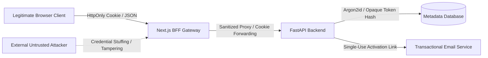

# AutoNexa Phase 17F — Authentication & Identity Threat Model (STRIDE)

**Phase:** 17F — Secure Email Authentication & User Identity Foundation  
**System:** AutoNexa Machine Learning Research Platform  
**Scope:** User Identity, Password Verification, Session Lifecycle, BFF Cookie Proxying  
**Methodology:** STRIDE (Spoofing, Tampering, Repudiation, Information Disclosure, Denial of Service, Elevation of Privilege)  
**Date:** November 2026  

---

## 1. Threat Modeling Overview

Phase 17F transitions AutoNexa from a static, shared API-key paradigm to a multi-user identity architecture. This threat model analyzes attack vectors against the identity, session, and credential layers, verifying that the new implementation satisfies modern defense-in-depth security standards without compromising existing platform capabilities.



---

## 2. Detailed STRIDE Analysis

### 2.1 Spoofing (Identity Impersonation)

| Threat ID | Threat Description | Attack Vector | Severity | Implemented Mitigations & Residual Status |
| :--- | :--- | :--- | :---: | :--- |
| **S-01** | Session Cookie Forgery | Attacker fabricates or guesses session cookies to impersonate a legitimate user. | **High** | **Mitigated:** Session tokens are generated using 32 bytes of CSPRNG entropy (`secrets.token_urlsafe(32)` yielding 256 bits of entropy). The database stores only constant-time SHA-256 hashes. Brute-forcing a 256-bit token is computationally impossible ($2^{256}$). |
| **S-02** | User Identity Spoofing via Email Collision | Attacker registers an existing user's email using different capitalization (e.g. `User@domain.com` vs `user@domain.com`). | **Medium** | **Mitigated:** All emails are lowercased and whitespace-trimmed via `normalize_email()`. The database schema enforces a unique index on `normalized_email` (`ix_users_normalized_email`), rejecting collisions with HTTP 409 Conflict. |
| **S-03** | Client Header Spoofing via BFF | Malicious user passes arbitrary `X-User-Id` or fake `X-Session-Token` headers. | **High** | **Mitigated:** The backend derives user identity strictly by validating the session token hash against the database `sessions` table. Client-supplied user ID headers are never trusted. |

---

### 2.2 Tampering (Data Modification)

| Threat ID | Threat Description | Attack Vector | Severity | Implemented Mitigations & Residual Status |
| :--- | :--- | :--- | :---: | :--- |
| **T-01** | Session Token Manipulation in Storage | Malicious actor modifies session expiration or user linkage directly in the database. | **High** | **Mitigated:** SQLite database file permissions are restricted to the local service account. WAL mode and foreign key constraints (`ondelete="CASCADE"`) guarantee referential integrity. |
| **T-02** | Replay of Email Verification Tokens | Attacker re-submits an intercepted verification token to reactivate a disabled account. | **Medium** | **Mitigated:** Verification tokens are strictly single-use. The token consumption transaction marks `used_at = utc_now()`. Re-submissions return HTTP 400. |
| **T-03** | Parameter Tampering during Password Reset | Attacker attempts to change another user's password by modifying the reset payload. | **High** | **Mitigated:** `ResetPasswordRequest` accepts only the opaque token and new password. The backend resolves the target user exclusively via the cryptographic token hash lookup in `auth_tokens`. |

---

### 2.3 Repudiation (Denial of Action)

| Threat ID | Threat Description | Attack Vector | Severity | Implemented Mitigations & Residual Status |
| :--- | :--- | :--- | :---: | :--- |
| **R-01** | Disavowal of Malicious Account Activity | User claims an unauthorized action was executed by an attacker without audit evidence. | **Medium** | **Mitigated:** Every session tracks `ip_address`, `user_agent`, `created_at`, and sliding `last_activity_at`. The user can inspect active sessions via `GET /api/v1/auth/sessions`. |
| **R-02** | Unrecorded Account Lifecycle Transitions | User claims account was verified without authorization. | **Low** | **Mitigated:** Database records explicit timestamps: `created_at`, `email_verified_at`, `last_login_at`, and `revoked_at`. |

---

### 2.4 Information Disclosure (Data Leakage)

| Threat ID | Threat Description | Attack Vector | Severity | Implemented Mitigations & Residual Status |
| :--- | :--- | :--- | :---: | :--- |
| **I-01** | User Enumeration via Registration & Login | Attacker enumerates registered user emails by observing differentiated response codes or timing discrepancies. | **Medium** | **Mitigated:** Resend verification and forgot-password endpoints return identical HTTP 200 generic success messages regardless of whether the email exists. Login returns uniform `"Invalid email or password"` for missing users and wrong passwords. |
| **I-02** | Client Credential Leakage via `localStorage` | Malicious scripts or browser extensions steal administrative keys stored in browser storage. | **Critical** | **Mitigated:** Normal user authentication uses `HttpOnly` cookies completely inaccessible to JavaScript (`document.cookie` returns empty). Admin keys in `localStorage` have been demoted to a developer-only override section. |
| **I-03** | Server-Side Secret Leakage via BFF Errors | Unhandled upstream exceptions leak server-side API keys or file paths to the browser. | **High** | **Mitigated:** The BFF sanitizes all error payloads through `sanitizeError()`, stripping absolute filesystem paths and redacting API tokens prior to serialization. |

---

### 2.5 Denial of Service (Resource Starvation)

| Threat ID | Threat Description | Attack Vector | Severity | Implemented Mitigations & Residual Status |
| :--- | :--- | :--- | :---: | :--- |
| **D-01** | Argon2id Compute Exhaustion Flooding | Attacker floods registration or login endpoints to exhaust server CPU and RAM. | **High** | **Mitigated:** In-memory windowed rate limiting restricts login attempts (10/min per IP/email), registration (5/min per IP), and password resets (5/min per IP). Exceeded limits return HTTP 429 Too Many Requests immediately before invoking Argon2id. |
| **D-02** | Session Table Bloat & Memory Exhaustion | Attacker repeatedly authenticates to create millions of active session records. | **Medium** | **Mitigated:** Sliding expiration (7 days) and periodic token cleanup purge stale records. Password reset automatically executes `revoke_all_user_sessions()`. |

---

### 2.6 Elevation of Privilege (Access Escalation)

| Threat ID | Threat Description | Attack Vector | Severity | Implemented Mitigations & Residual Status |
| :--- | :--- | :--- | :---: | :--- |
| **E-01** | Standard User Role Escalation to Admin | Authenticated standard user attempts to invoke privileged training or model promotion endpoints. | **Critical** | **Mitigated:** Endpoints requiring administrative capabilities enforce `require_admin_user` dependency or require an explicit administrative API key. Standard users receive HTTP 403 Forbidden. |
| **E-02** | Confused Deputy Attack via BFF Forwarding | Attacker uses public BFF to reach administrative backend endpoints without providing credentials. | **Critical** | **Mitigated:** The BFF strictly audits route destinations via `isPrivilegedEndpoint()`. Server-side administrative credentials are never injected into unauthenticated requests. Privileged requests require client-supplied admin keys. |
| **E-03** | Public Self-Registration Exposure | Internet visitors register accounts and gain access to existing shared catalog datasets. | **Critical** | **Mitigated:** Protected by `AUTH_PUBLIC_REGISTRATION_ENABLED` feature flag (default `False`). Public registration returns HTTP 403 until Phase 17G multi-tenant data isolation is deployed. |

---

## 3. Defense-in-Depth Verification Summary

```
+-------------------------------------------------------------------------+
| Layer 1: Next.js BFF Gateway                                            |
| - Method allowlist & Path traversal prevention                          |
| - Public registration closed evaluation gate                            |
| - HttpOnly cookie forwarding & response header propagation             |
+-------------------------------------------------------------------------+
                                    |
+-------------------------------------------------------------------------+
| Layer 2: FastAPI Routing & Rate Limiting                                |
| - Sliding-window IP/Email rate limits (10/min login, 5/min register)    |
| - Anti-enumeration unified HTTP responses                               |
+-------------------------------------------------------------------------+
                                    |
+-------------------------------------------------------------------------+
| Layer 3: Cryptographic Identity & Verification                          |
| - Argon2id ($argon2id$v=19$m=65536,t=3,p=4, 64MB memory cost)          |
| - Opaque tokens (256-bit CSPRNG, SHA-256 hashed persistence)            |
| - Single-use token invalidation and sliding session touches             |
+-------------------------------------------------------------------------+
                                    |
+-------------------------------------------------------------------------+
| Layer 4: Relational Database Storage & Cascades                         |
| - Foreign keys with CASCADE ondelete                                    |
| - Unique normalized email index                                         |
| - Ledger schema version 2 tracking                                      |
+-------------------------------------------------------------------------+
```

